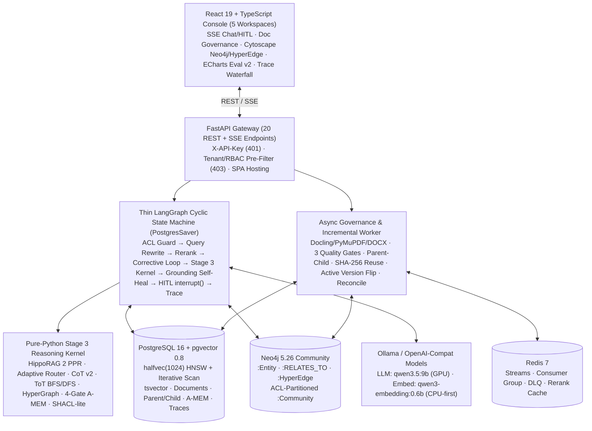

# Causal-GraphRAG-Workbench

[English](README.md) | [简体中文](README.zh-CN.md)

**Causal-GraphRAG-Workbench** *(formerly `LLM-GraphRAG-KG`)* is a modular, verifiable **Causal Knowledge Graph + GraphRAG + Agentic Reasoning** workbench combining research-grade explicit reasoning (`HippoRAG 2 PPR`, `Graph-CoT v2`, `Graph-ToT v2 BFS/DFS`, `HyperGraph`, 4-gate anti-poisoning `A-MEM`, `SHACL-lite`, 4D `LLM-as-a-Judge`) with an enterprise full-stack architecture (**PostgreSQL 16 + pgvector 0.8**, **Neo4j 5.26**, **Redis 7 Streams**, **Thin LangGraph + HITL**, **FastAPI REST/SSE**, and a **React 19 + TypeScript Console**).

---

## Overview and Operating Scope

- **Audience & Use Cases**: AI/RAG engineers, researchers, and industrial diagnostics teams building auditable multi-hop retrieval, root-cause analysis, and governed knowledge bases—ranging from zero-dependency local prototyping to multi-tenant Docker deployments.
- **Documented Status**:
  - **Stage 1.0 → 3.4 (Completed)**: Core GraphRAG pipeline, L0/L1/L2 compaction, HippoRAG 2 PPR + RRF, adaptive routing, paper-faithful Graph-CoT v2 & Graph-ToT v2 (BFS/DFS), 4D LLM-as-a-Judge, Semantic OpenIE, OREDA RDF/Turtle importer, N-ary HyperGraph, and 4-gate A-MEM.
  - **Stage 4.1 → 4.5 (Completed)**: PG16 `halfvec(1024)` HNSW + Iterative Scan, Neo4j 5.26 (`:HyperEdge` + ACL-partitioned `:Community`), Doc Governance (3 Quality Gates + Parent-Child + Redis Streams incremental worker), pure-CPU ONNX/lexical reranking, Thin LangGraph (`PostgresSaver` + Corrective RAG + HITL `interrupt()`), PG/OpenTelemetry tracing, 20 FastAPI REST/SSE endpoints, and a 5-workspace React 19 + TypeScript console.
  - **Stage 5 (Planned)**: Causal KG direction/inter-causal modeling (Chain / Fork / Collider-AND / Collider-OR / Intervention), Pearl 3-tier causal evidence, and `Causal-SHACL` guards — see [docs/stage5_causal_graphrag_plan.md](docs/stage5_causal_graphrag_plan.md).
- **Supported Environments**: Python `>=3.12` managed via `uv`, Docker Compose (for enterprise storage), Node.js `>=20` (for frontend builds), local Ollama or any OpenAI-compatible LLM/Embedding endpoint, plus an offline `mock` + `local_hash` mode for CI/testing.
- **Deployment Scope & Limits**: Verified on local single-node Windows/Linux workstations (including 8 GB VRAM GPUs via `qwen3.5:9b @ 16k` + CPU-first `qwen3-embedding:0.6b`). Multi-node HA clustering, external OAuth2/SSO IdP integration, and automated causal re-extraction of large unstructured corpora are outside the current version scope.

---

## System Architecture



---

## Interfaces and Guarantees

| Dimension | Contract for Current Version (`Stage 4.5`) |
|---|---|
| **CLI (`causal-graphrag` / `llm-graphrag-kg`)** | Offline & enterprise commands: `check-llm`, `check-embed`, `check-infra`, `build`, `query`, `agent-query`, `audit`, `shacl-check`, `export-viz`, `migrate-enterprise`, `ingest-enterprise`, `worker-run`, `reconcile`, `dlq-list`, `traces`, `serve`, `ui`, `privacy-check`. |
| **HTTP / SSE API** | FastAPI v1 (`/api/v1/*`, OpenAPI at `/docs`): 20 endpoints covering health/infra/tenants, document ingestion/multipart upload/rollback/soft-delete, Redis queue/DLQ/reconcile, Neo4j graph/ego/hyperedges/SHACL, LangGraph sync QA, `POST /api/v1/agent/stream` (`text/event-stream`), HITL resume, memories, traces, and Eval v2 metrics. |
| **Multi-Tenant & ACL** | Tenant (`X-Tenant-Id`) + RBAC (`X-ACL-Roles`) pre-filtering enforced inside PostgreSQL SQL (`tenant_id`, `is_deleted = FALSE`, `acl && $roles`, `JOIN documents` on `active_version`) and Neo4j Cypher (`Entity`, `RELATES_TO`, `HyperEdge`, `acl_partition` `Community`). Verified `0` leaks across all 10 surfaces. |
| **Verified Performance & VRAM Guardrails** | `qwen3-embedding:0.6b` defaults to Fix A (`num_ctx=2048`, `4.6 GB → 985 MB`) + Fix B (`num_gpu=0` CPU-first, `0 MiB VRAM`, ~55–65 ms/query; optional GPU `num_gpu=99`); PG `halfvec(1024)` HNSW `EXPLAIN ANALYZE` verified `0.163 ms`; CPU reranking 30 candidates `2.96 ms` (`0.69 ms` Redis cache hit). |
| **Failure & Invalid Input Behavior** | Missing/invalid `X-API-Key` → `401`; non-`admin` privileged calls (rollback/delete/reconcile/HITL resume) → `403`; forged MIME / high-garbled uploads rejected by `FileGate`/`ParseGate` → `422`; stale document versions (`v < active_version`) skipped idempotently; worker exhaustion routed to Redis DLQ; embedding model/dim mismatch blocked by `index_registry`. |

> Guarantees apply only under the stated environments and checks. Offline `pytest` validates logic with mocked drivers/models; Docker integration validates live PG16, Neo4j 5.26, Redis 7, and local Ollama (`qwen3-embedding:0.6b` + `qwen3.5:9b`).

---

## Quick Start

### Path A: Zero-Dependency Local Mode (30 Seconds, No Docker Required)

Requirements: Python `>=3.12` and `uv`.

```bash
git clone https://github.com/WindFromKadath/Causal-GraphRAG-Workbench.git
cd Causal-GraphRAG-Workbench
uv sync --extra dev

# Build and inspect KG on included sanitized sample corpus (offline mock mode)
uv run causal-graphrag build --input data/sample --provider mock
uv run causal-graphrag audit
uv run causal-graphrag export-viz
uv run causal-graphrag query "How does GraphRAG combine a knowledge graph for multi-hop reasoning?" --mode ppr --reasoning auto --provider mock
```

- **Sample Input**: `data/sample/` (3 docs) and `data/sample_fault_diagnosis/` (6 industrial diagnostics docs).
- **Expected Output**: Persisted local store in `storage/`, Markdown/CSV audit & interactive PyVis HTML/GraphML in `outputs/`.
- **Configuration**: Copy `.env.example` to `.env` to point at local Ollama (`http://127.0.0.1:11434`) or any OpenAI-compatible API. Never commit `.env`.

### Path B: Enterprise Full Stack (Docker PG16 + Neo4j 5.26 + Redis 7 + FastAPI + React 19)

Requirements: Docker Desktop / Engine, Node.js `>=20`, and local Ollama (`ollama pull qwen3.5:9b` and `ollama pull qwen3-embedding:0.6b`).

```bash
# 1. Install enterprise Python extras and start PG16 (25432), Neo4j (27474/27687), Redis (26379)
uv sync --extra enterprise --extra dev
docker compose up -d
uv run causal-graphrag check-infra

# 2. Migrate a local KG into PG16 (halfvec 1024d) + Neo4j 5.26 with SHACL-lite check
uv run causal-graphrag migrate-enterprise --config-file configs/fault_diagnosis.yaml --tenant fault_diag --acl "public,engineer" --clear-target

# 3. Build the React 19 + TypeScript Console and start FastAPI (serves both UI and OpenAPI)
npm --prefix frontend install
npm --prefix frontend run build
uv run causal-graphrag serve --host 127.0.0.1 --port 8000 --vector-backend pgvector --graph-backend neo4j --checkpointer postgres
```

- **Enterprise Console**: `http://127.0.0.1:8000` (5 workspaces: SSE Chat/HITL, Document Governance, Cytoscape Neo4j/HyperEdge Explorer, ECharts Eval Lab v2, Trace Waterfall & A-MEM Audit)
- **OpenAPI Docs**: `http://127.0.0.1:8000/docs`
- **Neo4j Browser**: `http://127.0.0.1:27474` (connect to `bolt://127.0.0.1:27687`)
- **Frontend Hot-Reload Dev Mode** (optional, separate terminal): `npm --prefix frontend run dev` → `http://127.0.0.1:5173`
- **Legacy Offline Workbench** (optional): `uv sync --extra viz && uv run --extra viz causal-graphrag ui`

---

## Verified Results, Benchmarks and Limitations

| Benchmark / Verification | Shared Protocol & Environment | Verified Result & Evidence |
|---|---|---|
| **GraphRAG-Bench Medical (4D LLM-as-a-Judge)** | 10 stratified Qs (`seed=42`, `qwen3.5:9b` + `nomic-embed-text`) | `naive_rag`: Acc `74.2%`, Faith `32.2%`, Refusal `10.0%`; **`ppr_cot_iter`**: Acc **`82.2%`** (+8.0pp), Faith **`52.3%`** (+20.1pp), Cov **`75.0%`**, Refusal **`0.0%`** ([stage3 plan](docs/stage3_nextgen_graphrag_plan.md)) |
| **GraphRAG-Bench Novel (4D LLM-as-a-Judge)** | 10 stratified Qs (`seed=42`, `qwen3.5:9b` + `nomic-embed-text`) | `naive_rag`: Acc `73.3%`, Faith `19.0%`; **`ppr_multi_branch`**: Acc **`78.1%`** (+4.8pp), Faith **`33.9%`** (+14.9pp), Cov **`66.8%`** |
| **`qwen3-embedding:0.6b` vs `nomic-embed-text`** | Hard-negative & bilingual retrieval bench (RTX 5060 8 GB) | Hard-negative acc **`100.0%`** vs `83.3%`; separation margin **`2.87×`** (CN industrial) & **`4.16×`** (CN↔EN); `halfvec(f16)` `0.0%` precision loss; Fix A+B (`num_ctx=2048, num_gpu=0`) eliminates `4.6 GB` KV VRAM swap tax |
| **OREDA `FMEA_KG.ttl` & IBM `FailureSensorIQ`** | Migrated into Docker PG16 + Neo4j 5.26 (`qwen3-embedding:0.6b`) | `fmea_oreda` (`87` chunks / `87` entities / `1,013` edges) & `failuresensoriq` (`111` chunks / `233` entities / `692` edges / `64` hyperedges): both **`SHACL-lite 100.0% PASS`** |
| **Enterprise Full-Stack Checks (Stage 4.1–4.5)** | Live Docker PG16 + Neo4j 5.26 + Redis 7 + Ollama (`qwen3.5:9b`) | `EXPLAIN ANALYZE` hits HNSW (`0.163 ms`); 10-surface ACL isolation `0` leaks; SHA-256 unchanged chunks `100%` skip re-embed; `PostgresSaver` HITL `interrupt()/resume` + SSE stream verified at **`100.0%` Grounding** |

### Known Limitations & Negative Findings
- **External Benchmark Datasets Not Bundled**: Cloning this repository does **not** include third-party datasets (`IBM FailureSensorIQ`, `GraphRAG-Bench`, `OREDA FMEA_KG.ttl`). Users must obtain them from their upstream sources under their respective licenses and place them in `data/private/` (gitignored).
- **8 GB VRAM Dual-Model Swap Tax**: On single 8 GB GPUs, pairing `qwen3.5:4b` (planner) + `qwen3.5:9b` (synthesizer) incurs `+7–11s/query` Ollama model-swap overhead; single `qwen3.5:9b` is recommended on 8 GB cards, and dual-model tiering (`--fast-model`) is recommended on `>=12 GB` VRAM or cloud APIs.
- **Unstructured Large-Text Edges (`grb_medical` / `grb_novel`)**: Direct migration preserves existing `CO_OCCURS_WITH` / `SYNONYM_OF` edges from Stage 3.1; structured directional causal extraction (`CAUSES / INDICATES / RULES_OUT`, 3-tier evidence, `Causal-SHACL`) is scheduled for [Stage 5](docs/stage5_causal_graphrag_plan.md).

---

## Validation and Repository Structure

Run the full local verification suite after changes:

```bash
uv run ruff check src tests scripts
uv run pytest -q
uv run causal-graphrag privacy-check --staged --require-changelog
npm --prefix frontend run typecheck && npm --prefix frontend run build
```

Verified baseline (`a70e56a`): `ruff` 0 errors, `pytest` **63/63 passed**, `tsc --noEmit` 0 errors, `vite build` clean (`2,152` modules), `privacy-check` PASS.

```text
Causal-GraphRAG-Workbench/
├── .env.example                 # Redacted environment template (copy to .env; never commit .env)
├── CHANGELOG.md                 # Atomic per-commit maintenance & verification log
├── LICENSE                      # MIT License (code & original docs)
├── docker-compose.yml           # PG16+pgvector (25432), Neo4j 5.26 (27474/27687), Redis 7 (26379)
├── deploy/postgres/init.sql     # PostgreSQL 16 + pgvector 0.8 schema & HNSW/GIN DDL
├── configs/                     # Domain YAML configs (default, fault_diagnosis, failuresensoriq, fmea_kg_rdf, grb_*)
├── data/                        # Sanitized public sample corpora (data/private/ is gitignored)
├── docs/                        # Architecture guides, benchmarks, troubleshooting & Stage 2–5 plans
├── frontend/                    # React 19 + TypeScript + Vite 6 + Tailwind v4 + Cytoscape.js + ECharts Console
├── scripts/privacy_check.py     # Pre-commit secret, path & CHANGELOG hygiene guard
├── src/llm_graphrag_kg/         # Core Python package (core, providers, pipelines, reasoning, retrieval, agent, api, eval, observability, viz)
└── tests/                       # 63 offline unit & FastAPI httpx.AsyncClient integration tests
```

### Key Documentation Map
- [docs/evolution_and_papers_guide.md](docs/evolution_and_papers_guide.md) — Stage 1 → 5 architecture evolution & paper study guide (CN)
- [docs/stage4_enterprise_refactor_plan.md](docs/stage4_enterprise_refactor_plan.md) — Stage 4.1 → 4.5 enterprise architecture, DDL & verified gates (CN)
- [docs/stage5_causal_graphrag_plan.md](docs/stage5_causal_graphrag_plan.md) — Stage 5 Causal KG modeling, Pearl tiers & `Causal-SHACL` plan (CN)
- [docs/engineering_deployment.md](docs/engineering_deployment.md) & [docs/troubleshooting_diagnosis.md](docs/troubleshooting_diagnosis.md) — Deployment, offline migration & fault diagnosis handbook (CN)
- [CHANGELOG.md](CHANGELOG.md) — Complete per-commit change history and verification records (CN)

---

## Privacy, Contributions and License

- **Privacy & Commit Hygiene**: Never commit `.env`, `.vscode/`, `data/private/`, `storage/`, `outputs/`, `frontend/node_modules/`, or `frontend/dist/`. Every commit must update [CHANGELOG.md](CHANGELOG.md) and pass `uv run causal-graphrag privacy-check --staged --require-changelog`.
- **Issues & Contributions**: Report reproducible issues or proposals via [GitHub Issues](https://github.com/WindFromKadath/Causal-GraphRAG-Workbench/issues) with sanitized inputs and environment details (no credentials or private paths). Keep both `README.md` and `README.zh-CN.md` synchronized when public interfaces change.
- **License**: Original source code and documentation are released under the **MIT License** ([LICENSE](LICENSE)).
- **Third-Party Terms & Acknowledgements**: Upstream datasets, models, and services remain governed by their own licenses (including IBM FailureSensorIQ under Apache-2.0, GraphRAG-Bench, OREDA/IndustryAssetEQA, Qwen3 models, Neo4j Community, PostgreSQL/pgvector, Redis, and LangGraph). Key inspirations include Microsoft GraphRAG & LazyGraphRAG, HippoRAG / HippoRAG 2, Graph-CoT, ToT / ToG-2, HyperGraphRAG, A-MEM, CausalRAG, and W3C SHACL.
