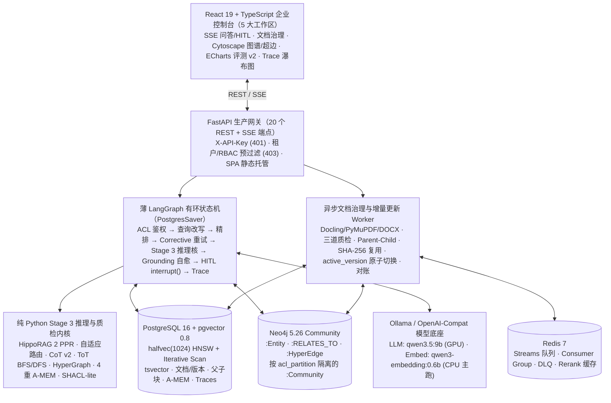

# LLM-GraphRAG-KG

[English](README.md) | [简体中文](README.zh-CN.md)

**LLM-GraphRAG-KG** 是一个模块化、可落地生产的 **LLM + GraphRAG + 知识图谱（KG）** 全栈框架，将研究级显性推理内核（`HippoRAG 2 PPR`、`Graph-CoT v2`、`Graph-ToT v2 BFS/DFS`、`HyperGraph`、4 重防投毒 `A-MEM`、`SHACL-lite`、官方 4D `LLM-as-a-Judge`）与企业级工程架构（**PostgreSQL 16 + pgvector 0.8**、**Neo4j 5.26**、**Redis 7 Streams**、**薄 LangGraph + HITL**、**FastAPI REST/SSE** 与 **React 19 + TypeScript 控制台**）有机统一。

---

## 项目介绍与适用条件

- **适用对象与场景**：面向 AI/RAG 工程师、研究者及工业故障诊断团队，用于构建可审计多跳检索、根因分析与受治理知识库——同时支持“零外部依赖本地原型”与“Docker 多租户企业全栈”两种运行形态。
- **本文对应版本与阶段状态**：
  - **Stage 1.0 → 3.4（已完成）**：核心 GraphRAG 管线、L0/L1/L2 上下文压缩、HippoRAG 2 PPR + RRF、自适应三路路由、论文完整版 Graph-CoT v2 与 Graph-ToT v2（BFS/DFS）、4D LLM-as-a-Judge、断点式语义 OpenIE、OREDA RDF/Turtle 导入器、N 元 HyperGraph 与 4 重防投毒 A-MEM。
  - **Stage 4.1 → 4.5（已完成）**：PG16 `halfvec(1024)` HNSW + Iterative Scan、Neo4j 5.26（`:HyperEdge` + ACL 分区 `:Community`）、文档治理层（三道质检 + Parent-Child + Redis Streams 异步增量幂等 Worker）、纯 CPU ONNX/词面精排、薄 LangGraph（`PostgresSaver` + Corrective RAG + HITL `interrupt()`）、PG/OpenTelemetry 全链路追踪、20 个 FastAPI REST/SSE 端点及 React 19 五大工作区控制台。
  - **Stage 5（规划中）**：因果知识图谱与因果间结构建模（Chain / Fork / Collider-AND / Collider-OR / Intervention）、Pearl 三级因果证据强度与 `Causal-SHACL` 门禁——详见 [docs/stage5_causal_graphrag_plan.md](docs/stage5_causal_graphrag_plan.md)。
- **支持的环境与设备**：Python `>=3.12`（`uv` 管理）、Docker Compose（企业双存储与 Redis）、Node.js `>=20`（前端构建）、本机 Ollama 或任意 OpenAI-compatible 模型接口，以及零依赖离线 `mock` + `local_hash` 测试模式。
- **适用部署范围与限制**：已在单机 Windows/Linux 工作站完成实测验证（含 8 GB 显存 GPU：`qwen3.5:9b @ 16k` + CPU 主跑 `qwen3-embedding:0.6b` 护栏）。多节点高可用集群、外部 OAuth2/SSO 身份提供商集成与超大规模纯文本的自动因果重抽不在当前版本覆盖范围内。

---

## 系统全景架构



---

## 接口与约束

| 维度 | 当前版本（`Stage 4.5`）的明确约定 |
|---|---|
| **CLI (`llm-graphrag-kg`)** | 离线与企业命令：`check-llm`、`check-embed`、`check-infra`、`build`、`query`、`agent-query`、`audit`、`shacl-check`、`export-viz`、`migrate-enterprise`、`ingest-enterprise`、`worker-run`、`reconcile`、`dlq-list`、`traces`、`serve`、`ui`、`privacy-check`。 |
| **HTTP / SSE 协议** | FastAPI v1（`/api/v1/*`，OpenAPI 文档位于 `/docs`）：共 20 个端点，覆盖健康/设施/租户发现、文档治理入库/Multipart 上传/回滚/软删、Redis 队列/DLQ/对账、Neo4j 图谱/Ego-Graph/超边/SHACL、LangGraph 同步问答、`POST /api/v1/agent/stream`（`text/event-stream`）、HITL 恢复、A-MEM 记忆、Trace 与评测 v2。 |
| **多租户与 ACL 隔离** | 租户（`X-Tenant-Id`）与角色（`X-ACL-Roles`）预过滤强下推至 PostgreSQL SQL（`tenant_id`、`is_deleted = FALSE`、`acl && $roles`、`JOIN documents` 强校 `active_version`）与 Neo4j Cypher（节点、关系、超边及 `acl_partition` 社区）。10 个读写面实测 **`0` 越权泄漏**。 |
| **实测性能与显存边界** | `qwen3-embedding:0.6b` 默认启用 Fix A（`num_ctx=2048`，内存由 `4.6 GB → 985 MB`）+ Fix B（`num_gpu=0` 纯 CPU 主跑，`0 MiB` 显存占用，~55–65 ms/问，可选切 GPU `99`）；PG `halfvec(1024)` HNSW `EXPLAIN ANALYZE` 实测 `0.163 ms`；30 候选 CPU 精排 `2.96 ms`（Redis 缓存命中 `0.69 ms`）。 |
| **无效输入、越权与故障处理** | 缺/错 `X-API-Key` → `401`；非 `admin` 调用回滚/软删/对账/HITL 审批 → `403`；伪造 MIME 或高乱码率上传由 `FileGate`/`ParseGate` 拦截 → `422`；乱序旧版本（`v < active_version`）幂等忽略；Worker 重试耗尽自动转入 Redis DLQ；Embedding 模型/维度错配由 `index_registry` 强拦截。 |

> 以上保证均限定在已声明环境与验证范围内：离线 `pytest` 使用确定性桩模型与替身存储验证逻辑，Docker 实机集成测试验证了 PG16、Neo4j 5.26、Redis 7 与本机 Ollama（`qwen3-embedding:0.6b` + `qwen3.5:9b`）。

---

## 构建与最小算例

### 路径 A：零依赖离线快速体验（30 秒，无需 Docker）

环境要求：Python `>=3.12` 与 `uv`。

```bash
git clone https://github.com/WindFromKadath/LLM-GraphRAG-KG.git
cd LLM-GraphRAG-KG
uv sync --extra dev

# 使用仓库内置脱敏示例语料执行离线构建、审计与问答
uv run llm-graphrag-kg build --input data/sample --provider mock
uv run llm-graphrag-kg audit
uv run llm-graphrag-kg export-viz
uv run llm-graphrag-kg query "GraphRAG 如何结合知识图谱解决多跳推理问题？" --mode ppr --reasoning auto --provider mock
```

- **公开示例输入**：`data/sample/`（3 篇）与 `data/sample_fault_diagnosis/`（6 篇工业故障诊断脱敏语料）。
- **预期输出**：本地持久化索引生成于 `storage/`，Markdown/CSV 审计报告与交互式 PyVis HTML / GraphML 生成于 `outputs/`。
- **公开配置参考**：复制 `.env.example` 为 `.env` 即可接入本机 Ollama（`http://127.0.0.1:11434`）或任意 OpenAI-compatible 云端 API；严禁提交 `.env`。

### 路径 B：企业全栈启动（Docker PG16 + Neo4j 5.26 + Redis 7 + FastAPI + React 19）

环境要求：Docker Desktop / Engine、Node.js `>=20`，以及本机 Ollama（预先执行 `ollama pull qwen3.5:9b` 与 `ollama pull qwen3-embedding:0.6b`）。

```bash
# 1. 安装企业扩展依赖并拉起 PG16 (25432)、Neo4j 5.26 (27474/27687)、Redis 7 (26379)
uv sync --extra enterprise --extra dev
docker compose up -d
uv run llm-graphrag-kg check-infra

# 2. 将本地知识图谱迁移写入 PG16 (halfvec 1024d) + Neo4j 5.26
uv run llm-graphrag-kg migrate-enterprise --config-file configs/fault_diagnosis.yaml --tenant fault_diag --acl "public,engineer" --clear-target

# 3. 构建 React 19 + TypeScript 控制台并启动 FastAPI（单端口同时托管控制台与 API）
npm --prefix frontend install
npm --prefix frontend run build
uv run llm-graphrag-kg serve --host 127.0.0.1 --port 8000 --vector-backend pgvector --graph-backend neo4j --checkpointer postgres
```

- **企业 Web 控制台**：`http://127.0.0.1:8000`（5 大工作区：SSE 问答/HITL、文档治理、Cytoscape Neo4j/超边浏览器、ECharts 评测实验室 v2、Trace 瀑布耗时 & A-MEM 审计）
- **OpenAPI 接口文档**：`http://127.0.0.1:8000/docs`
- **Neo4j Browser 可视化**：`http://127.0.0.1:27474`（连接地址填写 `bolt://127.0.0.1:27687`）
- **前端热更新开发模式**（可选，另开终端）：`npm --prefix frontend run dev` → `http://127.0.0.1:5173`
- **旧版离线工作台**（可选）：`uv sync --extra viz && uv run --extra viz llm-graphrag-kg ui`

---

## 已验证结果、基准评测与局限

| 评测 / 验收维度 | 同源协议与运行环境 | 实测结果与证据位置 |
|---|---|---|
| **GraphRAG-Bench Medical（4D LLM-as-a-Judge）** | 10 题分层抽样（`seed=42`，`qwen3.5:9b` + `nomic-embed-text`） | `naive_rag`：Accuracy `74.2%`、Faithfulness `32.2%`、拒答率 `10.0%`；**`ppr_cot_iter`**：Accuracy **`82.2%`** (+8.0pp)、Faithfulness **`52.3%`** (+20.1pp)、Coverage **`75.0%`**、拒答率 **`0.0%`**（[Stage 3 报告](docs/stage3_nextgen_graphrag_plan.md)） |
| **GraphRAG-Bench Novel（4D LLM-as-a-Judge）** | 10 题分层抽样（`seed=42`，`qwen3.5:9b` + `nomic-embed-text`） | `naive_rag`：Accuracy `73.3%`、Faithfulness `19.0%`；**`ppr_multi_branch`**：Accuracy **`78.1%`** (+4.8pp)、Faithfulness **`33.9%`** (+14.9pp)、Coverage **`66.8%`** |
| **`qwen3-embedding:0.6b` vs `nomic-embed-text`** | 难负例与跨语言实测（RTX 5060 8 GB） | 难负例准确率 **`100.0%`** vs `83.3%`；区分度 **`2.87×`**（中文工业）与 **`4.16×`**（中英跨语言）；`halfvec(f16)` 零精度损失；Fix A+B（`num_ctx=2048, num_gpu=0`）根除默认 `4.6 GB` KV 显存换模税 |
| **OREDA `FMEA_KG.ttl` 与 IBM `FailureSensorIQ`** | 迁入 Docker PG16 + Neo4j 5.26（`qwen3-embedding:0.6b`） | `fmea_oreda`（`87` 切片 / `87` 实体 / `1,013` 关系）与 `failuresensoriq`（`111` 切片 / `233` 实体 / `692` 关系 / `64` 超边）双双达到 **`SHACL-lite 100.0% PASS`** |
| **企业全栈集成验收（Stage 4.1–4.5）** | 真机 Docker PG16 + Neo4j 5.26 + Redis 7 + Ollama（`qwen3.5:9b`） | `EXPLAIN ANALYZE` 实证命中 HNSW（`0.163 ms`）；10 面 ACL 隔离 `0` 越权泄漏；SHA-256 未改切片 `100%` 跳过重算；`PostgresSaver` HITL `interrupt()/resume` 与 SSE 节点流实测 **`100.0%` Grounding** |

### 已知局限与负结果说明
- **第三方公开数据集不随仓库分发**：克隆本仓库**不包含**第三方原始数据集（`IBM FailureSensorIQ`、`GraphRAG-Bench`、`OREDA FMEA_KG.ttl`）。如需复现对应评测，请按原始来源与许可条款自行获取并放置于已被 `.gitignore` 屏蔽的 `data/private/` 目录。
- **8 GB 单卡双模型换模税**：在 8 GB 显存单卡在线交互场景下，`qwen3.5:4b`（中间规划）+ `qwen3.5:9b`（最终综合）会触发 `+7–11s/题` 的 Ollama 换模开销；8 GB 单卡在线推荐统一使用 `qwen3.5:9b`，`>=12 GB` 显存或云端 API 再启用 `--fast-model` 分层提速。
- **大规模纯文本图谱边质量边界**：当前直迁入 Neo4j 的 `grb_medical` / `grb_novel` 仍保留了 Stage 3.1 的统计共现边（`CO_OCCURS_WITH`）与同义边（`SYNONYM_OF`）；面向大规模纯文本的因果门控漏斗、4 层因果抽分与 `Causal-SHACL` 硬校验已规划为 [Stage 5](docs/stage5_causal_graphrag_plan.md)。

---

## 验证命令与仓库结构

每次改动后执行全量本地验证：

```bash
uv run ruff check src tests scripts
uv run pytest -q
uv run llm-graphrag-kg privacy-check --staged --require-changelog
npm --prefix frontend run typecheck && npm --prefix frontend run build
```

已核查基线（`a70e56a`）：`ruff` 0 告警、`pytest` **63/63 通过**、`tsc --noEmit` 0 错误、`vite build` 通过（`2,152` 模块）、`privacy-check` PASS。

```text
LLM-GraphRAG-KG/
├── .env.example                 # 脱敏环境变量模板（复制为 .env 使用；严禁提交 .env）
├── CHANGELOG.md                 # 每次提交同步更新的维护日志与验证证据总账
├── LICENSE                      # MIT 开源许可（代码与原创文档）
├── docker-compose.yml           # PG16+pgvector (25432)、Neo4j 5.26 (27474/27687)、Redis 7 (26379)
├── deploy/postgres/init.sql     # PostgreSQL 16 + pgvector 0.8 表结构与 HNSW/GIN 索引 DDL
├── configs/                     # 领域 YAML 配置（default、fault_diagnosis、failuresensoriq、fmea_kg_rdf、grb_*）
├── data/                        # 脱敏公开示例语料（data/private/ 已在 .gitignore 中排除）
├── docs/                        # 架构演进手册、评测报告、排障手册与 Stage 2–5 规划文档
├── frontend/                    # React 19 + TypeScript + Vite 6 + Tailwind v4 + Cytoscape.js + ECharts 控制台
├── scripts/privacy_check.py     # 提交前隐私、路径与 CHANGELOG 规范检查器
├── src/llm_graphrag_kg/         # Python 核心包（core、providers、pipelines、reasoning、retrieval、agent、api、eval、observability、viz）
└── tests/                       # 63 项离线单元测试与 FastAPI httpx.AsyncClient 异步集成测试
```

### 核心文档导航
- [docs/evolution_and_papers_guide.md](docs/evolution_and_papers_guide.md) — Stage 1 → 5 架构演进总览与论文范式学习手册
- [docs/stage4_enterprise_refactor_plan.md](docs/stage4_enterprise_refactor_plan.md) — Stage 4.1 → 4.5 企业级架构设计、DDL 与实测验收门禁
- [docs/stage5_causal_graphrag_plan.md](docs/stage5_causal_graphrag_plan.md) — Stage 5 因果知识图谱建模、Pearl 证据分级与 `Causal-SHACL` 规划
- [docs/engineering_deployment.md](docs/engineering_deployment.md) 与 [docs/troubleshooting_diagnosis.md](docs/troubleshooting_diagnosis.md) — 工程部署、离线迁移与排障手册
- [CHANGELOG.md](CHANGELOG.md) — 完整变更日志与每次提交的实测核验记录

---

## 隐私规范、反馈与许可

- **隐私与提交规范**：严禁提交 `.env`、`.vscode/`、`data/private/`、`storage/`、`outputs/`、`frontend/node_modules/` 与 `frontend/dist/`。每次有意义的提交需同步更新 [CHANGELOG.md](CHANGELOG.md) 并通过 `uv run llm-graphrag-kg privacy-check --staged --require-changelog`。
- **问题反馈与贡献**：请通过 [GitHub Issues](https://github.com/WindFromKadath/LLM-GraphRAG-KG/issues) 提交可复现问题或改进建议，报告中请移除任何凭据与本机私人路径。公开接口或使用步骤变更时请同步更新 `README.md` 与 `README.zh-CN.md`。
- **许可协议**：本项目原创源码与文档采用 **MIT License**（见 [LICENSE](LICENSE)）。
- **第三方材料与致谢**：第三方数据集、模型与基础组件各自适用其原有条款（包括 IBM FailureSensorIQ 的 Apache-2.0 协议、GraphRAG-Bench、OREDA/IndustryAssetEQA、Qwen3 模型、Neo4j Community、PostgreSQL/pgvector、Redis 与 LangGraph）。方法设计主要参考 Microsoft GraphRAG & LazyGraphRAG、HippoRAG / HippoRAG 2、Graph-CoT、ToT / ToG-2、HyperGraphRAG、A-MEM、CausalRAG 与 W3C SHACL。
