# 架构演进总览与论文范式学习手册（Stage 1 → Stage 4.5）

> **文档定位**：本手册是 `LLM-GraphRAG-KG` 项目的**持续演进学习总览与论文对照指南**（随每个 Stage 同步更新）。  
> 面向学习与复盘场景，系统记录每一次架构小升级的 **真实触发痛点（Why）→ 参考论文与核心范式（Paper）→ 项目源码落点（Code）→ 改前/改后实测收益（Evidence）→ 工程避坑心得（Takeaway）**。

---

## 1. 全景演进主线

本项目的全部架构升级均遵循**“实测压测暴露短板 → 调研学术界/工业界最新范式 → 最小耦合落地 → 同源数据集定量验收”**四步闭环，而非凭空堆砌功能。

```mermaid
flowchart LR
    S1["Stage 1: MVP & 工业本体<br/>Microsoft GraphRAG + Ontology-First<br/>(打通建图/检索/工作台闭环)"]
    S21["Stage 2.1: Harness & Compact<br/>Context Engineering + 无损三级压缩<br/>(治子图噪声串台 & JSON失稳)"]
    S22["Stage 2.2: 显性 CoT & PPR<br/>Graph-CoT + HippoRAG + Scope-L0<br/>(夺回思考权 & 忠实度门禁)"]
    S23["Stage 2.3: 显性 ToT & 高难基准<br/>ToT + ToG + GraphRAG-Bench<br/>(多假设反证剪枝 & 开放长文本)"]
    S24["Stage 2.4: 大图可视化治理<br/>Ego-Graph + W3C SHACL-lite<br/>(去毛线球 & 全图本体合规质检)"]
    S30["Stage 3.0: 本地算力底座定型<br/>Qwen3.5 Hybrid Attention + num_gpu<br/>(打穿 8GB 显存延迟瓶颈)"]
    S31["Stage 3.1: 下一代检索底座<br/>BM25+Dense RRF + HippoRAG 2<br/>(打穿假向量召回天花板)"]
    S32["Stage 3.2 & v2 论文级基线<br/>路由+并集聚合+迭代CoT+多深度ToT<br/>(4b vs 9b 中间层双模型消融)"]
    S33["Stage 3.3: 官方Judge·OpenIE·RDF<br/>四维语义裁判 + 断点语义抽图<br/>+ 工业 OREDA FMEA_KG.ttl"]
    S34["Stage 3.4: HyperGraph & A-MEM<br/>N元多条件超边 + 4重防投毒写回<br/>+ 7标签页闭环工作台"]
    S4["Stage 4.1–4.5 (已定型·待推进)<br/>PG16+pgvector · Neo4j 5.26 · Redis Streams<br/>Docling · Qwen3-Emb · BGE-Rerank · LangGraph<br/>FastAPI SSE + React/TS 现代前端"]

    S1 --> S21 --> S22 --> S23 --> S24 --> S30 --> S31 --> S32 --> S33 --> S34 --> S4
```

---

## 2. 全阶段升级速查总表

| 阶段 | 状态 | 核心升级内容 | 核心参考论文 / 范式 / 标杆 | 解决的核心痛点 | 关键实测优势 |
|---|---|---|---|---|---|
| **Stage 1.1–1.2** | 已完成 | 协议解耦 MVP + Louvain 社区摘要 + Local/Global/Hybrid + Streamlit 工作台 | **Microsoft GraphRAG** *(Edge et al., 2024)* | 纯向量 RAG 难跨文档多跳与全局聚合；黑盒建图无法核验 | 零外部库跑通全链路；交互式图谱与原文溯源同屏核验 |
| **Stage 1.3** | 已完成 | IBM FailureSensorIQ 四层 ISO 本体 + 显式 ER 消歧 + Ollama 原生 `/api/chat` | **Ontology-First KG** + **FailureSensorIQ** *(IBM, 2025)* | 自由抽图跨设备语义串台；Ollama 默认 4K 截断与隐式思考超时 | 设备隔离 + 拼写纠错；`think`/`num_ctx` 精准控制，KG 领先 LLM `+38%~+62%` |
| **Stage 2.1** | 已完成 | `LLMHarness` 驾驭层 + 三级无损优先 `Compact`（L0/L1/L2） | **Anthropic Context Engineering / Harness** + **Extractive Pruning** | 68~113 节点子图噪声导致 12B 模型注意力串台；裸调用无自愈熔断 | `L3` 多选 `94% → 100%`（500/500），Token `-67%~-88.9%`，提速 `1.9×`，0 空回复 |
| **Stage 2.2** | 已完成 | 显性 4 步 `Graph-CoT` + `GroundingAudit` + 异构 **PPR** + **Scope-Aware L0** | **HippoRAG** *(NeurIPS 2024)* + **Graph-CoT** *(ACL 2024)* + **PoG** *(AAAI 2025)* | 关闭隐式思考后需显性可审计推理；普通 L0 丢失封闭世界负例导致 `L2` 掉分 | `L2` 准确率 `36.8% → 95.0%`（+58.2pp）；工业 CoT 4/4 步 **100% 忠实溯源** |
| **Stage 2.3** | 已完成 | 显性可控 `Graph-ToT`（Branch→Ground→Prune→L2 Fold→Synthesize）+ `GraphRAG-Bench` | **ToT** *(NeurIPS 2023)* + **ToG** *(ICLR 2024)* + **GraphRAG-Bench** *(ICLR)* | 单链 CoT 面对多症状并发缺乏“竞争假设对比与反证剪枝”能力 | 精准选中胜出根因并给出反证剪枝日志，严格 3 次调用，Grounding **100%** |
| **Stage 2.4** | 已完成 | 6 标签页工作台锁定 `failuresensoriq` + **Ego-Graph** + 可读回放 + **SHACL-lite** | **W3C SHACL** *(语义网约束标准)* + **Ego-Network 可视化治理** | >200 节点毛线球难读；哈希 ID 不可读；缺全图自动化质检门禁 | 单设备降噪 `-82%~-88%`；可读思维卡片；全图 SHACL-lite **8/8 100% PASS** |
| **Stage 3.0** | 已完成 | 主力底座升级 `qwen3.5:9b` + `GRAPHRAG_LLM_NUM_GPU=99` + 4k–128k 显存建模 | **Qwen 3.5 Hybrid Attention**（低 KV 斜率）与消费级显存治理 | `gemma4:12b` 权重超 8 GB 显存被迫 CPU 混合卸载，`ppr_tot` 慢至 `52s` | `ppr_tot` 暴速 **3.2×–3.5×**（`52s → 15–16s`）；双域 `ppr_cot` 反超 `naive_rag` 登顶 |
| **Stage 3.1** | 已完成 | Ollama 原生稠密嵌入（SQLite 缓存）+ 双语 **BM25 + Dense RRF** + **HippoRAG 2** | **HippoRAG 2** *(ICML 2025)* + **Okapi BM25** & **RRF** *(SIGIR 2009)* | `local_hash` 假向量无法识别跨词语义，锁死开放语料召回上限 | Medical `Ret EvRec` 达 **79.8%**（≥75% PASS），Novel 达 **72.4%**（≥65% PASS） |
| **Stage 3.2** | 已完成 | 自适应任务路由器 + 非剪枝多分支聚合 + 取消 `tot.py` 截断 + 动态早停 | **When to use Graphs in RAG** + **OpenSPG KAG** + **ToG-2** + **Search-R1** | `ppr_tot` 单胜剪枝 + 220 截断导致多面摘要“高召回、低覆盖”剪刀差 | 摘要覆盖率暴涨 `+36.5~+43.2pp`；双域 Complex F1 达 `41.9%/29.6%` 第 1；延迟较 S2 降 **-63.6%**，`multi_branch` **100% 溯源** |
| **Stage 3.2+ (v2 基线)** | 已完成 | 论文完整版迭代 `Graph-CoT v2`（`cot_iter`）+ 多深度 `Graph-ToT v2`（`tot_bfs`/`tot_dfs` 真回溯）+ `4b vs 9b` 双模型分层消融 | **Graph-CoT** *(ACL 2024)* + **PoG** *(AAAI 2025)* + **ToT** *(NeurIPS 2023)* + **ToG/ToG-2** *(ICLR 2024/2025)* | 旧 CoT 为单轮结构化生成、旧 ToT 为 Depth-1 扁平展开无真回溯；需量化轻重双模型分工边界 | 同 10 题：`cot_iter` F1 达 **`44.7%`（+8.7pp）**；`tot_bfs/dfs` 检索召回飙至 **`86.7%`**、`tot_dfs` F1 **`41.3%`（+9.9pp）** 触发真回溯 `8/10` 题；量化出 `4b` 净算力快 `15%–24%` 但 8 GB 单卡换模税 `+7.1~11.2s` 的硬件边界 |
| **Stage 3.3** | 已完成 | 官方口径四维 **LLM-as-a-Judge** + 断点式语义 **OpenIE** + 工业 OREDA `FMEA_KG.ttl` RDF 导入 | **GraphRAG-Bench Eval** + **IndustryAssetEQA** *(ACL 2026)* + **W3C Turtle/SHACL** | 纯 `Token-F1` 易被拒答/同义改写失真；共现边缺语义方向；工业 RDF 无原生入口 | Medical `ppr_cot_iter` 语义 Accuracy **`82.2%`** (+8.0pp) / Faithfulness **`52.3%`** (+20.1pp) / 0% 拒答；Novel `multi_branch` Accuracy **`78.1%`** (+4.8pp)；OpenIE 语义谓词 **`100%`**；`FMEA_KG.ttl` **100% SHACL-lite PASS** |
| **Stage 3.4** | 已完成 | 轻量 **HyperGraph** 多条件超边 + 4 重防投毒自演化记忆写回（**A-MEM**）+ 工作台 Tab 7 联动 | **HyperGraphRAG** *(NeurIPS 2025)* + **A-MEM** *(NeurIPS 2025)* + **IndustryAssetEQA** | 二元边难表达“多症状联合推出单根因”；历史正确排障经验无法安全沉淀复用 | 故障诊断自动挖掘 `6` 条 / FailureSensorIQ 挖掘 `64` 条 N 元联合超边；4 重门禁 100% 拦截未扎根/拒答/极性矛盾投毒；真机 `tot_dfs --writeback` 写回 `mem_063584d27c0b` 并在二次查询自动召回（4/4 步 `100%` Grounding），全套 `pytest` **45/45** 通过 |
| **Stage 4.1–4.5** | 规划定型 | 企业级技术栈重构：**PG16+pgvector (`halfvec`) + Neo4j 5.26 + Redis Streams/DLQ + Docling/Parent-Child + `Qwen3-Embedding-0.6B` + ONNX CPU Reranker + 薄 `LangGraph` + FastAPI SSE + React/TS 前端** | **JavaGuide 企业 RAG 生产规范** + **Anthropic Contextual Retrieval** + **LangGraph Stateful HITL** + **Neo4j VectorCypher** | 原型阶段缺少生产级持久化、多租户 ACL 隔离、增量幂等更新、PDF 版面治理、重排漏斗、有环审批编排与现代 Web UI | 详规划见 [stage4_enterprise_refactor_plan.md](stage4_enterprise_refactor_plan.md)（直接在 `master` 按 Stage 4.1 → 4.5 原子推进） |

---

## 3. 分阶段深度学习卡片

### Stage 1.1–1.2：GraphRAG + KG 核心闭环与可视化核验工作台
- **升级前痛点（Why）**：
  - 传统 Naive RAG 仅做文本切片的扁平相似度检索，无法跨越多个文档串联“设备 → 症状 → 根因 → 维护 SOP”的多跳因果链，也无法回答全局汇总型问题。
  - 知识图谱抽图如果停留在后台黑盒里，学习者和工程师根本无法确认实体有没有抽错、边有没有张冠李戴。
- **参考论文与范式（Paper & Paradigm）**：
  - **Microsoft GraphRAG** — Edge et al., *From Local to Global: A Graph RAG Approach to Query-Focused Summarization* (arXiv:2404.16130, 2024)。核心范式是：**文本切片 → 实体与关系抽取 → 实体融合建图 → 社区发现（Leiden/Louvain）与社区摘要 → Local（子图）+ Global（社区）+ Hybrid 混合检索**。
  - **Clean Architecture / Protocol 解耦**：参考端口-适配器（Ports & Adapters）模式，核心管线只依赖 Python `Protocol`，零数据库启动，日后迁移至 Neo4j/Qdrant 无需重写业务逻辑。
- **本项目源码落点（Code Map）**：
  - 协议与数据模型：`src/llm_graphrag_kg/core/interfaces.py`、`schema.py`
  - 离线与在线管线：`src/llm_graphrag_kg/pipelines/ingestion.py`、`extraction.py`、`community.py`、`retriever.py`、`workflow.py`
  - 可视化核验：`src/llm_graphrag_kg/viz/audit_report.py`、`html_exporter.py`、`graphml_exporter.py`、`app.py`
- **升级优势（Evidence）**：
  - 零外部数据库即可在本地跑通完整 GraphRAG 闭环，支持 PyVis 悬停原文溯源、问答子图高亮及 Streamlit 一站式核验。
- **学习要点（Takeaway）**：
  - GraphRAG 的核心价值不是替代向量检索，而是用**显式结构化拓扑（实体-关系-社区）**补齐向量检索丢失的跨文档关联与全局视野。

---

### Stage 1.3：工业标准本体建图（FailureSensorIQ）与 Ollama 原生控制
- **升级前痛点（Why）**：
  - 仅靠自由开放抽图在工业领域会产生严重“跨设备串台”（例如把汽轮机和压缩机同名传感器的失效关系混在同一节点下），且原始工业数据常包含真实拼写脏数据（如 `temparature`）。
  - 通过通用 OpenAI 兼容层调用本地 Ollama 时，遇到两大暗坑：① 默认 `num_ctx=4096` 会静默截断长 Prompt；② 推理型模型默认开启 `think=True`，在不确定题目上陷入死循环直至 180s 超时返回空串。
- **参考论文与范式（Paper & Paradigm）**：
  - **Ontology-First Knowledge Graph**：先定义领域 Schema 约束（实体类型、关系方向、命名空间隔离），再按本体灌入图谱，辅以显式实体消歧（Entity Resolution, ER）。
  - **IBM FailureSensorIQ** (Apache-2.0, 2025)：基于 ISO 14224 / ISO 13374 国际标准的工业资产-失效模式-传感器多级评测基准（涵盖标准单选、10 选项、5 选 2 多选、选项扰动四级难度）。
- **本项目源码落点（Code Map）**：
  - 工业适配器与四级压测：`src/llm_graphrag_kg/adapters/failuresensoriq.py`、`configs/failuresensoriq.yaml`
  - 原生 Ollama 控制器：`src/llm_graphrag_kg/providers/llm/ollama_native.py`
- **升级优势（Evidence）**：
  - 四层规范本体（`Equipment --[HAS_FAILURE_MODE]--> FailureMode --[INSTANCE_OF]--> FailureCategory` & `--[MONITORED_BY]--> SignalChannel`）彻底隔离跨设备污染，自动修正真实拼写误差并保留 `aliases`。
  - 在 `FailureSensorIQ` 上，`graphrag_kg` 相比纯大模型参数记忆（`llm_only`）准确率提升 **+38% ~ +62%**。
- **学习要点（Takeaway）**：
  - 面向垂直行业（工业/医疗/金融），**Ontology-First + 命名空间隔离 + 显式 ER** 往往比盲目调大 LLM 参数量带来大得多的准确率跃升。

---

### Stage 2.1：`LLMHarness` 推理驾驭层与三级无损优先上下文压缩（Compact）
- **升级前痛点（Why）**：
  - Stage 1 压测揭示了一个反直觉现象：**“上下文窗口装得下 ≠ 模型推得对”**。当检索子图膨胀到 68~113 个节点时，即便 32K 窗口绰绰有余，12B 模型仍会因为无关三元组干扰发生注意力串台（`L3_multi_answers` 丢分）。
  - 裸调 `llm.complete()` 缺乏步数/耗时熔断、JSON 畸形自动修复和统一 Token 遥测账本。
- **参考论文与范式（Paper & Paradigm）**：
  - **LLM Harness / Context Engineering**（参考 Anthropic *Building Effective Agents* 与工业级 Agent 驾驭层思想）：将 Prompt 编译、结构化契约验证、重试修复、预算熔断和遥测账本收口到确定性代码层，让 LLM 只专注推理。
  - **Extractive Context Compression**（借鉴 *LLMLingua* / *RECOMP* 等上下文压缩方向，但针对高可靠工业场景改造为**三级无损优先压缩**：L0 规则级子图锚点裁剪 + 紧凑符号编码、L1 小数安全分句抽取、L2 保留数值与 `chunk_id` 的结构化状态折叠，严禁有损文学摘要）。
- **本项目源码落点（Code Map）**：
  - 压缩器：`src/llm_graphrag_kg/harness/context_compactor.py`
  - 驾驭运行壳：`src/llm_graphrag_kg/harness/runtime.py`
  - 2,000 题四基线审计：`docs/benchmark_stage2_1_audit_and_roadmap.md`
- **升级优势（Evidence）**：
  - 在 `FailureSensorIQ L3_multi_answers`（500 题）上，KG 上下文压缩 **-67% ~ -88.9%**，Exact Match 从 `94.0% / 97.2%` 跃升至 **100.0%（500/500 满分）**，单题提速 **~1.9×**，8,000 次推理 **0 空回复**。
- **学习要点（Takeaway）**：
  - 在 RAG/GraphRAG 中，**信噪比（SNR）比窗口长度更重要**；用零 LLM 成本的确定性 L0/L1 压缩删掉噪声，往往能同时做到“更准、更快、更省 Token”。

---

### Stage 2.2：显性 `Graph-CoT`、`GroundingAudit` 门禁、异构 `PPR` 与 `Scope-Aware L0`
- **升级前痛点（Why）**：
  - 关闭模型内置黑盒 `think` 后，复杂排障需要“看得见、审得了”的显性推理链，且必须防止模型编造不存在的 `relation_id` / `chunk_id`。
  - 固定 k-hop 扩展在稠密图上极易邻居爆炸，缺乏按相关性加权的多跳扩散。
  - Stage 2.1 的 2,000 题法证审计发现：`L2_10_options` 在压缩后暴跌至 `36.8%`，根因是 L0 剪枝只保留了正向命中子图、丢失了“同设备下其他合法但未关联的传感器/失效模式”这一**封闭世界边界（Closed-World Scope）**。
- **参考论文与范式（Paper & Paradigm）**：
  - **HippoRAG** — Gutiérrez et al., *HippoRAG: Neurobiologically Inspired Long-Term Memory for Large Language Models* (**NeurIPS 2024**)。核心思想是模拟人脑海马体索引理论，在知识图谱上用 **Personalized PageRank (PPR)** 从查询锚点出发做概率游走，单步即可穿透多跳关联，无需多轮循环调用 LLM。
  - **Graph-CoT** — Jin et al., *Graph Chain-of-Thought: Augmenting Large Language Models by Reasoning on Graphs* (**ACL 2024 Findings**) 与 **Plan-on-Graph (PoG)** (**AAAI 2025**)。核心思想是强制每一步思维链显式绑定图谱节点/关系/证据切片，并结合自检纠错机制防止推理漂移。
- **本项目源码落点（Code Map）**：
  - 显性思维链与忠实度门禁：`src/llm_graphrag_kg/reasoning/schema.py`、`cot.py`（`GraphCoTEngine` + `audit_cot_grounding()`）
  - 纯 Python 幂迭代 PPR：`src/llm_graphrag_kg/pipelines/retriever.py`（`_run_ppr_retrieval` / `_personalized_pagerank`）
  - Scope-Aware L0 边界感知修复：`src/llm_graphrag_kg/adapters/failuresensoriq.py`
- **升级优势（Evidence）**：
  - **Scope-Aware L0** 将 `L2_10_options`（100 题）准确率从 **`36.8%` 暴拉至 `95.0%`（+58.2pp）**，反超未压缩基线 `49.4%` 达 `+45.6pp`。
  - 工业故障诊断实跑 `--mode ppr --reasoning cot --compact`：上下文压缩 `-75.0%`，**`GroundingAudit` 4/4 步 100.0% 通过（0 编造引用）**。
- **学习要点（Takeaway）**：
  - 做上下文压缩时，对于**否定/排除型问题**（如“哪项与该故障无关”），必须显式保留**领域边界差集（Scope-Aware）**，否则正向剪枝会破坏封闭世界推理前提；
  - 显性 CoT 的真正护城河不是“让模型多写几句分析”，而是用**确定性代码做 GroundingAudit 逐引用验真**。

---

### Stage 2.3：显性可控 `Graph-ToT`（思维树）与 `GraphRAG-Bench` 高难双域实测
- **升级前痛点（Why）**：
  - 工业现场出现“2倍频振动升高 + 电机定子电流波动 + 轴承温升”等多症状并发时，单链 CoT 容易过早陷入第一个想到的根因，无法并行查证多个竞争假设并给出清晰的排除反证。
  - 需要引入大规模非结构化长文本高难基准，跳出结构化工业本体的“舒适区”检验真实边界。
- **参考论文与范式（Paper & Paradigm）**：
  - **Tree of Thoughts (ToT)** — Yao et al., *Tree of Thoughts: Deliberate Problem Solving with Large Language Models* (**NeurIPS 2023**)：将线性思考扩展为多候选分支搜索树，引入显式评估与剪枝。
  - **Think-on-Graph (ToG)** — Sun et al., *Think-on-Graph: Deep and Responsible Reasoning of Large Language Model on Knowledge Graph* (**ICLR 2024**)：将 Beam Search 锚定在知识图谱上，每个候选分支独立查图获取证据，结合图谱事实打分剪枝。
  - **GraphRAG-Bench** (*When to use Graphs in RAG*, ICLR 基准)：涵盖 Medical（1.05 MB）与 Novel 长篇叙事双域，区分 `Complex Reasoning` 与 `Contextual Summarize` 等高难题型。
- **本项目源码落点（Code Map）**：
  - 思维树引擎：`src/llm_graphrag_kg/reasoning/tot.py`（`GraphToTEngine`：Branch → Ground → Score & Prune → L2 Fold → Synthesize，默认严格控制在 3 次 LLM 调用）
  - 高难基准适配器：`src/llm_graphrag_kg/adapters/graphrag_bench.py`、`configs/graphrag_bench.yaml`
  - 双域边界审计：`docs/benchmark_stage2_hard_datasets.md`
- **升级优势（Evidence）**：
  - 工业并发排障稳定展开 3 条假设，精准选中 `H1: 轴系不对中` 并以反证剪枝 `H2/H3`，通过 L2 状态折叠将剪枝记忆压缩保留，上下文总压缩 `-80.1%~-83.8%`，Grounding **100%**。
  - 在 `GraphRAG-Bench` 双域上，**检索证据召回率（`Ret EvRec`）** 严格单调领先所有基线；同时诚实暴露出 4 大瓶颈（`local_hash` 上限、共现边噪声、ToT 单胜剪枝伤及多面摘要、`Token-F1` 拒答失真），为整个 Stage 3 提供了精确的靶点清单。
- **学习要点（Takeaway）**：
  - **ToT 不是银弹**：它非常适合**互斥根因定位（排他性诊断）**，但如果不分青红皂白用于**多面综述摘要**，强制“只留胜出分支”反而会丢掉互补信息。

---

### Stage 2.4：可视化核验工作台升级（Ego-Graph + 可读思维回放 + SHACL-lite）
- **升级前痛点（Why）**：
  - 节点超过 200 个后，力导向图退化为“毛线球（Hairball）”无法人工核查。
  - CoT/ToT 思维卡片若直接显示 `ent_289eb0bd429b` 这类哈希 ID，可读性极差。
  - 缺乏一键扫描 100% 实体与关系合规性的质量防线。
- **参考论文与范式（Paper & Paradigm）**：
  - **W3C SHACL** (*Shapes Constraint Language*, W3C Recommendation)：工业知识图谱数据形状与本体合规校验标准。本项目落地零外部依赖的 `SHACL-lite`，涵盖 5 项通用图卫生规则（白名单、无悬空边、无自环、零幽灵溯源、孤立节点）+ 3 项工业 ISO 四层本体定义域/值域强约束。
  - **Ego-Network Visual Filtering**：以单设备/单实体为中心按 1~2 跳局部切片，消除全局视觉拥挤。
- **本项目源码落点（Code Map）**：
  - 本体合规质检：`src/llm_graphrag_kg/viz/schema_validator.py`（`validate_kg_shacl_lite`）+ CLI `shacl-check`
  - Ego-Graph 与可读引用映射：`src/llm_graphrag_kg/viz/workbench_data.py`、`app.py`（6 标签页闭环工作台，默认锁定 `failuresensoriq`）
- **升级优势（Evidence）**：
  - 单设备 Ego-Graph 视觉降噪 **-82% ~ -88%**（233 → 27~29 节点）；思维回放直接展示可读实体/三元组名与 `G/S` 双轨得分；`storage/failuresensoriq` 通过 **8/8 规则 100.0% PASS**。
- **学习要点（Takeaway）**：
  - 可信知识图谱必须做到**“建图有本体、入库有质检（SHACL）、推理有回放（Grounding）”**三位一体。

---

### Stage 3.0：本地基础模型底座定型与消费级显存治理
- **升级前痛点（Why）**：
  - Stage 2 使用 `gemma4:12b`（磁盘体积 8.0 GB）在 8 GB 消费级显存上被迫 CPU/GPU 混合运行，16k RAG 下 Decode 仅 `22.5 t/s`，导致 `ppr_tot` 单题耗时达 `52s`；而强行全 GPU 又会触发 Windows WDDM 共享显存 PCIe 换页雪崩（Decode 暴跌至 `7.3 t/s`）。
  - 同时发现 Ollama 0.40 在 8 GB 显卡上的默认显存估算器过于保守，对 `qwen3.5:9b` 从 `8k` 起就提前切回 CPU，白白浪费了 2.5× 以上的 GPU 算力。
- **参考范式与工程方法论**：
  - **Hybrid Attention 低 KV Cache 架构（Qwen 3.5）**：实测 `qwen3.5:9b` 全 GPU 显存增长斜率仅 **~33 MiB / 1k tokens**（$\text{Peak VRAM} \approx 6218 + 33.0 \times \text{ctx\_k}\ \text{MiB}$），首次让 8 GB 消费级显存能够 100% 全 GPU 流畅跑 16k–32k GraphRAG。
  - **显式 GPU 调度控制与显存共存预算建模**：新增 `GRAPHRAG_LLM_NUM_GPU=99` 显式透传，并预留 ≥750 MiB 安全余量，为 Stage 3.1 接入本地稠密 Embedding 留出显存空间。
- **本项目源码落点（Code Map）**：
  - 压测报告与跨模型回归：`docs/benchmark_stage3_base_model.md`
  - 调度与遥测改造：`src/llm_graphrag_kg/config.py`、`providers/llm/ollama_native.py`、`factory.py`、`cli.py`
- **升级优势（Evidence）**：
  - 16k RAG 吞吐跃升至 Prefill **2,343 t/s** / Decode **51.3 t/s**（峰值显存 6,746 MiB）。
  - 全套端到端重跑：`ppr_tot` 延迟从 `~52s` 压缩至 **`15.1s–16.3s`（3.19×–3.47× 加速）**；`ppr_cot` 在 `GraphRAG-Bench` 双域首次全面反超 `naive_rag` 登顶第一；`FailureSensorIQ` `L1/L3/L4` 全员 **100.0%** 且单题仅 `0.41s–0.49s`。
- **学习要点（Takeaway）**：
  - 本地大模型系统的性能瓶颈常常不在“模型本身不够强”，而在**显存边界、KV Cache 斜率与推理引擎的隐式卸载策略**；先摸清硬件曲线再做上层架构，事半功倍。

---

### Stage 3.1：真实稠密嵌入 + 双语 BM25 RRF + HippoRAG 2（当前最新已完成）
- **升级前痛点（Why）**：
  - 之前全部开放语料实验仍停留在离线 `local_hash` 假向量（词袋哈希投影），无法理解任何跨词语义等价关系（如 `organ transplant` ↔ `immunosuppression`），导致 `GraphRAG-Bench Medical` 召回上限卡在 `47.7%–60.3%`、`Novel` 卡在 `29.5%–46.8%`。
  - 仅靠字符串匹配找图谱种子实体，遇到同义改写或长问句时极易漏锚点。
- **参考论文与范式（Paper & Paradigm）**：
  - **Okapi BM25** (*The Probabilistic Relevance Framework: BM25 and Beyond*, Robertson & Zaragoza, 2009) + **Reciprocal Rank Fusion (RRF)** (*Reciprocal Rank Fusion Outperforms Condorcet and Individual Rank Learning Methods*, Cormack et al., **SIGIR 2009**)：用公式 $\text{RRF}(d) = \frac{1-w}{k + r_{\text{dense}}(d)} + \frac{w}{k + r_{\text{bm25}}(d)}$ 无参数融合精确词汇命中（型号/专有名词/故障码）与稠密语义相似度。
  - **HippoRAG 2** — Gutiérrez et al., *From RAG to Memory: Non-Parametric Continual Learning for Large Language Models* (**ICML 2025**)。相比初代 HippoRAG 带来三大核心升级：
    1. **`SYNONYM_OF` 自动同义连边**：按实体向量余弦阈值（`>= 0.85`）自动打通语义等价实体，解决开放抽图实体碎片化；
    2. **Query-to-Triple 关系检索**：把三元组本身向量化，用最匹配的关系端点直接作为 PPR 种子，显著优于纯实体名匹配；
    3. **Passage-Pool 异构 PPR**：将 Top-K 混合检索候选文档池作为文档节点接入异构图并参与重启扩散，辅以特异性加权实体-文档边（抑制高频通用词噪声）。
- **本项目源码落点（Code Map）**：
  - 原生 Ollama 嵌入 + SQLite 缓存：`src/llm_graphrag_kg/providers/embedding/ollama_native.py`、`openai_compat.py`
  - 双语 BM25 + RRF 混合存储：`src/llm_graphrag_kg/providers/storage/local_vector.py`
  - HippoRAG 2 同义边与持久化语义索引：`src/llm_graphrag_kg/pipelines/hipporag.py`、`retriever.py`、`workflow.py`、`adapters/graphrag_bench.py`
  - 单元测试：`tests/test_stage3_1_retrieval.py`
- **升级优势（Evidence）**：
  - **Medical (25Q，验收线 ≥75%)**：新增 `236` 条 `SYNONYM_OF` 边，`Ret EvRec` 严格单调跃升至 `70.5%` (`naive_rag`) → `72.6%` (`hybrid_direct`) → **`77.5%`** (`ppr_cot`) → **`79.8%`** (`ppr_tot`，超门槛 **+4.8pp**，领先纯 Dense RAG **+9.3pp**)。
  - **Novel (25Q，验收线 ≥65%)**：新增 `31` 条 `SYNONYM_OF` 边，`Ret EvRec` 暴涨至 `65.9%` → `67.9%` → **`71.9%`** (`ppr_cot`) → **`72.4%`** (`ppr_tot`，超门槛 **+7.4pp**)，其中 `ppr_cot` 拿下 Token-F1 `28.1%` / ROUGE-L `20.7%` / Grounding `100.0%` 三项第 1，`hybrid_direct` 回答证据覆盖率 `68.2%` 登顶。
  - SQLite 内容哈希缓存实现重复查询嵌入 `0.00s` 零开销，且 `nomic-embed-text`（~400 MiB）与 `qwen3.5:9b`（16k ~6.75 GiB）可稳定同驻 8 GB 显存。
- **学习要点（Takeaway）**：
  - 稠密嵌入（Semantic）+ BM25（Lexical）+ HippoRAG 2（Relational + Structural PPR）三层叠加并非冗余，而是在**语义理解、精确专有名词、跨跳关联**三个正交维度形成互补；实测即便面对真实 Dense RAG，HippoRAG 2 依然稳赢 `+6.5pp ~ +9.3pp` 召回优势。

---

### Stage 3.2：自适应任务路由 + 非剪枝多分支聚合 + ToG-2 无损保留与动态早停
- **升级前痛点（Why）**：
  - Stage 3.1 虽然已将双域检索证据召回率推至 `79.8%`（Medical）与 `72.4%`（Novel），但 `ppr_tot` 回答覆盖率仍停留在 `27.1% / 32.1%`，出现严重的**“检索-生成剪刀差”**。
  - 逐行法证定位到两处根因：① `tot.py` Phase 4 强制仅保留 Rank 0 胜出分支的 2 条切片并做 `[:220]` 字符硬截断，等于把 440 字符以外的 80% 检索证据全扔了；② 对多面综述题（`Contextual Summarize`）强行套用“互斥单胜剪枝”会系统性删掉互补维度。
- **参考论文与范式（Paper & Paradigm）**：
  - **GraphRAG-Bench (*When to use Graphs in RAG*, ICLR)** & **OpenSPG KAG**：核心洞见是不同题型需要差异化图谱推理路径——单跳事实无需重搜索，互斥排障适合剪枝，全局/多面综合必须做无损并集聚合。
  - **ToG-2** (*Think-on-Graph 2.0*, [`DataArcTech/ToG-2`](https://github.com/DataArcTech/ToG-2))：强调知识图谱结构与完整原文切片（Full Passage）必须**双向无损保留**，避免图谱抽取或硬截断造成上下文细节丢失。
  - **Search-R1 / RAG-R1**（自适应推理步数控制思想）：当首跳检索已经高置信覆盖查询核心概念时动态早停（Dynamic Early Stopping），避免简单题空耗多轮调用。
- **本项目源码落点（Code Map）**：
  - 自适应路由器：`src/llm_graphrag_kg/reasoning/router.py`（`route_query` / `compute_first_hop_coverage` / `RouteDecision`）
  - 非剪枝多分支聚合与 ToG-2 截断修复：`src/llm_graphrag_kg/reasoning/tot.py`（`synthesis_mode="additive"` + 移除 `[:220]` 截断 + 补充全局 PPR/RRF 原文切片）
  - 全链路接入与测试：`pipelines/retriever.py`、`workflow.py`、`adapters/graphrag_bench.py`、`cli.py`、`viz/app.py`、`tests/test_stage3_2_router_multibranch.py`
- **升级优势（Evidence）**：
  - **`Contextual Summarize` 剪刀差彻底反转**：Medical 回答覆盖率从 `18.7%` 跃升至 **`60.5%–61.9%`（+43.2pp）**，`multi_branch` Token-F1 以 **`39.9%`** 反超 Dense `naive_rag`（`39.6%`）；Novel `ppr_auto` 以 **Token-F1 `31.1%` / 覆盖率 `59.2%`** 双项领先 `naive_rag`（`27.8% / 54.2%`）。
  - **`Complex Reasoning` 双域登顶**：仅取消 220 截断与补充全局切片，`ppr_tot` 在 Medical 跃升至 **`41.9%`**（+5.5pp vs `naive_rag`）、Novel 跃升至 **`29.6%`**（+5.4pp vs `naive_rag`），ROUGE-L 双域第 1。
  - **零幻觉与高效率**：`multi_branch` 仅需 `2.0` 次调用，双域 **50/50 题 Grounding `100.0%`**，平均耗时 **`18.8s–19.0s`**（较 Stage 2 ToT `52s` 下降 **`-63.6%`**，远超 ≥40% 验收门槛）。
- **学习要点（Takeaway）**：
  - **“剪枝”只属于互斥排障，“并集聚合”才属于多面综述**——把这两种截然相反的认知操作解耦并交由自适应路由器分发，再配以 ToG-2 完整原文保留，才能把底层图谱召回优势真正兑现成最终回答质量。

---

### Stage 3.2+ 基线深化：论文完整版 `Graph-CoT v2` & 多深度 `Graph-ToT v2 (BFS/DFS)` + `4b vs 9b` 中间层消融
- **升级前痛点（Why）**：
  - 对标原论文核查发现，Stage 2.2/2.3 的初版基线属于“工程简化版”：① 初版 `Graph-CoT` 为单轮 JSON 生成，缺少 `Thought → Graph-Action → Observation` 真正的多轮图谱交互工具循环；② 初版 `Graph-ToT` 仅在 Depth-1 扁平生成 3 个分支并做 1 次横向剪枝，缺少论文中的多深度真实图边扩展（Depth 1→2）、离散状态评估（`sure / likely / impossible`）以及 **BFS 束搜索** / **DFS 深度探索 + 死胡同真实回溯（Backtracking）**。
  - 同时，引入多轮中间规划与分支评估后，必须验证“轻量模型（`qwen3.5:4b`）做中间层 + 主力模型（`qwen3.5:9b`）做最终综合”与“全链路统一 `9b`”在质量、搜索行为与 8 GB 显存真实延迟上的量化差异。
- **参考论文与范式（Paper & Paradigm）**：
  - **Graph-CoT** (*Graph Chain-of-Thought*, Jin et al., **ACL 2024**) & **PoG** (*Plan-on-Graph*, Chen et al., **AAAI 2025**)：真正的多轮 KG 交互工具循环（`RetrieveNode` / `InspectEntity` / `ExpandNeighbors` / `FetchChunk` / `Finish`），当动作参数缺失或未命中时触发 `[SELF-CORRECT]` 纠错反馈，按需主动补拉图谱邻域与原文块。
  - **ToT** (*Tree of Thoughts*, Yao et al., **NeurIPS 2023**) & **ToG / ToG-2** (*Think-on-Graph*, Sun et al., **ICLR 2024 / 2025**)：真实多跳沿图边扩展前沿（Depth `1 → 2`）+ 离散状态估值（`sure` 早停 / `likely` 扩展 / `impossible` 剪枝 + L2 折叠）+ 完整支持 **BFS Beam Search (`tot_bfs`)** 与 **DFS + Backtracking (`tot_dfs`)**。
- **本项目源码落点（Code Map）**：
  - 双模型分层配置与工厂：`src/llm_graphrag_kg/config.py`（`GRAPHRAG_LLM_FAST_MODEL` / `GRAPHRAG_LLM_FAST_NUM_CTX=8192`）、`providers/factory.py`（`create_fast_llm_client`）
  - 论文完整版迭代 `Graph-CoT v2`：`src/llm_graphrag_kg/reasoning/cot_iterative.py`（`IterativeGraphCoTEngine`）
  - 论文完整版多深度 `Graph-ToT v2`：`src/llm_graphrag_kg/reasoning/tot_deep.py`（`DeepGraphToTEngine`，支持 `bfs` 与 `dfs` 回溯）
  - 全链路与可视化适配：`reasoning/schema.py`、`pipelines/retriever.py`、`adapters/graphrag_bench.py`、`cli.py`（`--fast-model`）、`viz/app.py`、`viz/tot_tree_exporter.py`（展示 `D1/D2` 深度、`verdict` 与 `↩ 回溯` 标记）、`tests/test_paper_faithful_cot_tot.py`
- **升级优势（Evidence，GraphRAG-Bench Medical 同源 10 题分层对照，`seed=42`）**：
  - **v1 简化版 → v2 论文完整版全面跃升（统一 `qwen3.5:9b`）**：
    - `cot_iter`：**Token-F1 `36.0% → 44.7%`（+8.7pp，超 `naive_rag` +7.4pp）**、ROUGE-L `27.1% → 34.4%`（+7.3pp）、Ans EvCov `61.2% → 68.3%`（+7.1pp）、Grounding `94.5%`；其中 Complex Reasoning 达 **`48.1%`**、Contextual Summarize 达 **`41.3%`** 双项第 1。
    - `tot_bfs` / `tot_dfs`：多深度真实图边扩展将 **Ret EvRec 推升至 `86.7%`（#1，超 `naive_rag` +12.1pp）**；Token-F1 从 v1.5 D1 的 `31.4%` 跃升至 **`39.1%`（`tot_bfs`，Grounding `100.0%`，`20.97s`）** 与 **`41.3%`（`tot_dfs`，+9.9pp，Ans EvCov `68.5%`，8/10 题触发真实回溯平均 `1.4` 次）**。
  - **`qwen3.5:4b` vs `qwen3.5:9b` 中间层控制变量消融**：
    - **质量与题型分化**：在 **Complex Reasoning** 上 `9b` 中间层跨三引擎全面胜出 `+2.4 ~ +3.6pp` F1（且 `tot_dfs` 回溯更果断：`1.4` vs `1.8` 次）；但在 **离散打分型 `tot_bfs`** 上 `4b` 中间层已反超 `9b`（F1 **`39.5%`** vs `39.1%`、ROUGE-L **`29.3%`** vs `27.4%`），且 `cot_iter (4b→9b)` 拿下全榜最高 **Ans EvCov `72.4%`** 与 `96.7%` Grounding。
    - **8 GB 显存硬件工程律（纯算力 vs 换模税）**：剔除冷加载后，`4b` 中间层的**纯计算延迟（Net Compute）快 `14.7% ~ 24.1%`**（`cot_iter` `27.62s → 20.95s`、`tot_bfs` `20.96s → 17.86s`、`tot_dfs` `25.29s → 20.06s`）；但在 **8 GB 单卡在线交互**模式下，`4b (3.98 GiB) + 9b (6.75 GiB) > 8 GB` 触发每题双向换模冷加载税 **`+7.09s ~ +11.16s`**，反而使端到端墙钟时间慢 `1.8s ~ 4.5s`。
- **学习要点（Takeaway）**：
  - **让模型“按需主动查图”与“多跳回溯”不是玄学**：补齐论文级工具循环与多深度图边搜索后，两套基线均暴涨 `+7.7 ~ +9.9pp` F1，检索证据召回直接突破 `86.7%`。
  - **双模型分层必须匹配显存拓扑**：8 GB 单卡在线交互应坚持 **`qwen3.5:9b` 单模型常驻**（零换模 + 复杂推理更稳）；仅在 **≥12–16 GB 显存双常驻、云端双 API 或离线两阶段批处理（先批量跑完 `4b` 规划，再切 `9b` 批量综合）** 时开启 `--fast-model qwen3.5:4b` 才能兑现 `15%–24%` 净加速红利。

---

### Stage 3.3：官方口径四维 LLM-as-a-Judge + 断点式语义 OpenIE + 工业 OREDA RDF 导入
- **升级前痛点（Why）**：
  - 早期沿用的词面 `Token-F1` 存在两大失真：① 无法识别语义等价的同义改写（例如丰富的多分支综述答案反而在词面 F1 上显得更低）；② 无法把“检索失败后的保守短拒答”单独剥离，容易掩盖 `naive_rag` 的漏检缺陷。
  - 开放长文本快抽模式仍产出大量无向 `CO_OCCURS_WITH` 共现边，缺少方向性语义谓词；同时工业界大量存量知识以标准 **RDF / Turtle (`.ttl`)** 形式沉淀（如 OREDA `FMEA_KG.ttl`），缺乏一键导入、去重纠错与 `SHACL-lite` 质检通道。
- **参考论文与范式（Paper & Paradigm）**：
  - **GraphRAG-Bench Official Evaluation**（`answer_accuracy.py` / `faithfulness.py` / `coverage.py` / `evidence_recall.py`）：采用 **`Answer Accuracy = 0.75 * F1(TP, FP, FN) + 0.25 * CosineSim`**、逐断言上下文 **Faithfulness**、参考事实 **Semantic Coverage** 与独立 **Refusal Rate** 四维语义标尺。
  - **IndustryAssetEQA**（ACL 2026，OREDA `FMEA_KG.ttl` 工业知识图谱）+ **W3C Turtle / SHACL-lite**：工业标准三元组零依赖解析、跨 URI 同名实体对齐（Entity Resolution）、自环过滤与带行号原文溯源卡片构建。
- **本项目源码落点（Code Map）**：
  - 官方四维语义裁判：`src/llm_graphrag_kg/eval/llm_judge.py`（`LLMJudgeEvaluator` / `detect_refusal` / `judge_grb_checkpoints`），CLI 命令 `llm-graphrag-kg judge-grb`
  - 断点式定向语义 OpenIE：`src/llm_graphrag_kg/pipelines/extraction.py`（`SemanticOpenIEExtractor` / `normalize_openie_predicate`），接入 `adapters/graphrag_bench.py` 与 `ingest-grb --openie`
  - 工业 OREDA RDF/Turtle 导入器：`src/llm_graphrag_kg/adapters/rdf_fmea.py`（`parse_turtle_triples` / `ingest_fmea_rdf_ttl`）、`configs/fmea_kg_rdf.yaml`、CLI 命令 `llm-graphrag-kg ingest-rdf` 与 `cli.py query` 自动嵌入对齐
  - 单元测试：`tests/test_stage3_3_judge_openie_rdf.py`
- **升级优势（Evidence）**：
  - **四维 LLM-as-a-Judge 彻底揭穿旧 `Token-F1` 失真（`qwen3.5:9b` + `nomic-embed-text`）**：
    - **Medical (10Q)**：`naive_rag` 出现 `10.0%` 拒答（摘要题高达 **`20.0%`**），Accuracy `74.2%` / Faithfulness `32.2%`；而图谱全线 **0.0% 拒答**，**`ppr_auto` 反超至 `78.9%` (+4.7pp)**，**`ppr_cot_iter` 登顶 `82.2%` Accuracy (+8.0pp，Complex Reasoning 高达 `93.9%`) / `52.3%` Faithfulness (+20.1pp) / `75.0%` Sem. Coverage (+9.2pp)**！
    - **Novel (10Q)**：旧 Token-F1 显得偏低的 **`ppr_multi_branch`** 在官方四维裁判下**全面夺冠**：**`78.1%` Accuracy (+4.8pp vs `naive_rag` `73.3%`)、`33.9%` Faithfulness (+14.9pp，近 1.8×)、`66.8%` Sem. Coverage (+2.6pp)**。
  - **语义 OpenIE 纯度 100%**：实测 Medical 12 切片断点抽取产出 `42` 实体 / `49` 定向语义边，**`semantic_predicate_ratio = 1.0`**（零 `CO_OCCURS_WITH`，真实抽取 `DIAGNOSES` / `LOCATED_IN` / `CAUSED_BY` / `CAUSES` / `PART_OF` / `TREATS` 等）。
  - **工业 `FMEA_KG.ttl` 零误差导入**：解析 `1,192` 条原始三元组 / `94` 节点 → 合并 `7` 组重复标签、滤除 `2` 条自环 → 产出 `87` 规范实体 / `1,013` 有向关系 / `5` 社区，**`SHACL-lite` 一次达成 `100.0% PASS`（0 Error / 0 Warning）**；实问 OREDA 代码 `SHH` 触发 `auto` 早停、压缩 `-76.4%`、4/4 步 **100.0% Grounding** 精准命中 `Spurious high alarm level` 及受影响安全组件。
- **学习要点（Takeaway）**：
  - **评测口径决定迭代方向**：词面 `Token-F1` 会系统性低估高质量改写与多分支归纳、纵容短拒答；引入官方四维语义裁判后，GraphRAG 在准确度、忠实度与零拒答上的真实优势才被完整看见。

---

### Stage 3.4：HyperGraph 多条件超边 + 4 重防投毒自演化记忆写回（A-MEM）+ 工作台联动（Stage 3 收官完成）
- **升级前痛点（Why）**：
  - 传统二元三元组（`A -> B`）无法原生表达工业与医疗中最核心的 **N 元联合条件诊断**（例如单凭“2倍频振动升高”无法唯一确定根因，只有当 `{2倍频振动升高 + 滚动轴承 + 弹性联轴器}` 联合出现时才高置信指向 `轴系不对中`）。
  - 经过完整 ToT/CoT 推理和 `GroundingAudit` 验证的高质量排障结论在查询结束后即被丢弃，无法沉淀为可审计、防投毒的长期情景记忆供后续查询复用。
- **参考论文与范式（Paper & Paradigm）**：
  - **HyperGraphRAG**（NeurIPS 2025）：以超边（HyperEdge）原生建模 N 元联合知识关系，在本项目中采用与标准二元图完全兼容的 `HyperEdge` 模型与二分图映射，确保向 Neo4j `HyperNode` 无痛迁移。
  - **A-MEM** (*Agentic Memory for LLM Agents*, NeurIPS 2025) & **IndustryAssetEQA**（`episodic_store.py` / `nli_checks.py`）：设计**“四重防投毒写回门禁”**——严禁将未经核验的 LLM 输出直接写回知识库，必须依次通过 `GATE_1_GROUNDING`（100% Grounding + 零编造引用 + 可反查切片）、`GATE_2_SUBSTANCE/CONFIDENCE`（非拒答 + 置信度达标）、`GATE_3_CONFLICT_NLI`（极性矛盾与同条件互斥目标冲突拦截）与 `GATE_4_AUDIT_PERSIST`（带 UTC 时间戳 `valid_from` 与 `provenance_run_id` 持久化，并自动晋升为 `VERIFIED_JOINT_DIAGNOSIS` 超边）。
- **本项目源码落点（Code Map）**：
  - 核心数据模型与配置：`src/llm_graphrag_kg/core/schema.py`（`HyperEdge`、`VerifiedMemoryRecord`）、`config.py`（`MemoryConfig`）、`providers/storage/networkx_store.py`（`graph.json` 向后兼容持久化）
  - 超边挖掘与联合匹配：`src/llm_graphrag_kg/pipelines/hypergraph.py`（`mine_joint_hyperedges` / `match_hyperedges` / `format_hyperedge_context`）
  - 4 重防投毒自演化记忆：`src/llm_graphrag_kg/pipelines/memory_store.py`（`VerifiedMemoryStore` / `check_memory_conflict` / `WriteBackGateDecision`）
  - 全链路与 7 标签页工作台：`pipelines/retriever.py`、`pipelines/workflow.py`、`cli.py`（`mine-hyperedges`、`memory-list`、`query --writeback`）、`viz/app.py`（新增 Tab 7「🧬 超边与自演化记忆」）、`tests/test_stage3_4_hypergraph_memory.py`
- **升级优势（Evidence）**：
  - **多条件超边自动挖掘与精准匹配**：工业故障诊断图谱自动挖掘 `6` 条 N 元联合超边（如 `{2倍频振动升高 + 滚动轴承 + 弹性联轴器} ===[JOINT_INDICATES]===> 轴系不对中`，`conf=0.98`）；IBM FailureSensorIQ 自动挖掘 `64` 条多传感器联合故障超边（如 5 信号联合指向 `steam turbine :: damaged labyrinth seals`，`conf=0.98`）；单症状不误触发，多症状精准命中。
  - **100% 防投毒闭环实证**：单元测试覆盖 4 重门禁全部拦截路径（未扎根、拒答、低置信度、极性反转矛盾、同条件互斥根因）；真机 `qwen3.5:9b` 运行 `tot_dfs --writeback` 成功通过门禁写回 `mem_063584d27c0b` 并自动晋升超边，二次查询自动触发 `HyperGraph Matches (4 hits)` + `Recalled A-MEM (mem_063584d27c0b)` 且达到 4/4 步 **`100.0%` Grounding**。
  - **7 标签页工作台无异常渲染**：Streamlit 无头 `AppTest` 全部 7 个标签页 0 异常，全仓 `pytest` **45/45** 通过。
- **学习要点（Takeaway）**：
  - 自演化 RAG 的生命线不是“写回越多越好”，而是**“把未扎根与逻辑冲突 100% 挡在门外”**；结合 N 元超边与带时间戳的审计账本，系统才能在持续运行中越用越准而不发生知识腐化。

---

## 4. 第四阶段企业级重构已锁定技术栈（Prototype → Production）

> 至 Stage 3.4 为止，研究原型阶段（Stage 1 → 3.4）已全部闭环。对照 `JavaGuide` 企业级 RAG 生产标准与本机 8 GB 显存环境，**Stage 4.1 → 4.5 已正式定型**（完整架构、Schema、切分/嵌入规范与 5 阶段验收门禁详见 [stage4_enterprise_refactor_plan.md](stage4_enterprise_refactor_plan.md)），核心推理内核零重写，按 `Protocol` 逐层升级如下：

| 当前原型模块（Stage 3.4） | 核心抽象协议 / 数据契约 | 已锁定 Stage 4 企业级替换方案 | 关键工程策略 |
|---|---|---|---|
| `NetworkXGraphStore` (`graph.json`) | `BaseGraphStore` + `Entity` / `Relation` / `HyperEdge` | **Neo4j 5.26 Community（✅ Stage 4.1 已落地）**（Docker 端口 `27474/27687`，复用本机镜像） | `:HyperEdge` 中介节点 + ACL 预过滤 Cypher + 按 `acl_partition` 分区隔离社区摘要（保留 NetworkX 作单测替身） |
| `LocalVectorStore` (`.npy` + Okapi BM25) | `BaseVectorStore` + `TextChunk` | **PostgreSQL 16 + `pgvector 0.8.7`（✅ Stage 4.1 已落地）**（Docker 端口 `25432`） | `halfvec(1024)` HNSW（省 50% 内存，`EXPLAIN` `0.163ms` 命中）+ `hnsw.iterative_scan` + `tsvector`/CJK RRF + `index_registry` 模型指纹强校验 + 业务/ACL/A-MEM 同库 ACID |
| `nomic-embed-text` + 固定滑窗切分 | `BaseEmbeddingClient` + `DocumentIngestor` | **`qwen3-embedding:0.6b`（✅ Stage 4.1 CPU 主跑）** + **多格式解析（Docling / PyMuPDF / python-docx）+ Parent-Child + 面包屑前缀 + 三道质检（✅ Stage 4.2 已落地）** | Fix A/B 0 显存占用；表格 `<=600 tok` 原子保留、`>600 tok` 续拼表头；Python AST 切分；SHA-256 哈希去重跳过未变块 |
| 手动线性/分支编排 + 全量 `build` | `GraphRAGPipeline` + `VerifiedMemoryStore` | **Redis Streams / DLQ 异步增量 Worker（✅ Stage 4.2）** + **薄 `LangGraph`（`PostgresSaver` + Corrective RAG + Grounding 自愈 + HITL `interrupt()`）+ 纯 CPU ONNX/词面精排 + PG/OTel Trace + 评测 v2（✅ Stage 4.3 已落地）** | 幂等去重、乱序拦截、双库软删；0 显存 CPU 精排 + Redis 缓存；有环自愈与人工审批持久化；执行失败与质量分母分离 |
| `cli.py` + 草台 Streamlit | `QueryResult` + `tot_tree_exporter.py` | **FastAPI（Async REST + SSE 流式推送 + Tenant/ACL 鉴权，✅ Stage 4.4 已落地）+ React 19 / TypeScript / Vite / Tailwind / Cytoscape.js / ECharts（Stage 4.5）** | 20 个生产 OpenAPI 端点与节点级 SSE；Stage 4.5 交付 5 大企业控制台工作区 |

### Stage 4.1 — 企业级双存储底座（PostgreSQL 16 + pgvector 0.8 + Neo4j 5.26 + Redis 7）
- **升级动机（Why）**：
  - 原型阶段的 `LocalVectorStore (.npy)` 与 `NetworkXGraphStore (graph.json)` 属于单进程全量加载内存文件，缺乏 ACID 事务、多租户隔离、行级 RBAC/ACL Pre-Filter、Embedding 模型指纹强校验、软删除审计与图谱持久化约束。
- **核心工程设计与落点（Code Map）**：
  - 基础设施与初始化：`docker-compose.yml`（PG16 `25432`、Neo4j `27474/27687`、Redis `26379`）、`deploy/postgres/init.sql`、`pyproject.toml` `[enterprise]` 依赖组。
  - PG16 + pgvector 0.8 适配器：`src/llm_graphrag_kg/providers/storage/pgvector_store.py`（`PgVectorStore` + `PgVerifiedMemoryStore`）：使用 `halfvec(1024)` HNSW 索引与 `hnsw.iterative_scan = strict_order`，强制所有查询携带 `tenant_id + is_deleted = FALSE + acl && $roles` 预过滤，并由 `index_registry` 表拦截任何 Embedding 模型/维度错配。
  - Neo4j 5.26 适配器：`src/llm_graphrag_kg/providers/storage/neo4j_store.py`（`Neo4jGraphStore`）：复合唯一约束 `(tenant_id, entity_id)` / `(tenant_id, hyperedge_id)`，以 `:HyperEdge` 中介节点承接 Stage 3.4 多条件超边，按 `acl_partition` 分区隔离 `:Community` 摘要，并在所有 k-hop Cypher 遍历中强制节点与关系双层 ACL 预过滤。
  - 工厂路由、迁移与 CLI：`providers/factory.py`（`create_graph_store` / `create_vector_store` / `create_memory_store` 懒加载零循环依赖）、`pipelines/workflow.py`、`pipelines/migrate_enterprise.py`、`cli.py`（`check-infra`、`migrate-enterprise`、`query/shacl-check --vector-backend/--graph-backend/--tenant/--acl`）与 `tests/test_stage4_1_enterprise_storage.py`。
- **真机实测证据（Evidence）**：
  - `check-infra` 全健康（`PostgreSQL 16.16 + pgvector 0.8.7`、`Neo4j 5.26.32`、`Redis 7.4.12`）；全仓 `pytest` **53/53** 通过。
  - `EXPLAIN (ANALYZE, BUFFERS)` 实证命中 **`Index Scan using idx_child_chunks_hnsw_cosine`**（`0.163 ms`）；`index_registry` 实证拦截 `nomic-embed-text (768d)` 混入 `qwen3-embedding:0.6b (1024d)` 索引。
  - **10 面多租户与 RBAC/ACL 零泄漏测试**：`public` 角色在 PG 稠密/BM25/混合/按 ID 读取/A-MEM 与 Neo4j 实体/查询/k-hop/超边/社区全 10 个接口上 **`0` 越权泄漏**，`admin_only` 全部可见，软删除立即不可见并写入 `audit_logs`。
  - **端到端业务验收**：OREDA `fmea_oreda`（87 实体 / 1,013 关系 / 87 切片）迁入 PG+Neo4j 达 **`SHACL-lite 100.0% PASS`**；`fault_diag` 在 PG16 + Neo4j 5.26 + `qwen3-embedding:0.6b` (CPU) + `qwen3.5:9b` (GPU) 上跑通 `ppr + auto -> tot` 诊断，命中 4 条 Neo4j 超边 + 1 条 PG A-MEM，`GroundingAudit` 达 **`100.0%`**。

### Stage 4.2 — 企业级文档治理层与异步增量幂等更新（Doc Governance + Redis Streams Worker）
- **升级动机（Why）**：
  - 真实企业知识库文档包含多栏 PDF、复杂表格、DOCX 与代码，固定滑窗切分会截断表头、撕裂函数、丢失章节上下文；同时全量 `build` 无法应对高频增量更新，直接覆盖还会造成“双版本污染、乱序旧版本覆盖新版本、中途崩溃留僵尸块、删文档漏删图谱节点”等生产故障。
- **核心工程设计与落点（Code Map）**：
  - 文档治理与 Parent-Child 分块：`src/llm_graphrag_kg/pipelines/doc_governance.py`（`run_file_gate`、`run_parse_gate`、`run_chunk_gate`、`parse_document_blocks`、`split_markdown_table`、`split_code_block`、`build_parent_child_chunks`、`govern_document`）：Tier-1 Docling / Tier-2 PyMuPDF（多栏排序 + `find_tables()`）& `python-docx` / 原生 Markdown+AST；`<=600 tok` 表格原子保留、`>600 tok` 自动续拼表头；每条子块自动注入 `[标题 > 章节路径 | P.x]` 面包屑与 SHA-256 `content_hash`。
  - 严格版本隔离与双库软删：`providers/storage/pgvector_store.py`（全部查询 `JOIN documents` 强校验 `c.version_id = d.active_version AND d.is_deleted = FALSE`，新增 `get_parent_chunks` 与 `rollback_document_version`）与 `providers/storage/neo4j_store.py`（新增 `soft_delete_document` 自动剔除删除文档的 `source_chunk_ids` 并软删无有效溯源的实体/关系/超边）。
  - 异步增量幂等 Worker 与对账：`src/llm_graphrag_kg/pipelines/incremental_worker.py`（`DocumentChangeEvent`、`IncrementalIngestionWorker`、`ReconciliationReport`）：Redis Streams（`XADD`/`XREADGROUP`/`XACK`）+ DLQ 死信流、单调版本号锁（`FOR UPDATE` 拦截乱序旧版本）、SHA-256 哈希复用跳过未变块 Embedding、`pending → processing(claim_token) → ready` 乐观租约状态机、原子切换 `active_version`、旁路缓存失效与 `reconcile` 过期租约回收；接入 `cli.py`（`ingest-enterprise` / `worker-run` / `reconcile` / `dlq-list`）与 `tests/test_stage4_2_doc_governance_incremental.py`。
- **真机实测证据（Evidence）**：
  - `ruff` 0 告警，全仓 `pytest` **58/58** 通过（含三道质检、长表续拼表头、Python AST 切分、幂等/复用/乱序/DLQ 离线单测）。
  - **真机 Docker（PG16 + Neo4j 5.26 + Redis 7 + Ollama `qwen3-embedding:0.6b` CPU）实测**：
    - 双栏含表 PDF 自动识别空白第 2 页标记 `partial_available (missing_pages=[2])`，DOCX 完整保留表头与章节，伪造 MIME PDF 与高乱码率文本 **100% 拦截**；
    - Redis Streams 增量闭环：`v1` 重复投递触发 `idempotent_noop`（`0` 重算）；`v2` 仅修改 1 个章节时未改 2 个章节 **100% 跳过重算 Embedding**（`reused=2, computed=1`）；乱序 `v1` 到达被 `stale_version_ignored` 拦截；在线查询 **0 双版本污染** 且一键回滚 `v2→v1→v2` 秒级生效；
    - 模拟 Worker 崩溃超时租约被 `reconcile` 成功回收（`reclaimed=1`）；`delete` 事件同步软删 PG 切片与 Neo4j 实体/关系，双库检索立即归 `0`。

### Stage 4.3 — 检索漏斗升级、薄 LangGraph 有环编排、PG/OTel 可观测与评测 v2
- **升级动机（Why）**：
  - 手动线性的 `GraphRAGPipeline.query()` 缺少“证据不足重查（Corrective RAG）”“引用未扎根自动自愈”“高风险 A-MEM 写回前人工暂停审批（HITL）”等有环状态机能力；同时评测需要 `Hit@K / MRR@K`、三态可答性（`FULL/PARTIAL/NONE`）与执行失败分母隔离，上线排查需要节点级瀑布耗时与 OpenTelemetry 链路。
- **核心工程设计与落点（Code Map）**：
  - 检索漏斗：`src/llm_graphrag_kg/retrieval/query_rewrite.py`（Multi-Query + Self-Query，强制保留原 Query `1.25×` 锚定权重 + Corrective 扩写）与 `retrieval/reranker.py`（`CrossEncoderReranker`：纯 CPU `onnxruntime` + Rust `tokenizers` 零 PyTorch/零显存精排，自动支持本地 ONNX 模型与 `bilingual_lexical_cross` 零下载降级，内置 Redis Rerank 缓存）。
  - 薄 `LangGraph` 编排层：`src/llm_graphrag_kg/agent/graph.py`（`GraphRAGAgentRunner`）：100% 复用 Stage 3 纯 Python 推理核，仅用 `StateGraph` + `PostgresSaver`/`MemorySaver` + `interrupt()`/`Command(resume=...)` 实现 8 节点有环状态机（含 Corrective RAG 循环、Grounding 自愈循环、HITL 写回审批与 `stream_events()` SSE 事件流）。
  - 可观测与评测 v2：`src/llm_graphrag_kg/observability/tracing.py`（PostgreSQL `request_traces` 账本 + OpenTelemetry `graphrag.request` / `graphrag.node.*` Span 采集）、`eval/llm_judge.py` v2（`compute_retrieval_ir_metrics`、`classify_answerability_v2`、`classify_refusal_kind` 与 `_summarize_mode_scores` 执行失败隔离），接入 `cli.py`（`agent-query` / `traces`）与 `tests/test_stage4_3_retrieval_langgraph_eval.py`。
- **真机实测证据（Evidence）**：
  - `ruff` 0 告警，全仓 `pytest` **62/62** 通过（覆盖 Corrective 循环、Grounding 自愈、HITL 批准/拒绝、SSE 事件流、ONNX CPU 逻辑、OTel Spans 与 Eval v2）。
  - **真机 Docker（PG16 `PostgresSaver` + `request_traces` + Neo4j 5.26 + Redis 7 + Ollama `qwen3-embedding:0.6b` CPU + `qwen3.5:9b` GPU）实测**：
    - 30 候选 CPU 精排 `2.96 ms`（Redis 缓存命中 `0.69 ms`），`0` 显存占用；
    - `fault_diag` 全链路实跑成功在 `hitl_memory_approval` 触发 `interrupt(amem_writeback_approval)` 持久化至 PG，经 `resume_hitl()` 恢复并完成 `100.0%` Grounding 问答，PG `request_traces` 成功入库且 OpenTelemetry 捕获 `8` 条完整节点 Span。

### Stage 4.4 — FastAPI 生产服务层（Async REST + SSE 流式推送 + 租户/ACL 鉴权）
- **升级动机（Why）**：
  - 将 Stage 4.1–4.3 的双存储、文档治理、Redis Streams 增量更新、LangGraph 有环推理/HITL 与可观测评测统一封装为解耦的标准 HTTP/SSE 微服务网关，为多租户调用、权限隔离与 Stage 4.5 现代前端提供完整 OpenAPI 契约。
- **核心工程设计与落点（Code Map）**：
  - 服务架构：`src/llm_graphrag_kg/api/schemas.py`（Pydantic v2 OpenAPI 契约）、`api/deps.py`（`AppServices` 生命周期容器、`get_auth_context` 常量时间 `X-API-Key` 校验 + `X-Tenant-Id`/`X-ACL-Roles` 提取、`require_admin` RBAC 守卫）与 `api/app.py`（20 个 `/api/v1/*` REST + SSE 端点与 CORS 中间件）；接入 `cli.py`（`serve` 命令）与 `tests/test_stage4_4_fastapi_service.py`。
- **真机实测证据（Evidence）**：
  - `ruff` 0 告警，`pytest` **63/63 通过且 0 警告**（`httpx.AsyncClient` 全覆盖 `401/403` 鉴权、伪造 PDF `422`、文档/图谱/Ego-Graph/超边/SHACL、HITL 暂停与恢复、真实 `text/event-stream` SSE 与 Eval v2）。
  - **真机 Docker FastAPI 联调**：`GET /api/v1/infra/health` 三服务全绿；`GET /api/v1/graph/overview` 返回 `fault_diag` 51 实体/94 关系/7 超边；`GET /api/v1/graph/shacl?profile=fmea_kg_rdf` 达 **`100.0% PASS`**；`POST /api/v1/agent/stream` 实时流式推送完整 7 节点更新与最终 `100.0%` Grounding 回答，并可在 `GET /api/v1/traces` 即时反查。

---

## 5. 核心参考文献与开源索引

| 方向 | 论文 / 标准 / 开源项目 | 年份 / 出处 | 本项目对应阶段 |
|---|---|---|---|
| GraphRAG 基础范式 | Edge et al., *From Local to Global: A Graph RAG Approach to Query-Focused Summarization* | 2024 (Microsoft) | Stage 1.1–1.2 |
| 工业本体与基准 | IBM Research, *FailureSensorIQ* (ISO 14224/13374 MCQA Benchmark, Apache-2.0) | 2025 | Stage 1.3 / 2.1 / 2.4 |
| 混合检索与融合 | Robertson & Zaragoza, *The Probabilistic Relevance Framework: BM25*; Cormack et al., *RRF* | 2009 (SIGIR) | Stage 3.1 |
| 海马体 PPR 图检索 | Gutiérrez et al., *HippoRAG: Neurobiologically Inspired Long-Term Memory for LLMs* | NeurIPS 2024 | Stage 2.2 |
| 同义边与三元组检索 | Gutiérrez et al., *HippoRAG 2: From RAG to Memory* ([`OSU-NLP-Group/HippoRAG`](https://github.com/OSU-NLP-Group/HippoRAG)) | ICML 2025 | Stage 3.1 |
| 显性图谱思维链 | Jin et al., *Graph Chain-of-Thought (Graph-CoT)*; Chen et al., *Plan-on-Graph (PoG)* | ACL 2024 / AAAI 2025 | Stage 2.2 |
| 思维树与图谱束搜索 | Yao et al., *Tree of Thoughts (ToT)*; Sun et al., *Think-on-Graph (ToG)* | NeurIPS 2023 / ICLR 2024 | Stage 2.3 |
| 图文双向与路由评测 | *GraphRAG-Bench (When to use Graphs in RAG)*; [`OpenSPG/KAG`](https://github.com/OpenSPG/KAG); [`DataArcTech/ToG-2`](https://github.com/DataArcTech/ToG-2) | 2024–2025 (ICLR) | Stage 2.3 / 3.2 / 3.3 |
| 图谱质检标准 | W3C, *Shapes Constraint Language (SHACL)* | W3C Standard | Stage 2.4 |
| 超图与自演化记忆 | *HyperGraphRAG*; *A-MEM (Agentic Memory)*; *IndustryAssetEQA* | NeurIPS 2025 / ACL 2026 | Stage 3.3 / 3.4 |
