# 架构演进总览与论文范式学习手册（Stage 1 → Stage 3.4）

> **文档定位**：本手册是 `LLM-GraphRAG-KG` 项目的**持续演进学习总览与论文对照指南**（随每个 Stage 同步更新）。  
> 面向学习与复盘场景，系统记录每一次架构小升级的 **真实触发痛点（Why）→ 参考论文与核心范式（Paper）→ 项目源码落点（Code）→ 改前/改后实测收益（Evidence）→ 工程避坑心得（Takeaway）**。

---

## 1. 全景演进主线

本项目的全部架构升级均遵循**“实测压测暴露短板 → 调研学术界/工业界最新范式 → 最小耦合落地 → 同源数据集定量验收”**四步闭环，而非凭空堆砌功能。

```mermaid
flowchart LR
    S1["Stage 1: MVP & 工业本体<br/>Microsoft GraphRAG + Ontology-First<br/>(打通建图/检索/工作台闭环)"]
    S21["Stage 2.1: Harness & Compact<br/>Context Engineering + 无损三级压缩<br/>(治子图噪声串台 & JSON失稳)"]
    S22["Stage 2.2: 显性 CoT & PPR<br/>Graph-CoT + HippoRAG + Scope-L0<br/>(夺回思考权 & 忠实度门禁)"]
    S23["Stage 2.3: 显性 ToT & 高难基准<br/>ToT + ToG + GraphRAG-Bench<br/>(多假设反证剪枝 & 开放长文本)"]
    S24["Stage 2.4: 大图可视化治理<br/>Ego-Graph + W3C SHACL-lite<br/>(去毛线球 & 全图本体合规质检)"]
    S30["Stage 3.0: 本地算力底座定型<br/>Qwen3.5 Hybrid Attention + num_gpu<br/>(打穿 8GB 显存延迟瓶颈)"]
    S31["Stage 3.1: 下一代检索底座<br/>BM25+Dense RRF + HippoRAG 2<br/>(打穿假向量召回天花板)"]
    S3N["Stage 3.2–3.4 (规划中)<br/>自适应路由 + LLM-Judge<br/>+ HyperGraph + A-MEM 记忆"]

    S1 --> S21 --> S22 --> S23 --> S24 --> S30 --> S31 --> S3N
```

---

## 2. 全阶段升级速查总表

| 阶段 | 状态 | 核心升级内容 | 核心参考论文 / 范式 / 标杆 | 解决的核心痛点 | 关键实测优势 |
|---|---|---|---|---|---|
| **Stage 1.1–1.2** | 已完成 | 协议解耦 MVP + Louvain 社区摘要 + Local/Global/Hybrid + Streamlit 工作台 | **Microsoft GraphRAG** *(Edge et al., 2024)* | 纯向量 RAG 难跨文档多跳与全局聚合；黑盒建图无法核验 | 零外部库跑通全链路；交互式图谱与原文溯源同屏核验 |
| **Stage 1.3** | 已完成 | IBM FailureSensorIQ 四层 ISO 本体 + 显式 ER 消歧 + Ollama 原生 `/api/chat` | **Ontology-First KG** + **FailureSensorIQ** *(IBM, 2025)* | 自由抽图跨设备语义串台；Ollama 默认 4K 截断与隐式思考超时 | 设备隔离 + 拼写纠错；`think`/`num_ctx` 精准控制，KG 领先 LLM `+38%~+62%` |
| **Stage 2.1** | 已完成 | `LLMHarness` 驾驭层 + 三级无损优先 `Compact`（L0/L1/L2） | **Anthropic Context Engineering / Harness** + **Extractive Pruning** | 68~113 节点子图噪声导致 12B 模型注意力串台；裸调用无自愈熔断 | `L3` 多选 `94% → 100%`（500/500），Token `-67%~-88.9%`，提速 `1.9×`，0 空回复 |
| **Stage 2.2** | 已完成 | 显性 4 步 `Graph-CoT` + `GroundingAudit` + 异构 **PPR** + **Scope-Aware L0** | **HippoRAG** *(NeurIPS 2024)* + **Graph-CoT** *(ACL 2024)* + **PoG** *(AAAI 2025)* | 关闭隐式思考后需显性可审计推理；普通 L0 丢失封闭世界负例导致 `L2` 掉分 | `L2` 准确率 `36.8% → 95.0%`（+58.2pp）；工业 CoT 4/4 步 **100% 忠实溯源** |
| **Stage 2.3** | 已完成 | 显性可控 `Graph-ToT`（Branch→Ground→Prune→L2 Fold→Synthesize）+ `GraphRAG-Bench` | **ToT** *(NeurIPS 2023)* + **ToG** *(ICLR 2024)* + **GraphRAG-Bench** *(ICLR)* | 单链 CoT 面对多症状并发缺乏“竞争假设对比与反证剪枝”能力 | 精准选中胜出根因并给出反证剪枝日志，严格 3 次调用，Grounding **100%** |
| **Stage 2.4** | 已完成 | 6 标签页工作台锁定 `failuresensoriq` + **Ego-Graph** + 可读回放 + **SHACL-lite** | **W3C SHACL** *(语义网约束标准)* + **Ego-Network 可视化治理** | >200 节点毛线球难读；哈希 ID 不可读；缺全图自动化质检门禁 | 单设备降噪 `-82%~-88%`；可读思维卡片；全图 SHACL-lite **8/8 100% PASS** |
| **Stage 3.0** | 已完成 | 主力底座升级 `qwen3.5:9b` + `GRAPHRAG_LLM_NUM_GPU=99` + 4k–128k 显存建模 | **Qwen 3.5 Hybrid Attention**（低 KV 斜率）与消费级显存治理 | `gemma4:12b` 权重超 8 GB 显存被迫 CPU 混合卸载，`ppr_tot` 慢至 `52s` | `ppr_tot` 暴速 **3.2×–3.5×**（`52s → 15–16s`）；双域 `ppr_cot` 反超 `naive_rag` 登顶 |
| **Stage 3.1** | 已完成 | Ollama 原生稠密嵌入（SQLite 缓存）+ 双语 **BM25 + Dense RRF** + **HippoRAG 2** | **HippoRAG 2** *(ICML 2025)* + **Okapi BM25** & **RRF** *(SIGIR 2009)* | `local_hash` 假向量无法识别跨词语义，锁死开放语料召回上限 | Medical `Ret EvRec` 达 **79.8%**（≥75% PASS），Novel 达 **72.4%**（≥65% PASS） |
| **Stage 3.2** | 规划中 | 自适应任务路由器 + 非剪枝多分支聚合 + 取消 `tot.py` 截断 + 动态早停 | **When to use Graphs in RAG** + **OpenSPG KAG** + **ToG-2** + **Search-R1** | `ppr_tot` 单胜剪枝导致多面摘要“高召回、低覆盖”剪刀差 | 目标：消除摘要剪刀差，将 79.8% 召回红利转化为生成质量全面第 1，延迟再降 ≥40% |
| **Stage 3.3** | 规划中 | 官方口径四维 **LLM-as-a-Judge** + 语义 OpenIE + 工业 OREDA `FMEA_KG.ttl` 导入 | **GraphRAG-Bench Eval** + **IndustryAssetEQA** *(ACL 2026)* | 纯 `Token-F1` 易被 0% 召回短拒答欺骗；共现边缺乏语义方向 | 目标：建立无拒答失真的语义评测标尺，打通标准化工业 RDF/Turtle 知识导入 |
| **Stage 3.4** | 规划中 | 轻量 **HyperGraph** 多条件超边 + 验证后自演化记忆写回 + 工作台联动 | **HyperGraphRAG** *(NeurIPS 2025)* + **A-MEM** *(NeurIPS 2025)* | 二元边难表达“多症状联合推出单根因”；历史正确排障经验无法沉淀 | 目标：支持 N 元联合因果推理，并建立经 Grounding+NLI 门禁过滤的无投毒记忆写回 |

---

## 3. 分阶段深度学习卡片

### Stage 1.1–1.2：GraphRAG + KG 核心闭环与可视化核验工作台
- **升级前痛点（Why）**：
  - 传统 Naive RAG 仅做文本切片的扁平相似度检索，无法跨越多个文档串联“设备 → 症状 → 根因 → 维护 SOP”的多跳因果链，也无法回答全局汇总型问题。
  - 知识图谱抽图如果停留在后台黑盒里，学习者和工程师根本无法确认实体有没有抽错、边有没有张冠李戴。
- **参考论文与范式（Paper & Paradigm）**：
  - **Microsoft GraphRAG** — Edge et al., *From Local to Global: A Graph RAG Approach to Query-Focused Summarization* (arXiv:2404.16130, 2024)。核心范式是：**文本切片 → 实体与关系抽取 → 实体融合建图 → 社区发现（Leiden/Louvain）与社区摘要 → Local（子图）+ Global（社区）+ Hybrid 混合检索**。
  - **Clean Architecture / Protocol 解耦**：参考端口-适配器（Ports & Adapters）模式，核心管线只依赖 Python `Protocol`，零数据库启动，日后迁移至 Neo4j/Qdrant 无需重写业务逻辑。
- **本项目源码落点（Code Map）**：
  - 协议与数据模型：`src/llm_graphrag_kg/core/interfaces.py`、`schema.py`
  - 离线与在线管线：`src/llm_graphrag_kg/pipelines/ingestion.py`、`extraction.py`、`community.py`、`retriever.py`、`workflow.py`
  - 可视化核验：`src/llm_graphrag_kg/viz/audit_report.py`、`html_exporter.py`、`graphml_exporter.py`、`app.py`
- **升级优势（Evidence）**：
  - 零外部数据库即可在本地跑通完整 GraphRAG 闭环，支持 PyVis 悬停原文溯源、问答子图高亮及 Streamlit 一站式核验。
- **学习要点（Takeaway）**：
  - GraphRAG 的核心价值不是替代向量检索，而是用**显式结构化拓扑（实体-关系-社区）**补齐向量检索丢失的跨文档关联与全局视野。

---

### Stage 1.3：工业标准本体建图（FailureSensorIQ）与 Ollama 原生控制
- **升级前痛点（Why）**：
  - 仅靠自由开放抽图在工业领域会产生严重“跨设备串台”（例如把汽轮机和压缩机同名传感器的失效关系混在同一节点下），且原始工业数据常包含真实拼写脏数据（如 `temparature`）。
  - 通过通用 OpenAI 兼容层调用本地 Ollama 时，遇到两大暗坑：① 默认 `num_ctx=4096` 会静默截断长 Prompt；② 推理型模型默认开启 `think=True`，在不确定题目上陷入死循环直至 180s 超时返回空串。
- **参考论文与范式（Paper & Paradigm）**：
  - **Ontology-First Knowledge Graph**：先定义领域 Schema 约束（实体类型、关系方向、命名空间隔离），再按本体灌入图谱，辅以显式实体消歧（Entity Resolution, ER）。
  - **IBM FailureSensorIQ** (Apache-2.0, 2025)：基于 ISO 14224 / ISO 13374 国际标准的工业资产-失效模式-传感器多级评测基准（涵盖标准单选、10 选项、5 选 2 多选、选项扰动四级难度）。
- **本项目源码落点（Code Map）**：
  - 工业适配器与四级压测：`src/llm_graphrag_kg/adapters/failuresensoriq.py`、`configs/failuresensoriq.yaml`
  - 原生 Ollama 控制器：`src/llm_graphrag_kg/providers/llm/ollama_native.py`
- **升级优势（Evidence）**：
  - 四层规范本体（`Equipment --[HAS_FAILURE_MODE]--> FailureMode --[INSTANCE_OF]--> FailureCategory` & `--[MONITORED_BY]--> SignalChannel`）彻底隔离跨设备污染，自动修正真实拼写误差并保留 `aliases`。
  - 在 `FailureSensorIQ` 上，`graphrag_kg` 相比纯大模型参数记忆（`llm_only`）准确率提升 **+38% ~ +62%**。
- **学习要点（Takeaway）**：
  - 面向垂直行业（工业/医疗/金融），**Ontology-First + 命名空间隔离 + 显式 ER** 往往比盲目调大 LLM 参数量带来大得多的准确率跃升。

---

### Stage 2.1：`LLMHarness` 推理驾驭层与三级无损优先上下文压缩（Compact）
- **升级前痛点（Why）**：
  - Stage 1 压测揭示了一个反直觉现象：**“上下文窗口装得下 ≠ 模型推得对”**。当检索子图膨胀到 68~113 个节点时，即便 32K 窗口绰绰有余，12B 模型仍会因为无关三元组干扰发生注意力串台（`L3_multi_answers` 丢分）。
  - 裸调 `llm.complete()` 缺乏步数/耗时熔断、JSON 畸形自动修复和统一 Token 遥测账本。
- **参考论文与范式（Paper & Paradigm）**：
  - **LLM Harness / Context Engineering**（参考 Anthropic *Building Effective Agents* 与工业级 Agent 驾驭层思想）：将 Prompt 编译、结构化契约验证、重试修复、预算熔断和遥测账本收口到确定性代码层，让 LLM 只专注推理。
  - **Extractive Context Compression**（借鉴 *LLMLingua* / *RECOMP* 等上下文压缩方向，但针对高可靠工业场景改造为**三级无损优先压缩**：L0 规则级子图锚点裁剪 + 紧凑符号编码、L1 小数安全分句抽取、L2 保留数值与 `chunk_id` 的结构化状态折叠，严禁有损文学摘要）。
- **本项目源码落点（Code Map）**：
  - 压缩器：`src/llm_graphrag_kg/harness/context_compactor.py`
  - 驾驭运行壳：`src/llm_graphrag_kg/harness/runtime.py`
  - 2,000 题四基线审计：`docs/benchmark_stage2_1_audit_and_roadmap.md`
- **升级优势（Evidence）**：
  - 在 `FailureSensorIQ L3_multi_answers`（500 题）上，KG 上下文压缩 **-67% ~ -88.9%**，Exact Match 从 `94.0% / 97.2%` 跃升至 **100.0%（500/500 满分）**，单题提速 **~1.9×**，8,000 次推理 **0 空回复**。
- **学习要点（Takeaway）**：
  - 在 RAG/GraphRAG 中，**信噪比（SNR）比窗口长度更重要**；用零 LLM 成本的确定性 L0/L1 压缩删掉噪声，往往能同时做到“更准、更快、更省 Token”。

---

### Stage 2.2：显性 `Graph-CoT`、`GroundingAudit` 门禁、异构 `PPR` 与 `Scope-Aware L0`
- **升级前痛点（Why）**：
  - 关闭模型内置黑盒 `think` 后，复杂排障需要“看得见、审得了”的显性推理链，且必须防止模型编造不存在的 `relation_id` / `chunk_id`。
  - 固定 k-hop 扩展在稠密图上极易邻居爆炸，缺乏按相关性加权的多跳扩散。
  - Stage 2.1 的 2,000 题法证审计发现：`L2_10_options` 在压缩后暴跌至 `36.8%`，根因是 L0 剪枝只保留了正向命中子图、丢失了“同设备下其他合法但未关联的传感器/失效模式”这一**封闭世界边界（Closed-World Scope）**。
- **参考论文与范式（Paper & Paradigm）**：
  - **HippoRAG** — Gutiérrez et al., *HippoRAG: Neurobiologically Inspired Long-Term Memory for Large Language Models* (**NeurIPS 2024**)。核心思想是模拟人脑海马体索引理论，在知识图谱上用 **Personalized PageRank (PPR)** 从查询锚点出发做概率游走，单步即可穿透多跳关联，无需多轮循环调用 LLM。
  - **Graph-CoT** — Jin et al., *Graph Chain-of-Thought: Augmenting Large Language Models by Reasoning on Graphs* (**ACL 2024 Findings**) 与 **Plan-on-Graph (PoG)** (**AAAI 2025**)。核心思想是强制每一步思维链显式绑定图谱节点/关系/证据切片，并结合自检纠错机制防止推理漂移。
- **本项目源码落点（Code Map）**：
  - 显性思维链与忠实度门禁：`src/llm_graphrag_kg/reasoning/schema.py`、`cot.py`（`GraphCoTEngine` + `audit_cot_grounding()`）
  - 纯 Python 幂迭代 PPR：`src/llm_graphrag_kg/pipelines/retriever.py`（`_run_ppr_retrieval` / `_personalized_pagerank`）
  - Scope-Aware L0 边界感知修复：`src/llm_graphrag_kg/adapters/failuresensoriq.py`
- **升级优势（Evidence）**：
  - **Scope-Aware L0** 将 `L2_10_options`（100 题）准确率从 **`36.8%` 暴拉至 `95.0%`（+58.2pp）**，反超未压缩基线 `49.4%` 达 `+45.6pp`。
  - 工业故障诊断实跑 `--mode ppr --reasoning cot --compact`：上下文压缩 `-75.0%`，**`GroundingAudit` 4/4 步 100.0% 通过（0 编造引用）**。
- **学习要点（Takeaway）**：
  - 做上下文压缩时，对于**否定/排除型问题**（如“哪项与该故障无关”），必须显式保留**领域边界差集（Scope-Aware）**，否则正向剪枝会破坏封闭世界推理前提；
  - 显性 CoT 的真正护城河不是“让模型多写几句分析”，而是用**确定性代码做 GroundingAudit 逐引用验真**。

---

### Stage 2.3：显性可控 `Graph-ToT`（思维树）与 `GraphRAG-Bench` 高难双域实测
- **升级前痛点（Why）**：
  - 工业现场出现“2倍频振动升高 + 电机定子电流波动 + 轴承温升”等多症状并发时，单链 CoT 容易过早陷入第一个想到的根因，无法并行查证多个竞争假设并给出清晰的排除反证。
  - 需要引入大规模非结构化长文本高难基准，跳出结构化工业本体的“舒适区”检验真实边界。
- **参考论文与范式（Paper & Paradigm）**：
  - **Tree of Thoughts (ToT)** — Yao et al., *Tree of Thoughts: Deliberate Problem Solving with Large Language Models* (**NeurIPS 2023**)：将线性思考扩展为多候选分支搜索树，引入显式评估与剪枝。
  - **Think-on-Graph (ToG)** — Sun et al., *Think-on-Graph: Deep and Responsible Reasoning of Large Language Model on Knowledge Graph* (**ICLR 2024**)：将 Beam Search 锚定在知识图谱上，每个候选分支独立查图获取证据，结合图谱事实打分剪枝。
  - **GraphRAG-Bench** (*When to use Graphs in RAG*, ICLR 基准)：涵盖 Medical（1.05 MB）与 Novel 长篇叙事双域，区分 `Complex Reasoning` 与 `Contextual Summarize` 等高难题型。
- **本项目源码落点（Code Map）**：
  - 思维树引擎：`src/llm_graphrag_kg/reasoning/tot.py`（`GraphToTEngine`：Branch → Ground → Score & Prune → L2 Fold → Synthesize，默认严格控制在 3 次 LLM 调用）
  - 高难基准适配器：`src/llm_graphrag_kg/adapters/graphrag_bench.py`、`configs/graphrag_bench.yaml`
  - 双域边界审计：`docs/benchmark_stage2_hard_datasets.md`
- **升级优势（Evidence）**：
  - 工业并发排障稳定展开 3 条假设，精准选中 `H1: 轴系不对中` 并以反证剪枝 `H2/H3`，通过 L2 状态折叠将剪枝记忆压缩保留，上下文总压缩 `-80.1%~-83.8%`，Grounding **100%**。
  - 在 `GraphRAG-Bench` 双域上，**检索证据召回率（`Ret EvRec`）** 严格单调领先所有基线；同时诚实暴露出 4 大瓶颈（`local_hash` 上限、共现边噪声、ToT 单胜剪枝伤及多面摘要、`Token-F1` 拒答失真），为整个 Stage 3 提供了精确的靶点清单。
- **学习要点（Takeaway）**：
  - **ToT 不是银弹**：它非常适合**互斥根因定位（排他性诊断）**，但如果不分青红皂白用于**多面综述摘要**，强制“只留胜出分支”反而会丢掉互补信息。

---

### Stage 2.4：可视化核验工作台升级（Ego-Graph + 可读思维回放 + SHACL-lite）
- **升级前痛点（Why）**：
  - 节点超过 200 个后，力导向图退化为“毛线球（Hairball）”无法人工核查。
  - CoT/ToT 思维卡片若直接显示 `ent_289eb0bd429b` 这类哈希 ID，可读性极差。
  - 缺乏一键扫描 100% 实体与关系合规性的质量防线。
- **参考论文与范式（Paper & Paradigm）**：
  - **W3C SHACL** (*Shapes Constraint Language*, W3C Recommendation)：工业知识图谱数据形状与本体合规校验标准。本项目落地零外部依赖的 `SHACL-lite`，涵盖 5 项通用图卫生规则（白名单、无悬空边、无自环、零幽灵溯源、孤立节点）+ 3 项工业 ISO 四层本体定义域/值域强约束。
  - **Ego-Network Visual Filtering**：以单设备/单实体为中心按 1~2 跳局部切片，消除全局视觉拥挤。
- **本项目源码落点（Code Map）**：
  - 本体合规质检：`src/llm_graphrag_kg/viz/schema_validator.py`（`validate_kg_shacl_lite`）+ CLI `shacl-check`
  - Ego-Graph 与可读引用映射：`src/llm_graphrag_kg/viz/workbench_data.py`、`app.py`（6 标签页闭环工作台，默认锁定 `failuresensoriq`）
- **升级优势（Evidence）**：
  - 单设备 Ego-Graph 视觉降噪 **-82% ~ -88%**（233 → 27~29 节点）；思维回放直接展示可读实体/三元组名与 `G/S` 双轨得分；`storage/failuresensoriq` 通过 **8/8 规则 100.0% PASS**。
- **学习要点（Takeaway）**：
  - 可信知识图谱必须做到**“建图有本体、入库有质检（SHACL）、推理有回放（Grounding）”**三位一体。

---

### Stage 3.0：本地基础模型底座定型与消费级显存治理
- **升级前痛点（Why）**：
  - Stage 2 使用 `gemma4:12b`（磁盘体积 8.0 GB）在 8 GB 消费级显存上被迫 CPU/GPU 混合运行，16k RAG 下 Decode 仅 `22.5 t/s`，导致 `ppr_tot` 单题耗时达 `52s`；而强行全 GPU 又会触发 Windows WDDM 共享显存 PCIe 换页雪崩（Decode 暴跌至 `7.3 t/s`）。
  - 同时发现 Ollama 0.40 在 8 GB 显卡上的默认显存估算器过于保守，对 `qwen3.5:9b` 从 `8k` 起就提前切回 CPU，白白浪费了 2.5× 以上的 GPU 算力。
- **参考范式与工程方法论**：
  - **Hybrid Attention 低 KV Cache 架构（Qwen 3.5）**：实测 `qwen3.5:9b` 全 GPU 显存增长斜率仅 **~33 MiB / 1k tokens**（$\text{Peak VRAM} \approx 6218 + 33.0 \times \text{ctx\_k}\ \text{MiB}$），首次让 8 GB 消费级显存能够 100% 全 GPU 流畅跑 16k–32k GraphRAG。
  - **显式 GPU 调度控制与显存共存预算建模**：新增 `GRAPHRAG_LLM_NUM_GPU=99` 显式透传，并预留 ≥750 MiB 安全余量，为 Stage 3.1 接入本地稠密 Embedding 留出显存空间。
- **本项目源码落点（Code Map）**：
  - 压测报告与跨模型回归：`docs/benchmark_stage3_base_model.md`
  - 调度与遥测改造：`src/llm_graphrag_kg/config.py`、`providers/llm/ollama_native.py`、`factory.py`、`cli.py`
- **升级优势（Evidence）**：
  - 16k RAG 吞吐跃升至 Prefill **2,343 t/s** / Decode **51.3 t/s**（峰值显存 6,746 MiB）。
  - 全套端到端重跑：`ppr_tot` 延迟从 `~52s` 压缩至 **`15.1s–16.3s`（3.19×–3.47× 加速）**；`ppr_cot` 在 `GraphRAG-Bench` 双域首次全面反超 `naive_rag` 登顶第一；`FailureSensorIQ` `L1/L3/L4` 全员 **100.0%** 且单题仅 `0.41s–0.49s`。
- **学习要点（Takeaway）**：
  - 本地大模型系统的性能瓶颈常常不在“模型本身不够强”，而在**显存边界、KV Cache 斜率与推理引擎的隐式卸载策略**；先摸清硬件曲线再做上层架构，事半功倍。

---

### Stage 3.1：真实稠密嵌入 + 双语 BM25 RRF + HippoRAG 2（当前最新已完成）
- **升级前痛点（Why）**：
  - 之前全部开放语料实验仍停留在离线 `local_hash` 假向量（词袋哈希投影），无法理解任何跨词语义等价关系（如 `organ transplant` ↔ `immunosuppression`），导致 `GraphRAG-Bench Medical` 召回上限卡在 `47.7%–60.3%`、`Novel` 卡在 `29.5%–46.8%`。
  - 仅靠字符串匹配找图谱种子实体，遇到同义改写或长问句时极易漏锚点。
- **参考论文与范式（Paper & Paradigm）**：
  - **Okapi BM25** (*The Probabilistic Relevance Framework: BM25 and Beyond*, Robertson & Zaragoza, 2009) + **Reciprocal Rank Fusion (RRF)** (*Reciprocal Rank Fusion Outperforms Condorcet and Individual Rank Learning Methods*, Cormack et al., **SIGIR 2009**)：用公式 $\text{RRF}(d) = \frac{1-w}{k + r_{\text{dense}}(d)} + \frac{w}{k + r_{\text{bm25}}(d)}$ 无参数融合精确词汇命中（型号/专有名词/故障码）与稠密语义相似度。
  - **HippoRAG 2** — Gutiérrez et al., *From RAG to Memory: Non-Parametric Continual Learning for Large Language Models* (**ICML 2025**)。相比初代 HippoRAG 带来三大核心升级：
    1. **`SYNONYM_OF` 自动同义连边**：按实体向量余弦阈值（`>= 0.85`）自动打通语义等价实体，解决开放抽图实体碎片化；
    2. **Query-to-Triple 关系检索**：把三元组本身向量化，用最匹配的关系端点直接作为 PPR 种子，显著优于纯实体名匹配；
    3. **Passage-Pool 异构 PPR**：将 Top-K 混合检索候选文档池作为文档节点接入异构图并参与重启扩散，辅以特异性加权实体-文档边（抑制高频通用词噪声）。
- **本项目源码落点（Code Map）**：
  - 原生 Ollama 嵌入 + SQLite 缓存：`src/llm_graphrag_kg/providers/embedding/ollama_native.py`、`openai_compat.py`
  - 双语 BM25 + RRF 混合存储：`src/llm_graphrag_kg/providers/storage/local_vector.py`
  - HippoRAG 2 同义边与持久化语义索引：`src/llm_graphrag_kg/pipelines/hipporag.py`、`retriever.py`、`workflow.py`、`adapters/graphrag_bench.py`
  - 单元测试：`tests/test_stage3_1_retrieval.py`
- **升级优势（Evidence）**：
  - **Medical (25Q，验收线 ≥75%)**：新增 `236` 条 `SYNONYM_OF` 边，`Ret EvRec` 严格单调跃升至 `70.5%` (`naive_rag`) → `72.6%` (`hybrid_direct`) → **`77.5%`** (`ppr_cot`) → **`79.8%`** (`ppr_tot`，超门槛 **+4.8pp**，领先纯 Dense RAG **+9.3pp**)。
  - **Novel (25Q，验收线 ≥65%)**：新增 `31` 条 `SYNONYM_OF` 边，`Ret EvRec` 暴涨至 `65.9%` → `67.9%` → **`71.9%`** (`ppr_cot`) → **`72.4%`** (`ppr_tot`，超门槛 **+7.4pp**)，其中 `ppr_cot` 拿下 Token-F1 `28.1%` / ROUGE-L `20.7%` / Grounding `100.0%` 三项第 1，`hybrid_direct` 回答证据覆盖率 `68.2%` 登顶。
  - SQLite 内容哈希缓存实现重复查询嵌入 `0.00s` 零开销，且 `nomic-embed-text`（~400 MiB）与 `qwen3.5:9b`（16k ~6.75 GiB）可稳定同驻 8 GB 显存。
- **学习要点（Takeaway）**：
  - 稠密嵌入（Semantic）+ BM25（Lexical）+ HippoRAG 2（Relational + Structural PPR）三层叠加并非冗余，而是在**语义理解、精确专有名词、跨跳关联**三个正交维度形成互补；实测即便面对真实 Dense RAG，HippoRAG 2 依然稳赢 `+6.5pp ~ +9.3pp` 召回优势。

---

## 4. 下一阶段预告卡片（Stage 3.2 ~ 3.4 待落地）

> 详细工程设计见 [stage3_nextgen_graphrag_plan.md](stage3_nextgen_graphrag_plan.md)，完成每个子阶段后将同步回填实测数据至本手册。

1. **Stage 3.2：自适应任务路由 + 非剪枝多分支聚合 + 动态早停**
   - **参考论文/项目**：*When to use Graphs in RAG*（GraphRAG-Bench）、**OpenSPG KAG**（知识增强生成逻辑路由）、**ToG-2**（图与原文证据双向无损保留）、**Search-R1 / RAG-R1**（自适应推理步数控制）。
   - **核心目标**：解决 Stage 3.1 实测仍存在的“ToT 召回最高（79.8%）但单胜剪枝+截断导致多面摘要覆盖率仅 27.1%”的剪刀差，实现按题型自动分流（单跳早停 / 互斥排障走 ToT 剪枝 / 多面综述走无剪枝多分支聚合）。
2. **Stage 3.3：官方口径 LLM-as-a-Judge + 语义 OpenIE + 工业 RDF 导入**
   - **参考论文/项目**：**GraphRAG-Bench Official Evaluation**（四维语义评测）、**IndustryAssetEQA**（ACL 2026，OREDA `FMEA_KG.ttl` 工业知识图谱）。
   - **核心目标**：引入 Answer Accuracy / Faithfulness / Coverage / Refusal Rate 消除纯 `Token-F1` 拒答失真；用语义谓词三元组替代无类型共现边；打通标准工业 RDF/Turtle 一键导入与 SHACL-lite 质检。
3. **Stage 3.4：HyperGraph 多条件超边 + 验证后自演化记忆写回**
   - **参考论文/项目**：**HyperGraphRAG**（NeurIPS 2025，超图建模 N 元联合关系）、**A-MEM**（NeurIPS 2025，Agentic Memory 自组织演化记忆）。
   - **核心目标**：支持 `{症状A, 症状B, 症状C} ==[JOINT_INDICATES]==> 根因` 的原生超边表示，并仅允许通过 `GroundingAudit (100%)` 与一致性检验的高置信结论带时间戳写回经验图谱，防止知识投毒。

---

## 5. 核心参考文献与开源索引

| 方向 | 论文 / 标准 / 开源项目 | 年份 / 出处 | 本项目对应阶段 |
|---|---|---|---|
| GraphRAG 基础范式 | Edge et al., *From Local to Global: A Graph RAG Approach to Query-Focused Summarization* | 2024 (Microsoft) | Stage 1.1–1.2 |
| 工业本体与基准 | IBM Research, *FailureSensorIQ* (ISO 14224/13374 MCQA Benchmark, Apache-2.0) | 2025 | Stage 1.3 / 2.1 / 2.4 |
| 混合检索与融合 | Robertson & Zaragoza, *The Probabilistic Relevance Framework: BM25*; Cormack et al., *RRF* | 2009 (SIGIR) | Stage 3.1 |
| 海马体 PPR 图检索 | Gutiérrez et al., *HippoRAG: Neurobiologically Inspired Long-Term Memory for LLMs* | NeurIPS 2024 | Stage 2.2 |
| 同义边与三元组检索 | Gutiérrez et al., *HippoRAG 2: From RAG to Memory* ([`OSU-NLP-Group/HippoRAG`](https://github.com/OSU-NLP-Group/HippoRAG)) | ICML 2025 | Stage 3.1 |
| 显性图谱思维链 | Jin et al., *Graph Chain-of-Thought (Graph-CoT)*; Chen et al., *Plan-on-Graph (PoG)* | ACL 2024 / AAAI 2025 | Stage 2.2 |
| 思维树与图谱束搜索 | Yao et al., *Tree of Thoughts (ToT)*; Sun et al., *Think-on-Graph (ToG)* | NeurIPS 2023 / ICLR 2024 | Stage 2.3 |
| 图文双向与路由评测 | *GraphRAG-Bench (When to use Graphs in RAG)*; [`OpenSPG/KAG`](https://github.com/OpenSPG/KAG); [`DataArcTech/ToG-2`](https://github.com/DataArcTech/ToG-2) | 2024–2025 (ICLR) | Stage 2.3 / 3.2 / 3.3 |
| 图谱质检标准 | W3C, *Shapes Constraint Language (SHACL)* | W3C Standard | Stage 2.4 |
| 超图与自演化记忆 | *HyperGraphRAG*; *A-MEM (Agentic Memory)*; *IndustryAssetEQA* | NeurIPS 2025 / ACL 2026 | Stage 3.3 / 3.4 |
