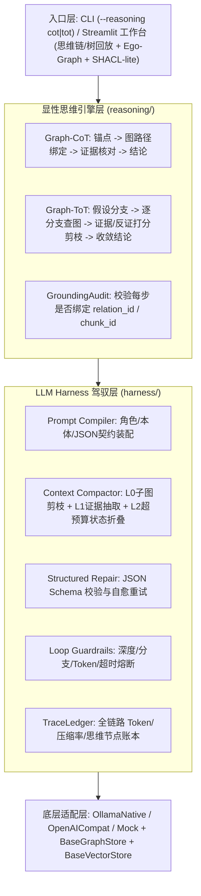

# 第二阶段实现方案：LLM Harness、三级上下文压缩（Compact）与显性 CoT / ToT 思维范式

> **阶段定位**：在第一阶段（基础框架闭环、PyVis/Streamlit 可视化核验、工业故障诊断文档与 FailureSensorIQ 四级基准验收）完成后，本阶段将系统从“**单轮裸模型检索问答原型**”升级为“**上下文可控、思维过程显性化、可逐节点审计的工程级 GraphRAG 推理平台**”。

---

## 1. 立项背景：第一阶段实测暴露的 4 大工程瓶颈

在基于本机 Ollama `gemma4:12b` 与 IBM FailureSensorIQ（四级难度共 1,200 次推理）实测中，我们观测到了 4 个清晰的架构瓶颈，直接驱动第二阶段改造：

1. **模型隐式思考不可控**：`gemma4:12b` 默认开启 `think=True` 时，在不确定题目上易陷入冗长思考循环（单题超 180s 超时或撞穿 4K 窗口返回空串），思考权被锁在模型黑盒内。
2. **裸模型调用缺乏工程护栏**：当前 `providers/llm/` 仅为无状态 `prompt -> str` 调用器，缺乏 Token 预算守卫、JSON 畸形自愈重试、多步超时熔断与统一遥测账本。
3. **高连通子图噪声引发注意力串台**：即使拥有 32K~256K 上下文，在 `L3_multi_answers` 压测中一旦检索子图膨胀到 68~113 个节点，12B 模型仍会在无关三元组间串台（丢分 6 题），说明“能装下 ≠ 能推对”。
4. **缺少可审计的多假设排除范式**：工业故障诊断面对多症状并发（如“2倍频升高 + 电流波动 + 温升”）时，需要显式对比多个候选根因并给出**反证剪枝依据**，而非单轮黑盒吐结论。

---

## 2. 第二阶段总体融合架构

**核心思想**：运行时关闭模型不可控的隐式思考（`think=False`），把**上下文预算、压缩裁剪、步数控制、格式修复**统一收口到 **LLM Harness（驾驭层）**，再在其上运行结构化、图谱绑定的 **显性 Graph-CoT / Graph-ToT 思维引擎**。



---

## 3. 核心模块详细设计

### 3.1 模块一：LLM Harness 推理驾驭层（`src/llm_graphrag_kg/harness/`）

#### A. 三级无损优先上下文压缩器（`context_compactor.py`）
严格遵循工业可信红线：**严禁使用有损文学摘要覆盖关键数值、物理单位、实体 ID 与 `chunk_id` 溯源指针**。

| 压缩级别 | 触发时机 | 核心策略 | LLM 成本 | 典型收益 |
|---|---|---|---|---|
| **L0 规则级无损压缩** | 默认常开（每次推理前） | ① **题干锚点精准剪枝**：仅以题干实体做核心种子扩展，防止候选项/无关邻域污染子图；<br>② **重复三元组去重合并**；<br>③ **紧凑符号编码**：以高密度 `A --[REL]--> B [chunk_id]` 替代冗长自然语言描述 | **0** | 单题上下文压缩 50%~80%，直接消除子图噪声串台 |
| **L1 证据抽取式压缩** | 命中的原文切片总长超阈值时 | 按句子与题干关键词/向量相关性打分，仅保留命中的高相关核心句 + 原 `chunk_id` 与字符区间 | **0** | 保留原始精确数值与条文引用，去除长段落无关铺垫 |
| **L2 语义状态折叠** | 多轮对话或 ToT 累计 Token 超预算（如 > 4,000 tok）时 | 将旧轮次或**已剪枝的 ToT 假设分支**折叠为结构化 `CompactedState`（如 `[PRUNED H3: 绕组故障 | 反证: 电阻正常 (chunk_004)]`），强制保留实体、数值与溯源 ID | 低（仅超限时触发） | 支撑多步 ToT 与多轮排障会话不滚雪球、延迟可控 |

同时输出 `CompactionReport`（`raw_tokens_est`、`compacted_tokens_est`、`compression_ratio`、`dropped_nodes`、`applied_levels`），写入遥测账本并可在工作台直观查看。

#### B. 统一运行壳（`runtime.py` — `LLMHarness`）
- **Prompt 编译**：标准化组装 `System Spec + Ontology Constraints + Compacted Context + Output JSON Schema`。
- **结构化输出与自动修复（Structured Auto-Repair）**：
  - 按目标 Pydantic 模型校验模型返回 JSON；
  - 若解析失败或必填字段缺失，自动携带精确校验错误发起最多 `max_retries=1~2` 次轻量修正调用，避免空回复或静默异常。
- **循环护栏与熔断（Guardrails）**：
  - 统一强制 `max_steps`、`max_total_tokens`、`max_wall_seconds` 上限，超时或超预算时优雅降级返回当前最高分分支与已收集证据。
- **全链路账本（`TraceLedger`）**：
  - 记录每一次模型调用的输入/输出 Token、压缩前/后对比、耗时、`tok/s`、是否触发修复重试，支持导出 JSON 复盘。

---

### 3.2 模块二：显性 CoT / ToT 思维范式引擎（`src/llm_graphrag_kg/reasoning/`）

#### A. 显性思维数据结构（`schema.py`）
- `ReasoningStep`：`step_id`、`stage`（`anchor` / `graph_traverse` / `evidence_check` / `synthesis`）、`claim`、`cited_entity_ids`、`cited_relation_ids`、`cited_chunk_ids`、`grounded: bool`
- `ThoughtBranch`：`branch_id`、`hypothesis`、`target_entity_id`、`depth`、`supporting_relations`、`contradicting_evidences`、`score`、`status`（`active` / `pruned` / `selected`）、`prune_reason`
- `ReasoningResult`：`question`、`paradigm`（`direct` / `cot` / `tot`）、`final_answer`、`steps: list[ReasoningStep]`、`branches: list[ThoughtBranch]`、`grounding_score: float`（已扎根步数占比）、`compaction: CompactionReport`、`trace_ledger`

#### B. 显性 Graph-CoT（`cot.py`）
- 面向常规单因查询与标准故障定位，执行固定 4 步结构化推导：
  1. 识别问题锚点与设备域；
  2. 从 L0 压缩后的图谱子图中绑定显式关系路径（`A --[REL]--> B`）；
  3. 对照 L1 压缩后的原文切片校验数值/阈值/SOP 步骤；
  4. 输出最终结论。
- **自动忠实度核验（`GroundingAudit`）**：代码逐条检查每个 `ReasoningStep` 引用的 `relation_id` 与 `chunk_id` 是否真实存在于本次检索子图，不存在则强制标记 `grounded=False` 并计入忠实度评分。

#### C. 显性 Graph-ToT（`tot.py`）
- 面向多症状并发、复合故障与高风险根因定位，默认预算 `beam_width=3`、`max_depth=2`、`max_llm_calls=6`：
  1. **Branch（假设生成）**：结合初始种子邻域，生成 `2~3` 个互异候选根因假设 `H1, H2, H3`；
  2. **Ground（分支独立查图）**：对每个假设独立调用 `BaseGraphStore.get_k_hop_subgraph()` 获取该假设的预期症状与关联 SOP，并经 `ContextCompactor (L0/L1)` 压缩为紧凑证据包；
  3. **Score & Prune（证据/反证打分剪枝）**：综合“确定性图谱命中率（命中已知症状数 / 缺失关键症状数）”与“LLM 语义一致性打分”，保留 Top-k 分支，将其余分支标记为 `pruned` 并记录 `prune_reason`；
  4. **Compact & Synthesize（压缩淘汰分支 + 收敛输出）**：将淘汰分支经 L2 状态折叠压缩后与胜出路径一并交给最终综合器，输出 **最终根因 + 处置 SOP + 显性排除理由**。

---

### 3.3 模块三：可视化核验与大图治理联动（`src/llm_graphrag_kg/viz/`）

同步补齐第一阶段在大图核验中识别出的 2 项关键刚需，并与 CoT/ToT 深度融合：

1. **Streamlit 思维链 / 思维树与 Compact 遥测面板**（集成至 `viz/app.py`「🔍 问答与子图追踪」页）：
   - 切换推理范式：`direct`（直出） / `cot`（显性思维链） / `tot`（显性思维树）+ `Compact` 开关；
   - 可视化展示 **Compact 压缩前后 Token 对比与裁剪节点数**；
   - 展示结构化 `CoT` 逐步卡片（带 `grounded` 绿标/红标）或 `ToT` 分支对比卡（绿色胜出假设、灰色剪枝假设 + 剪枝反证）。
2. **单设备 / 单节点 Ego-Graph 聚焦模式**（彻底解决 >200 节点毛线球问题）：
   - 在「📊 交互图谱」页增加中心实体下拉框与跳数滑块（1~2 跳），一键只渲染目标设备/故障周围 15~30 个清晰节点。
3. **SHACL-lite 全量本体合规质检面板**（`viz/schema_validator.py`）：
   - 自动扫描 100% 实体与关系，校验实体类型白名单、关系起点/终点类型合法性、是否存在自环边/缺失溯源的“幽灵三元组”/孤立节点，输出绿灯/红灯质检报告。

---

## 4. 配置扩展与向后兼容设计

在 `configs/*.yaml` 中新增可选配置段（旧配置文件不填时自动回退安全默认值，保证 **100% 向后兼容**）：

```yaml
harness:
  enable_compact: true
  max_context_tokens: 4000
  max_subgraph_relations: 30
  max_evidence_chunks: 6
  json_repair_retries: 1
  max_wall_seconds: 120

reasoning:
  default_paradigm: "cot"  # direct | cot | tot
  tot_beam_width: 3
  tot_max_depth: 2
  tot_max_llm_calls: 6
```

CLI 同步扩展参数：
```bash
# 使用显性 CoT + Compact 执行查询
uv run llm-graphrag-kg query "你的问题" --config-file configs/fault_diagnosis.yaml --reasoning cot --compact

# 使用显性 ToT 多假设分支推理
uv run llm-graphrag-kg query "离心泵出现2倍频振动升高且电机电流波动的根因？" --config-file configs/fault_diagnosis.yaml --reasoning tot --export-html
```

---

## 5. 分步实施里程碑与量化验收标准

| 子阶段 | 交付内容 | 量化验收标准 |
|---|---|---|
| **Stage 2.1：Harness & Compact 底座（已完成）** | `harness/context_compactor.py`（L0/L1/L2）+ `harness/runtime.py`（预算守卫、JSON 自愈、`TraceLedger`）+ 单元测试 + 2,000 题四基线压测审计（见 `docs/benchmark_stage2_1_audit_and_roadmap.md`） | ① 已达成：`L3_multi_answers`（500 题）Exact Match **100.0%（500/500）**，击败 `raw`（97.2%）；<br>② Prompt Token 下降 **~67%**、单题提速 **~1.9×**，8,000 次调用 **0 空回复** |
| **Stage 2.2：显性 Graph-CoT 引擎 + 2.1 审计待修复项 + PPR 检索（已完成）** | ① **并入 2.1 审计待修复项**：Scope-Aware L0 边界感知压缩（`Asset Domain Scope` + `In-Asset Unlinked` 差集 + 1 行 L1 Provenance）、三态 MCQA Prompt 规则、`_infer_relevancy_label` 否定词表补全；<br>② **显性 CoT 引擎**：`reasoning/schema.py` + `reasoning/cot.py` + `GroundingAudit` 忠实度门禁 + CLI `--reasoning cot`；<br>③ **HippoRAG 风格 PPR 检索**：`pipelines/retriever.py` 新增 `ppr` 多跳扩散模式 | ① 已达成：`L2_10_options`（100 题）Exact Match 从 **36.8%** 跃升至 **95.0%**，反超 `raw`（49.4%）**+45.6%**；<br>② 工业故障诊断实跑 4/4 步 **100.0%** 通过 `GroundingAudit`（-75.0% Token） |
| **Stage 2.3：显性 Graph-ToT 引擎（ToG 范式，已完成）** | `reasoning/tot.py`（Branch → Ground → Score & Prune → L2 Fold → Synthesize）+ CLI `--reasoning tot` + `GraphRAG-Bench` 高难多跳基准适配器（`ingest-grb` / `eval-grb`） | ① 已达成：多症状并发工业案例稳定展开 3 条竞争假设，精准选中 `轴系不对中` 并剪枝错误假设，L0+L1+L2 压缩 `-80.1%`、Grounding Audit 4/4 **100%**；<br>② `GraphRAG-Bench (Complex Reasoning)` 四范式对比 `ppr_tot` 证据覆盖率 **52.8%** & Token-F1 **16.1%** 全面领跑，严格 `3.0` 次调用 |
| **Stage 2.4：工作台升级与大图质检** | Streamlit CoT/ToT 思维回放 + Compact 遥测 + Ego-Graph 聚焦 + `SHACL-lite` 全量质检 + `AppTest` 回归 | ① `ruff check` 0 告警、`pytest` 100% 通过（含 `AppTest`）；<br>② 通过 `privacy_check.py --staged --require-changelog` |

---

## 6. 隐私与迁移约束（延续第一阶段铁律）

- 所有思维轨迹与遥测日志默认输出至被 `.gitignore` 忽略的 `outputs/` 目录，不入 Git 仓库；
- `LLMHarness` 与 `reasoning/` 仅依赖 `BaseLLMClient` / `BaseGraphStore` / `BaseVectorStore` 协议，未来迁移至 Neo4j、Qdrant 或云端大模型时零代码耦合；
- 每个子阶段（Stage 2.1 ~ 2.4）均遵循“**一功能一提交 + 同步更新 `CHANGELOG.md` + `pre-commit` 隐私门禁**”。
