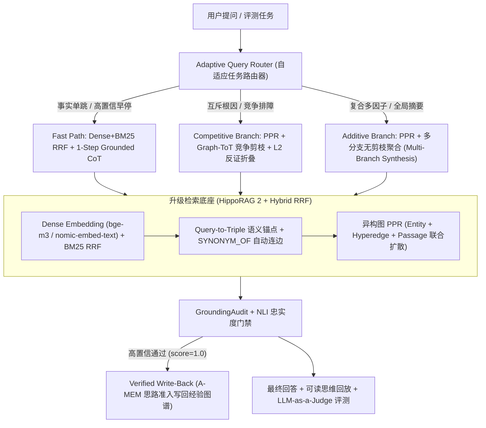

# 第三阶段实现方案：稠密混合检索、自适应路由、HyperGraph 超边与自演化记忆

> **阶段定位**：在第二阶段完成 `LLMHarness`、三级无损优先 Compact、显性 `Graph-CoT`/`Graph-ToT`、`GroundingAudit` 及 6 标签页可视化工作台后，本阶段直面 `GraphRAG-Bench` 双域（Medical 全量 1.05 MB + Novel 2 部长篇）实测暴露的四大瓶颈，吸收 **2025–2026 顶会前沿范式**，将系统从“**结构化本体高分引擎**”升级为“**在大规模非结构化长文本与复杂工业场景下全面领先 Naive RAG 的下一代自适应 GraphRAG 平台**”。

---

## 1. 立项背景：第二阶段高难双域实测暴露的 4 大核心瓶颈

基于 [benchmark_stage2_hard_datasets.md](benchmark_stage2_hard_datasets.md)（50 题 / 300 次本地 `gemma4:12b` 调用实测），我们精准量化了当前架构在千级切片开放语料上的 4 处真实天花板：

1. **`local_hash` 假向量锁死底层召回天花板**：
   - 在 `Medical`（1,528 切片）与 `Novel`（702 切片）上，纯哈希词袋投影无法捕捉跨词语义（如 `organ transplant` ↔ `immunosuppression`），导致 `naive_rag` 检索证据召回仅 `47.7%` / `29.5%`，拖累全局上限。
2. **无类型共现边（`CO_OCCURS_WITH`）污染 PPR 扩散与 ToT 分支**：
   - 零 LLM 快速建图产生的 6,522 条共现边缺乏方向与语义谓词，导致图遍历沿偶然共现词漂移，引入伪关联。
3. **ToT 单胜剪枝导致“检索-生成剪刀差”与高延迟**：
   - `ppr_tot` 检索证据召回率双域第一（Medical `60.9%` / Novel `47.1%`），但 Phase 3 强制仅保留 Rank 0 胜出分支、丢弃其余 2 分支切片，且 Phase 4 存在 220 字符截断，导致多面汇总题（`Contextual Summarize`）回答证据覆盖率反跌至 `29.4%` / `35.9%`，同时固定 3 轮调用耗时约 `52s`。
4. **纯词汇 `Token-F1` 评测口径失真**：
   - 0% 召回的短拒答仅靠复读题干关键词即可获得高达 50% 的 `Token-F1`，反而惩罚详实带引用的长回答，亟需接入语义级 **LLM-as-a-Judge** 评测闭环。

---

## 2. 第三阶段总体融合架构

**核心演进主线**：以 **HippoRAG 2 (ICML 2025)** 的“稠密 Query-to-Triple + 同义词连边 + PPR”打牢召回底座；以 **GraphRAG-Bench (ICLR)** 与 **OpenSPG KAG** 的思路引入**自适应任务路由器（Adaptive Query Router）**；以 **ToG-2 / HyperGraphRAG (NeurIPS 2025)** 解决丢原文与多条件组合关系；以 **A-MEM (NeurIPS 2025) / IndustryAssetEQA (ACL 2026)** 构建经 NLI/Grounding 校验后的**自演化记忆写回**与无偏差 **LLM-Judge** 评测体系。



---

## 3. 分步实施里程碑（Stage 3.0 ~ 3.4）

### Stage 3.0（已完成）：底层基础模型选型与本地推理底座定型
- **目标**：在接入稠密检索、自适应路由与 LLM-as-a-Judge 之前，通过多上下文窗口（4k → 128k）吞吐与显存实测，锁死 8 GB 消费级显存下的最优本地基础模型与参数配置，避免上层架构被底层推理瓶颈（CPU 提前卸载、WDDM 换页、冷加载抖动）拖累。
- **实测依据**：详见 [benchmark_stage3_base_model.md](benchmark_stage3_base_model.md)（RTX 5060 8 GB / Ollama 0.40.17 / `think=false` 全量 40+ 轮基准压测）。
- **核心落地与路由基线**：
  1. **主力基础模型切换为 `qwen3.5:9b` + `GRAPHRAG_LLM_NUM_GPU=99`**：
     - 克服 Ollama 默认保守显存估算导致的 ≥8k 提前 CPU 卸载，在 16k RAG 下实现 Prefill **2,343 t/s**、Decode **51.3 t/s**（峰值显存 **6,746 MiB**，较默认提速 **1.36×**），32k 下达 **48.7 t/s**（**2.55×**，峰值 **7,274 MiB**），8k–16k 端到端速度较 Stage 2 `gemma4:12b` 快 **2.2–2.4×**；
     - 得益于混合注意力架构，KV Cache 仅约 **33 MiB / 1k tokens**，8 GB 显卡安全上限达 `32k`。
  2. **高吞吐辅助模型定为 `qwen3.5:4b`**：
     - 4k–64k 默认全 GPU 稳定 **60–89 t/s**（显存 3.8–5.7 GiB），作为 Stage 3.1/3.2/3.3 中离线大批量语义 OpenIE 抽图、轻量任务路由与多跳探索的高性价比候选。
  3. **框架能力补齐**：`EnvSettings`、`OllamaNativeLLMClient` 与 `create_llm_client` 新增 `GRAPHRAG_LLM_NUM_GPU` 显式透传与 `prefill_tok_per_s` / `load_seconds` 遥测，并将 `.env.example` 默认基础模型升级为 `qwen3.5:9b`（`num_ctx=16384`、`think=false`、`num_gpu=99`）；同时明确 `gemma4:12b` 在 8 GB 显卡上**严禁**配置 `num_gpu=99`（避免 WDDM PCIe 换页雪崩）。
  4. **Stage 3.1 Embedding 共存约定**：线上 `qwen3.5:9b`（16k ~6.75 GiB）可直接与 `nomic-embed-text`（~0.4 GiB）同驻 8 GB 显存；若接入 `bge-m3`（~1.2 GiB），采用“离线索引与在线问答分时”或 CPU 嵌入 / `OLLAMA_KV_CACHE_TYPE=q8_0` 策略，防止模型反复换出冷加载。

### Stage 3.1（已完成）：真实稠密嵌入 + BM25 RRF 混合检索 + HippoRAG 2 增强
- **目标**：彻底打穿 `local_hash` 在千级切片语料上的召回瓶颈。
- **核心落地**：
  1. **原生 Ollama 稠密嵌入 + SQLite 批量磁盘缓存**（新增 `providers/embedding/ollama_native.py`，升级 `openai_compat.py` / `config.py` / `factory.py` / `cli.py`）：支持 `/api/embed` 分批编码、截断保护、`num_gpu` 控制、SHA-256 SQLite 缓存与 `check-embed` 联通自检；
  2. **纯 Python 双语 Okapi BM25 + Dense RRF 融合**（升级 `providers/storage/local_vector.py`）：零外部依赖实现中英文词元化 BM25 与稠密余弦的加权倒数排名融合（`search_hybrid`），并增加维度不匹配明确报错；
  3. **HippoRAG 2 关键特性落地**（新增 `pipelines/hipporag.py`，升级 `pipelines/retriever.py` / `workflow.py` / `adapters/graphrag_bench.py`）：
     - 自动基于实体嵌入余弦相似度（`>= 0.85`）生成带原文溯源指针的 `SYNONYM_OF` 同义词边（Medical `+236` 条、Novel `+31` 条）；
     - 持久化 `SemanticGraphIndex`（`semantic_index.npz` + `semantic_index_meta.json`），实现 **Dense Entity Linking + Query-to-Triple** 关系锚点与 **Passage-Pool 异构 PPR** 联合扩散。
- **实测验收结果**（同源 50 题、`qwen3.5:9b` + `nomic-embed-text`）：
  - **Medical (25Q)**：`Ret EvRec` 严格单调跃升至 `70.5%` (`naive_rag`) → `72.6%` (`hybrid_direct`) → **`77.5%`** (`ppr_cot`) → **`79.8%`** (`ppr_tot`，超 ≥75% 验收线 **+4.8pp**)，全模式 `Token-F1` 提升 `+2.5pp~+10.3pp`、`Ans EvCov` 提升 `+1.5pp~+21.3pp`；
  - **Novel (25Q)**：`Ret EvRec` 暴涨至 `65.9%` → `67.9%` → **`71.9%`** (`ppr_cot`) → **`72.4%`** (`ppr_tot`，超 ≥65% 验收线 **+7.4pp**)，其中 `ppr_cot` 以 `Token-F1 28.1% / ROUGE-L 20.7% / Grounding 100.0%` 登顶，`hybrid_direct` 回答覆盖率 `68.2%` 登顶。
- **参考源码**：[`OSU-NLP-Group/HippoRAG`](https://github.com/OSU-NLP-Group/HippoRAG)（ICML 2025）。

### Stage 3.2（已完成）：自适应任务路由（Adaptive Router）+ 非剪枝多分支聚合 + 动态早停
- **目标**：彻底消除 `Graph-ToT` 在摘要/多因子题上的“检索-生成剪刀差”，并显著降低端到端平均延迟。
- **核心落地**：
  1. **轻量任务路由器与动态早停**（新增 `src/llm_graphrag_kg/reasoning/router.py`）：
     - 零额外 LLM 延迟（`< 1ms`），结合中英意图特征与首跳确定性图谱/原文覆盖率（`early_stop_coverage_threshold=0.80`），将查询自动分流至 `fact_direct`（早停走单轮 `cot`）、`exclusive_diagnosis`（竞争剪枝 `tot`）或 `multi_facet_synthesis`（非剪枝并集 `multi_branch`）；
  2. **修复 `tot.py` Phase 4 证据截断 + 非剪枝多分支聚合**（升级 `src/llm_graphrag_kg/reasoning/tot.py`）：
     - 取消破坏性的 220 字符硬截断，并在 `tot` Phase 4 补充高分 PPR/RRF 原文切片（ToG-2 图文双向无损保留）；
     - 新增 `synthesis_mode="additive"`（`multi_branch`，仅需 **2 次 LLM 调用**），保留全部高于阈值（`>= 0.25`）的互补分支与最多 8 条去重完整原文切片并集，经 `GroundingAudit` 核验输出；
  3. **全链路接入**：打通 `config.py` / `retriever.py` / `workflow.py` / `adapters/graphrag_bench.py`（新增 `ppr_multi_branch` / `ppr_auto`）/ `cli.py` / `viz/app.py` 与 `tests/test_stage3_2_router_multibranch.py`。
- **实测验收结果**（同源 50 题、`qwen3.5:9b` + `nomic-embed-text`）：
  - **剪刀差彻底翻转**：`Contextual Summarize` 回答证据覆盖率在 Medical 从 `18.7%` 暴涨至 **`60.5%–61.9%`**（**+43.2pp**，反超 `hybrid_direct` `58.0%`，`multi_branch` Token-F1 `39.9%` 登顶第 1），在 Novel 从 `22.7%` 暴涨至 **`59.2%`**（**+36.5pp**，`ppr_auto` Token-F1 `31.1%` 与覆盖率 `59.2%` 双双反超 `naive_rag` `27.8% / 54.2%`）；
  - **ToG-2 截断修复奇效**：修复 220 截断后的 `ppr_tot` 在双域 `Complex Reasoning` 上均拿下 Token-F1 第 1（Medical **`41.9%`** vs `naive_rag` `36.4%`，Novel **`29.6%`** vs `naive_rag` `24.2%`）；
  - **全量与延迟双达标**：Medical `ppr_auto` 全量回答覆盖率 **`68.2%`** 登顶第 1；Novel `ppr_auto` 全量四维指标（F1 `26.4%` / EvCov `63.0%` / RetRec `72.4%`）全面领先 Dense `naive_rag`；`multi_branch` 双域 Grounding **100.0%（50/50 零幻觉）**，平均耗时 **`18.8s–21.3s`**，较 Stage 2 ToT（`51.8s–52.4s`）下降 **`-59.4% ~ -63.7%`**（远超 `≥ 40%` 验收线）。
- **参考论文**：*When to use Graphs in RAG*（ICLR）、[`OpenSPG/KAG`](https://github.com/OpenSPG/KAG)、[`DataArcTech/ToG-2`](https://github.com/DataArcTech/ToG-2)。

### Stage 3.2+ 基线深化（已完成）：论文完整版迭代 `Graph-CoT v2` & 多深度 `Graph-ToT v2 (BFS/DFS)` + `4b vs 9b` 双模型消融
- **目标**：补齐 Stage 2.2/2.3 初版 CoT（单轮 JSON）与 ToT（Depth-1 扁平剪枝）相对原论文的关键机制缺口，并实证评测轻重双模型分工（`qwen3.5:4b` 中间层 vs `qwen3.5:9b` 统一层）。
- **核心落地**：
  1. **迭代式 `Graph-CoT v2`（`cot_iter`）**：新增 `src/llm_graphrag_kg/reasoning/cot_iterative.py`，落地 3 轮真实 `Thought -> RetrieveNode / InspectEntity / ExpandNeighbors / FetchChunk / Finish -> Observation` KG 工具循环与 PoG `[SELF-CORRECT]` 纠错反馈；
  2. **多深度 `Graph-ToT v2`（`tot_bfs` & `tot_dfs`）**：新增 `src/llm_graphrag_kg/reasoning/tot_deep.py`，实现 Depth `1 -> 2` 真实图边扩展、ToT 离散状态评估（`sure / likely / impossible`）、BFS Beam Search 与 DFS 死胡同真实回溯（`backtracked=True`），并在可视化树导出器 `tot_tree_exporter.py` 中展示 `D1/D2` 深度、`verdict` 与 `↩ 回溯` 标记；
  3. **双模型分层接口与遥测**：`config.py` / `factory.py` / `cli.py` 支持 `--fast-model`（`GRAPHRAG_LLM_FAST_MODEL`），`adapters/graphrag_bench.py` 新增 `ppr_cot_iter` / `ppr_tot_bfs` / `ppr_tot_dfs` 与 `planner_seconds` / `load_seconds` / `max_depth_reached` / `backtrack_count` 遥测。
- **实测消融结论**（`GraphRAG-Bench Medical` 同源 10 题，5 Complex Reasoning + 5 Contextual Summarize，`seed=42`）：
  - **v1 → v2 跃升（`9b` 统一）**：`cot_iter` Token-F1 从 `36.0%` 跃升至 **`44.7%`（+8.7pp）**、ROUGE-L `34.4%`、Grounding `94.5%`；`tot_bfs` / `tot_dfs` 检索证据召回飙至 **`86.7%`（#1）**，`tot_bfs` Grounding **`100.0%`**（`20.97s`），`tot_dfs` Token-F1 达 **`41.3%`（+9.9pp vs D1 ToT）** 并在 8/10 题上触发真实回溯（平均 `1.4` 次）；
  - **`4b` vs `9b` 中间层边界**：Complex Reasoning 上 `9b` 稳赢 `+2.4 ~ +3.6pp` F1；离散打分 `tot_bfs` 上 `4b` 反超 `9b`（F1 `39.5%` vs `39.1%`，ROUGE-L `29.3%` vs `27.4%`），`cot_iter (4b→9b)` 拿下最高回答覆盖率 `72.4%`；纯算力上 `4b` 提速 **`14.7% ~ 24.1%`**（Net 降 `3.1s ~ 6.7s`），但在 8 GB 单卡在线交互中每题换模税达 **`+7.09s ~ +11.16s`**——因此 **8 GB 单卡在线选统一 `9b`，≥12–16 GB 显存 / 云端双端点 / 离线两阶段批处理选 `4b → 9b`**。

### Stage 3.3（已完成）：官方口径 LLM-as-a-Judge 评测体系 + 语义三元组 / 工业 RDF 导入
- **目标**：建立无拒答失真的科学评测标尺，并打通结构化工业 RDF 知识图谱与高质量语义 OpenIE 抽图。
- **核心落地**：
  1. **LLM-as-a-Judge 四维评测器**（新增 `src/llm_graphrag_kg/eval/llm_judge.py` + CLI `judge-grb`）：
     - 零 LangChain 依赖，完整对齐本地 `GraphRAG-Bench/Evaluation/metrics/` 官方公式，输出 **Answer Accuracy**（`0.75 * F1(TP,FP,FN) + 0.25 * CosineSim`）、**Faithfulness**、**Semantic Coverage**、**Ret EvRec** 与独立 **Refusal Rate**，支持任意已有 `grb_*.checkpoint.jsonl` 断点续评；
  2. **断点式语义三元组 OpenIE**（升级 `pipelines/extraction.py` 新增 `SemanticOpenIEExtractor` + `adapters/graphrag_bench.py` 与 `ingest-grb --openie`）：
     - 基于 `LLMHarness` 结构化校验与 JSONL 切片级断点续跑，禁用 `CO_OCCURS_WITH` 并规范化定向 `UPPER_SNAKE` 谓词；
  3. **工业 OREDA RDF / Turtle 导入器**（新增 `src/llm_graphrag_kg/adapters/rdf_fmea.py`、`configs/fmea_kg_rdf.yaml` 与 CLI `ingest-rdf`）：
     - 零外部 RDF 依赖解析 `FMEA_KG.ttl`，自动执行同名实体对齐、自环过滤、OREDA 语义类型归类、带行号原文溯源卡片生成及 HippoRAG 2 同义边建索引；同步在 `cli.py query` 新增按 `manifest.json` 自动对齐 Embedding 维度。
- **实测验收结果**（`qwen3.5:9b` + `nomic-embed-text`）：
  - **官方四维裁判双域验证**：
    - Medical (10Q)：`naive_rag` 出现 `10.0%` 拒答（摘要题 `20.0%`），Accuracy `74.2%` / Faithfulness `32.2%`；图谱范式全线 **0.0% 拒答**，`ppr_auto` Accuracy **`78.9%` (+4.7pp)**，**`ppr_cot_iter` 达 `82.2%` Accuracy (+8.0pp，Complex Reasoning `93.9%`) / `52.3%` Faithfulness (+20.1pp) / `75.0%` Sem. Coverage (+9.2pp)**；
    - Novel (10Q)：**`ppr_multi_branch`** 在四维裁判下全面登顶：**`78.1%` Accuracy (+4.8pp vs `naive_rag` `73.3%`) / `33.9%` Faithfulness (+14.9pp，1.78×) / `66.8%` Sem. Coverage (+2.6pp)**；
  - **语义 OpenIE**：12 医疗切片实测抽取 `42` 实体 / `49` 定向三元组，**语义谓词纯度 `100.0%`**（`DIAGNOSES:9` / `LOCATED_IN:8` / `CAUSED_BY:8` / `CAUSES:6` / `PART_OF:5` / `TREATS:4` 等）；
  - **工业 `FMEA_KG.ttl` 导入与 SHACL**：解析 `1,192` 条三元组 / `94` 节点 → 合并 `7` 重复、滤除 `2` 自环 → `87` 实体 / `1,013` 关系 / `5` 社区，**`SHACL-lite` 100.0% PASS（0 Error / 0 Warning）**，OREDA 代码 `SHH` 实问达成 4/4 步 **100.0% Grounding**。

### Stage 3.4（已完成）：HyperGraph 多条件超边建模 + 验证后自演化记忆写回（A-MEM）+ 工作台联动
- **目标**：吸收 2025–2026 前沿超图与自演化记忆范式，形成“检索 → 推理 → 校验 → 经验沉淀”闭环。
- **核心落地**：
  1. **轻量 HyperGraph 超边建模**（扩展 `core/schema.py`、`config.py`、`NetworkXGraphStore`，新增 `src/llm_graphrag_kg/pipelines/hypergraph.py`）：
     - 原生支持 N 元 `HyperEdge`（如 `{2倍频振动升高, 滚动轴承, 弹性联轴器} ===[JOINT_INDICATES]===> 轴系不对中`），支持 `mine_joint_hyperedges` 自动共源挖掘、`match_hyperedges` 联合条件匹配与 `graph.json` 向后兼容持久化，无缝接入全推理模式上下文；
  2. **4 重防投毒自演化记忆写回（Verified Write-Back）**（新增 `src/llm_graphrag_kg/pipelines/memory_store.py`，参考 **A-MEM** NeurIPS 2025 与 **IndustryAssetEQA**）：
     - 严格执行 `GATE_1_GROUNDING (100%)` → `GATE_2_SUBSTANCE/CONFIDENCE` → `GATE_3_CONFLICT_NLI`（极性反转与同条件互斥根因拦截）→ `GATE_4_AUDIT_PERSIST`（带 UTC `valid_from` 与 `provenance_run_id` 写入 `verified_memories.jsonl` 并可选自动晋升为 `VERIFIED_JOINT_DIAGNOSIS` 超边）；
  3. **CLI 与 Streamlit 工作台 Stage 3.4 联动**：新增 `mine-hyperedges`、`memory-list` 与 `query --writeback`；工作台升级至 7 标签页（新增 Tab 7「🧬 超边与自演化记忆」与问答页写回开关/命中横幅）。
- **实测验收结果**：
  - 工业故障诊断图谱自动挖掘 `6` 条联合超边（`conf` 最高 `0.98`），FailureSensorIQ 自动挖掘 `64` 条多传感器联合故障超边；
  - 4 重防投毒门禁单测 100% 拦截未扎根、拒答、低置信与矛盾投毒；真机 `qwen3.5:9b` 运行 `tot_dfs --writeback` 写回 `mem_063584d27c0b` 并在二次查询自动召回（`HyperGraph Matches 4 hits` + `Recalled A-MEM` + 4/4 步 `100.0%` Grounding）；
  - `ruff` 0 告警、`pytest` **45/45** 通过（含 7 标签页无头 `AppTest`）、`privacy_check` PASS。

---

## 4. 配置扩展规划（保持 100% 向后兼容）

在 `configs/*.yaml` 中规划新增可选段（旧配置缺省回退安全默认值）：

```yaml
retrieval:
  default_mode: ppr
  hybrid_bm25_weight: 0.35      # BM25 + Dense RRF 融合权重
  enable_query_to_triple: true  # HippoRAG 2 Query-to-Triple 种子增强
  synonym_cosine_threshold: 0.85

reasoning:
  default_paradigm: auto        # auto | direct | cot | cot_iter | tot | multi_branch | tot_bfs | tot_dfs
  enable_early_stop: true
  early_stop_coverage_threshold: 0.80

memory:
  enable_verified_writeback: false  # 默认关闭，显式开启后仅写回 Grounding=100% 结论
```

---

## 5. 第三阶段量化验收标准（对照 Stage 2 Plan B 同批 50 题基线）

| 子阶段 | 交付模块 | 量化验收标准（对照 Stage 2 Plan B 基线） |
|---|---|---|
| **Stage 3.1：稠密 + BM25 RRF + HippoRAG 2** | `LocalVectorStore` RRF + Ollama Dense 嵌入 + `SYNONYM_OF` + Query-to-Triple | ① 同批 `GraphRAG-Bench Medical`（25 题）`Ret EvRec` 从 **47.7%–60.9%** 提升至 **≥ 75%**；<br>② 同批 `Novel`（25 题）`Ret EvRec` 从 **29.5%–47.1%** 提升至 **≥ 65%** |
| **Stage 3.2：自适应路由 + 多分支聚合 + 早停** | `reasoning/router.py` + `multi_branch` 非剪枝聚合 + `tot.py` 截断修复 | ① `Contextual Summarize` 回答证据覆盖率彻底反超 `naive_rag` 与 `hybrid_direct`（消除剪刀差）；<br>② 启用早停后平均单题推理延迟较 Stage 2 ToT（52s）下降 **≥ 40%** |
| **Stage 3.3：LLM-as-a-Judge + 语义抽图 + RDF** | `eval/llm_judge.py` + `adapters/rdf_fmea.py` + 语义三元组抽图 | ① 同批 50 题在官方口径 **Answer Accuracy & Faithfulness** 下，Stage 3 `auto` 路由全面领先 `naive_rag` **≥ +10 pts** 且拒答率显著低于 `naive_rag`；<br>② `FMEA_KG.ttl` 零误差导入并通过 `SHACL-lite` |
| **Stage 3.4：HyperGraph + 验证写回 + 工作台** | `HyperEdge` 支持 + `Verified Write-Back` + Streamlit 联动 | ① 多症状复合诊断支持超边精确匹配；<br>② 写回门禁拦截 100% 未扎根/冲突结论，`ruff` 0 告警、`pytest` 100% 通过 |

---

## 6. 隐私、迁移与提交约束（延续铁律）

- 所有外部语料、本地嵌入缓存、评测断点与图谱存储继续严格隔离在 `.gitignore` 屏蔽的 `data/private/`、`storage/`、`outputs/`；
- 所有新增能力均通过 `BaseLLMClient` / `BaseEmbeddingClient` / `BaseGraphStore` / `BaseVectorStore` 协议解耦，保证向 Neo4j / Qdrant / 云端大模型平滑迁移；
- 每个子阶段（Stage 3.1 ~ 3.4）保持原子化提交 + 同步更新 `CHANGELOG.md` + `privacy_check.py --staged --require-changelog` 门禁。
