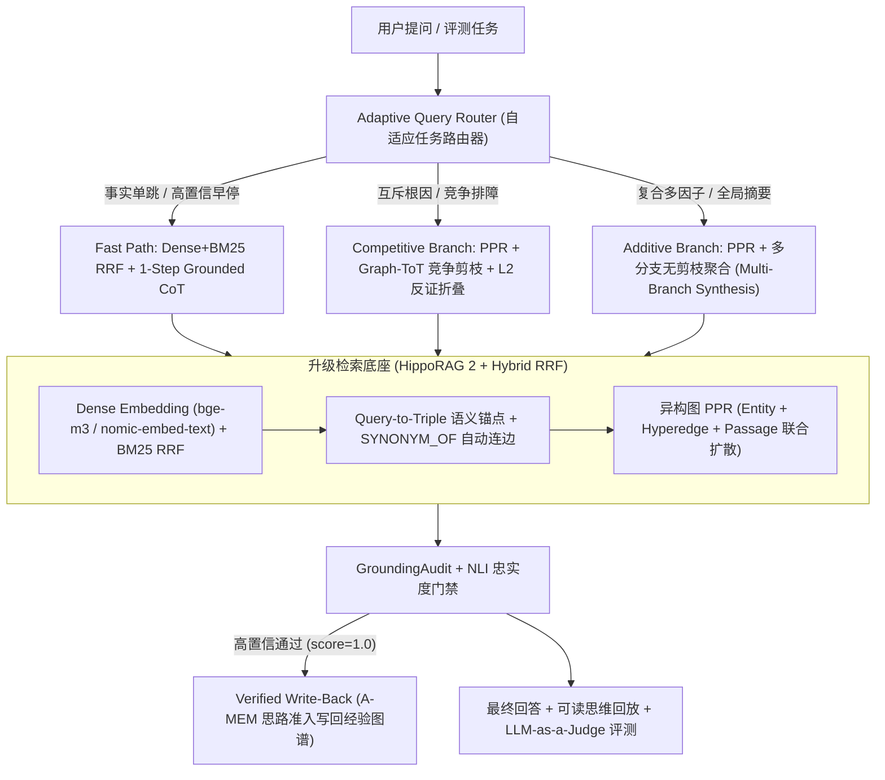

# 第三阶段实现方案：稠密混合检索、自适应路由、HyperGraph 超边与自演化记忆

> **阶段定位**：在第二阶段完成 `LLMHarness`、三级无损优先 Compact、显性 `Graph-CoT`/`Graph-ToT`、`GroundingAudit` 及 6 标签页可视化工作台后，本阶段直面 `GraphRAG-Bench` 双域（Medical 全量 1.05 MB + Novel 2 部长篇）实测暴露的四大瓶颈，吸收 **2025–2026 顶会前沿范式**，将系统从“**结构化本体高分引擎**”升级为“**在大规模非结构化长文本与复杂工业场景下全面领先 Naive RAG 的下一代自适应 GraphRAG 平台**”。

---

## 1. 立项背景：第二阶段高难双域实测暴露的 4 大核心瓶颈

基于 [benchmark_stage2_hard_datasets.md](benchmark_stage2_hard_datasets.md)（50 题 / 300 次本地 `gemma4:12b` 调用实测），我们精准量化了当前架构在千级切片开放语料上的 4 处真实天花板：

1. **`local_hash` 假向量锁死底层召回天花板**：
   - 在 `Medical`（1,528 切片）与 `Novel`（702 切片）上，纯哈希词袋投影无法捕捉跨词语义（如 `organ transplant` ↔ `immunosuppression`），导致 `naive_rag` 检索证据召回仅 `47.7%` / `29.5%`，拖累全局上限。
2. **无类型共现边（`CO_OCCURS_WITH`）污染 PPR 扩散与 ToT 分支**：
   - 零 LLM 快速建图产生的 6,522 条共现边缺乏方向与语义谓词，导致图遍历沿偶然共现词漂移，引入伪关联。
3. **ToT 单胜剪枝导致“检索-生成剪刀差”与高延迟**：
   - `ppr_tot` 检索证据召回率双域第一（Medical `60.9%` / Novel `47.1%`），但 Phase 3 强制仅保留 Rank 0 胜出分支、丢弃其余 2 分支切片，且 Phase 4 存在 220 字符截断，导致多面汇总题（`Contextual Summarize`）回答证据覆盖率反跌至 `29.4%` / `35.9%`，同时固定 3 轮调用耗时约 `52s`。
4. **纯词汇 `Token-F1` 评测口径失真**：
   - 0% 召回的短拒答仅靠复读题干关键词即可获得高达 50% 的 `Token-F1`，反而惩罚详实带引用的长回答，亟需接入语义级 **LLM-as-a-Judge** 评测闭环。

---

## 2. 第三阶段总体融合架构

**核心演进主线**：以 **HippoRAG 2 (ICML 2025)** 的“稠密 Query-to-Triple + 同义词连边 + PPR”打牢召回底座；以 **GraphRAG-Bench (ICLR)** 与 **OpenSPG KAG** 的思路引入**自适应任务路由器（Adaptive Query Router）**；以 **ToG-2 / HyperGraphRAG (NeurIPS 2025)** 解决丢原文与多条件组合关系；以 **A-MEM (NeurIPS 2025) / IndustryAssetEQA (ACL 2026)** 构建经 NLI/Grounding 校验后的**自演化记忆写回**与无偏差 **LLM-Judge** 评测体系。



---

## 3. 分步实施里程碑（Stage 3.0 ~ 3.4）

### Stage 3.0（已完成）：底层基础模型选型与本地推理底座定型
- **目标**：在接入稠密检索、自适应路由与 LLM-as-a-Judge 之前，通过多上下文窗口（4k → 128k）吞吐与显存实测，锁死 8 GB 消费级显存下的最优本地基础模型与参数配置，避免上层架构被底层推理瓶颈（CPU 提前卸载、WDDM 换页、冷加载抖动）拖累。
- **实测依据**：详见 [benchmark_stage3_base_model.md](benchmark_stage3_base_model.md)（RTX 5060 8 GB / Ollama 0.40.17 / `think=false` 全量 40+ 轮基准压测）。
- **核心落地与路由基线**：
  1. **主力基础模型切换为 `qwen3.5:9b` + `GRAPHRAG_LLM_NUM_GPU=99`**：
     - 克服 Ollama 默认保守显存估算导致的 ≥8k 提前 CPU 卸载，在 16k RAG 下实现 Prefill **2,343 t/s**、Decode **51.3 t/s**（峰值显存 **6,746 MiB**，较默认提速 **1.36×**），32k 下达 **48.7 t/s**（**2.55×**，峰值 **7,274 MiB**），8k–16k 端到端速度较 Stage 2 `gemma4:12b` 快 **2.2–2.4×**；
     - 得益于混合注意力架构，KV Cache 仅约 **33 MiB / 1k tokens**，8 GB 显卡安全上限达 `32k`。
  2. **高吞吐辅助模型定为 `qwen3.5:4b`**：
     - 4k–64k 默认全 GPU 稳定 **60–89 t/s**（显存 3.8–5.7 GiB），作为 Stage 3.1/3.2/3.3 中离线大批量语义 OpenIE 抽图、轻量任务路由与多跳探索的高性价比候选。
  3. **框架能力补齐**：`EnvSettings`、`OllamaNativeLLMClient` 与 `create_llm_client` 新增 `GRAPHRAG_LLM_NUM_GPU` 显式透传与 `prefill_tok_per_s` / `load_seconds` 遥测，并将 `.env.example` 默认基础模型升级为 `qwen3.5:9b`（`num_ctx=16384`、`think=false`、`num_gpu=99`）；同时明确 `gemma4:12b` 在 8 GB 显卡上**严禁**配置 `num_gpu=99`（避免 WDDM PCIe 换页雪崩）。
  4. **Stage 3.1 Embedding 共存约定**：线上 `qwen3.5:9b`（16k ~6.75 GiB）可直接与 `nomic-embed-text`（~0.4 GiB）同驻 8 GB 显存；若接入 `bge-m3`（~1.2 GiB），采用“离线索引与在线问答分时”或 CPU 嵌入 / `OLLAMA_KV_CACHE_TYPE=q8_0` 策略，防止模型反复换出冷加载。

### Stage 3.1：真实稠密嵌入 + BM25 RRF 混合检索 + HippoRAG 2 增强
- **目标**：彻底打穿 `local_hash` 在千级切片语料上的召回瓶颈。
- **核心改动**：
  1. **稠密语义嵌入接入**：支持本机 Ollama 免费开源嵌入模型（如 `nomic-embed-text` / `bge-m3`）一键配置与批量缓存，保留 `local_hash` 仅作离线单元测试回退；
  2. **纯 Python BM25 + Dense RRF 融合**（升级 `providers/vector/local_vector_store.py`）：零外部数据库依赖实现词汇精确命中（专有名词/型号/代码）与稠密语义召回的 Reciprocal Rank Fusion；
  3. **HippoRAG 2 关键特性落地**（升级 `pipelines/retriever.py` & `extraction.py`）：
     - 自动基于嵌入余弦相似度（`>= 0.85`）为语义等价实体建立 `SYNONYM_OF` 同义词边；
     - 引入 **Query-to-Triple** 检索，将关系描述向量化，用最匹配的三元组端点作为 PPR 种子。
- **参考源码**：[`OSU-NLP-Group/HippoRAG`](https://github.com/OSU-NLP-Group/HippoRAG)（ICML 2025）。

### Stage 3.2：自适应任务路由（Adaptive Router）+ 非剪枝多分支聚合 + 动态早停
- **目标**：彻底消除 `Graph-ToT` 在摘要/多因子题上的“检索-生成剪刀差”，并显著降低端到端平均延迟。
- **核心改动**：
  1. **轻量任务路由器**（新增 `src/llm_graphrag_kg/reasoning/router.py`）：
     - 结合规则特征与轻量分类，将查询自动路由至 3 条执行路径：
       - `fact_direct`（简单单跳/首跳高置信早停）→ 1 步 `PPR + CoT`，跳过冗余分支搜索；
       - `exclusive_diagnosis`（互斥根因/故障排除/假设检验）→ `Graph-ToT` 竞争剪枝 + L2 反证折叠；
       - `multi_facet_synthesis`（多因子复杂推理 / `Contextual Summarize` 全局摘要）→ **非剪枝多分支聚合（Multi-Branch Additive Synthesis）**，保留 Top-K 分支的全部高分证据并集，严禁丢弃互补信息。
  2. **修复 `tot.py` Phase 4 证据截断**：取消 220 字符硬截断，改为 L1 完整关键句集合注入（参考 **ToG-2** 图文双向保留机制）。
  3. **动态早停（Dynamic Early Stopping）**：借鉴 `Search-R1` / `RAG-R1` 控制思路，当 PPR 首跳确定性图谱覆盖率高于阈值时自动早停，避免简单题空耗 3 轮调用。
- **参考论文**：*When to use Graphs in RAG*（ICLR）、[`OpenSPG/KAG`](https://github.com/OpenSPG/KAG)、[`DataArcTech/ToG-2`](https://github.com/DataArcTech/ToG-2)。

### Stage 3.3：官方口径 LLM-as-a-Judge 评测体系 + 语义三元组 / 工业 RDF 导入
- **目标**：建立无拒答失真的科学评测标尺，并打通结构化工业 RDF 知识图谱与高质量语义 OpenIE 抽图。
- **核心改动**：
  1. **LLM-as-a-Judge 四维评测器**（新增 `src/llm_graphrag_kg/eval/llm_judge.py`）：
     - 直接参考本地已下载的 `GraphRAG-Bench` 官方实现（`data/private/graphrag_bench/Evaluation/metrics/`：`answer_accuracy.py`, `faithfulness.py`, `evidence_recall.py`, `coverage.py`）；
     - 同步输出 **Answer Accuracy（语义正确率）**、**Faithfulness（忠实度）**、**Retrieval Evidence Recall**、**Coverage** 以及独立统计的 **Refusal Rate（拒答率）**，彻底替代易被短拒答欺骗的纯 `Token-F1`。
  2. **语义三元组 OpenIE 升级**（升级 `adapters/graphrag_bench.py` 与 `pipelines/extraction.py`）：支持分批并行/断点式 LLM 语义三元组抽取，替换无类型 `CO_OCCURS_WITH` 共现边。
  3. **工业 RDF / Turtle 导入器**（新增 `adapters/rdf_fmea.py`）：支持直接导入本地 `IndustryAssetEQA` 的 OREDA 工业 FMEA 知识图谱（`data/private/assetopsbench_eqa/IndustryAssetEQA/data/fmea_kg/FMEA_KG.ttl`），并自动通过 `SHACL-lite` 全量质检。

### Stage 3.4：HyperGraph 多条件超边建模 + 验证后自演化记忆写回（A-MEM）+ 工作台联动
- **目标**：吸收 2025–2026 前沿超图与自演化记忆范式，形成“检索 → 推理 → 校验 → 经验沉淀”闭环。
- **核心改动**：
  1. **轻量 HyperGraph 超边建模**（扩展 `core/schema.py` 与 `NetworkXGraphStore`）：
     - 支持 `HyperEdge`（如 `{2倍频振动升高, 轴承温升异常, 电机定子电流波动} ===[JOINT_INDICATES]===> 轴系不对中`），在二分图表示上无缝兼容现有 `BaseGraphStore`、PPR 扩散与 PyVis 可视化。
  2. **验证后自演化记忆写回（Verified Write-Back）**（参考 **A-MEM** NeurIPS 2025 与 **IndustryAssetEQA** `nli_checks.py` / `episodic_store.py`）：
     - 仅当推理结果通过 `GroundingAudit (score=1.0)` 且经轻量一致性校验无冲突时，才允许作为带时间戳与来源指针（`valid_from`, `provenance_run_id`）的“已验证诊断经验节点”写回图谱，严防知识投毒。
  3. **Streamlit 工作台 Stage 3 面板**：新增路由路径可视化（Fast / Competitive ToT / Multi-Branch Aggregation）、LLM-Judge 评测对比视图与超边/写回经验节点筛选。

---

## 4. 配置扩展规划（保持 100% 向后兼容）

在 `configs/*.yaml` 中规划新增可选段（旧配置缺省回退安全默认值）：

```yaml
retrieval:
  default_mode: ppr
  hybrid_bm25_weight: 0.35      # BM25 + Dense RRF 融合权重
  enable_query_to_triple: true  # HippoRAG 2 Query-to-Triple 种子增强
  synonym_cosine_threshold: 0.85

reasoning:
  default_paradigm: auto        # auto | direct | cot | tot | multi_branch
  enable_early_stop: true
  early_stop_coverage_threshold: 0.80

memory:
  enable_verified_writeback: false  # 默认关闭，显式开启后仅写回 Grounding=100% 结论
```

---

## 5. 第三阶段量化验收标准（对照 Stage 2 Plan B 同批 50 题基线）

| 子阶段 | 交付模块 | 量化验收标准（对照 Stage 2 Plan B 基线） |
|---|---|---|
| **Stage 3.1：稠密 + BM25 RRF + HippoRAG 2** | `LocalVectorStore` RRF + Ollama Dense 嵌入 + `SYNONYM_OF` + Query-to-Triple | ① 同批 `GraphRAG-Bench Medical`（25 题）`Ret EvRec` 从 **47.7%–60.9%** 提升至 **≥ 75%**；<br>② 同批 `Novel`（25 题）`Ret EvRec` 从 **29.5%–47.1%** 提升至 **≥ 65%** |
| **Stage 3.2：自适应路由 + 多分支聚合 + 早停** | `reasoning/router.py` + `multi_branch` 非剪枝聚合 + `tot.py` 截断修复 | ① `Contextual Summarize` 回答证据覆盖率彻底反超 `naive_rag` 与 `hybrid_direct`（消除剪刀差）；<br>② 启用早停后平均单题推理延迟较 Stage 2 ToT（52s）下降 **≥ 40%** |
| **Stage 3.3：LLM-as-a-Judge + 语义抽图 + RDF** | `eval/llm_judge.py` + `adapters/rdf_fmea.py` + 语义三元组抽图 | ① 同批 50 题在官方口径 **Answer Accuracy & Faithfulness** 下，Stage 3 `auto` 路由全面领先 `naive_rag` **≥ +10 pts** 且拒答率显著低于 `naive_rag`；<br>② `FMEA_KG.ttl` 零误差导入并通过 `SHACL-lite` |
| **Stage 3.4：HyperGraph + 验证写回 + 工作台** | `HyperEdge` 支持 + `Verified Write-Back` + Streamlit 联动 | ① 多症状复合诊断支持超边精确匹配；<br>② 写回门禁拦截 100% 未扎根/冲突结论，`ruff` 0 告警、`pytest` 100% 通过 |

---

## 6. 隐私、迁移与提交约束（延续铁律）

- 所有外部语料、本地嵌入缓存、评测断点与图谱存储继续严格隔离在 `.gitignore` 屏蔽的 `data/private/`、`storage/`、`outputs/`；
- 所有新增能力均通过 `BaseLLMClient` / `BaseEmbeddingClient` / `BaseGraphStore` / `BaseVectorStore` 协议解耦，保证向 Neo4j / Qdrant / 云端大模型平滑迁移；
- 每个子阶段（Stage 3.1 ~ 3.4）保持原子化提交 + 同步更新 `CHANGELOG.md` + `privacy_check.py --staged --require-changelog` 门禁。
