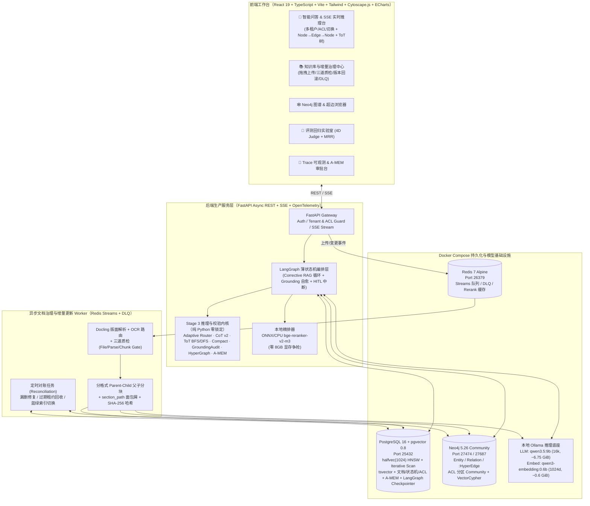

# 第四阶段规划：企业级技术栈重构总方案（Stage 4.1 → Stage 4.5）

> **文档定位**：本规划在研究原型阶段（Stage 1.0 → Stage 3.4）全面收官后制定，结合 `JavaGuide` 企业级 RAG 生产最佳实践、本机硬件约束（RTX 5060 8 GB 显存 + 已有 `neo4j:5.26-community` Docker 镜像 + Node `v24`），在 **`master` 分支**上按 5 个独立可验收的子阶段完成向企业级生产技术栈的平滑演进。  
> **核心原则**：**100% 复用并保护 Stage 1–3.4 的研究级推理资产**（HippoRAG 2 PPR、Adaptive Router、`Graph-CoT v2`、`Graph-ToT v2 BFS/DFS`、`GroundingAudit`、`HyperGraph`、4 重防投毒 `A-MEM`、`SHACL-lite`、4D `LLM-as-a-Judge`），重点将底层“骨架、血脉、编排与前端”全面企业化。

---

## 1. 目标企业级全景架构

---

## 2. 已锁定的核心技术选型表

| 架构模块 | 锁定选型 | 端口 / 规格 / 显存策略 | 对标企业级痛点与核心价值 |
|---|---|---|---|
| **主语言与服务层** | **Python 3.12 + FastAPI（Async REST + SSE）** | 直接在 `master` 增量演进 | 零跨语言改写成本，100% 复用 Stage 1–3.4 推理与评测资产 |
| **基础设施编排** | **Docker Compose** | PG `25432` / Neo4j `27474,27687` / Redis `26379` | 复用本机已有 `neo4j:5.26-community` 镜像，独立端口与现有容器零冲突 |
| **向量库 & 元数据库** | **PostgreSQL 16 + `pgvector 0.8+`**（SQLAlchemy 2.0 Async） | **`halfvec(1024)` + HNSW (`halfvec_cosine_ops`) + `hnsw.iterative_scan = strict_order` + `tsvector`** | 业务表、版本状态机、父子块、ACL、A-MEM 账本、LangGraph Checkpointer 与向量索引**同库 ACID 强一致**；`halfvec` 显存/内存减半（`-50%`），Iterative Scan 根治 `WHERE acl` 过滤后 Top-K 不足 |
| **知识图谱存储** | **Neo4j 5.26 Community**（`Neo4jGraphStore` 实现 `BaseGraphStore`） | 保留 `NetworkXGraphStore` 仅作离线单测替身 | 实体唯一约束、`:HyperEdge` 中介节点、`VectorCypherRetriever` / 只读白名单 Cypher、**按 `acl_partition` 权限分区隔离社区摘要** |
| **Embedding 路线** | **`qwen3-embedding:0.6b`**（Ollama 原生，主力） *（保留 `bge-m3` / `nomic-embed-text` / `openai_compat` 配置可切）* | **1024d（MRL 支持 32–1024d）**；**双修复护栏：Fix A `num_ctx=2048`（内存从 `4.6 GB → 985 MB`）+ Fix B 默认 `num_gpu=0` 纯 CPU 主跑（0 MiB 显存、~55–65ms/问，可选切 `99` 全 GPU 14–25ms）** | 实测中文工业区分度强 `2.87×`、跨语言强 `4.16×`、`halfvec(f16)` 零损；彻底根治默认 32K KV 导致的 8 GB 显存互踢换模税 |
| **文档解析与 Chunking** | **Docling**（PDF 多栏/TableFormer 表格/DOCX/MD）+ PyMuPDF 轻降级 + **分格式 Parent-Child 父子分块** + **面包屑前缀** + **三道质检** | Parent `1000–1500 tok` / Child `256–384 tok`（12% Overlap）；表格 `<600 tok` 原子不拆，`>600 tok` 续拼表头；代码 AST 切分 | 彻底解决“解析错位/语义丢失/条件截断”；每个 Child 自动注入 `[文档 > 一级 > 二级 \| P.x]` 零成本消除指代不明；`FileGate/ParseGate/ChunkGate` 拦截伪造 MIME、乱码与碎片块 |
| **在线检索漏斗** | **Pre-Filter ACL → Query Rewrite/Multi-Query → 粗召回 Top-40 → Cross-Encoder Rerank Top-8 → Compact Top-4** | Reranker：**ONNX/CPU `BAAI/bge-reranker-v2-m3`**（排 30 条 ~150–250ms，**0 显存占用**） | 拉开三级漏斗，保留原始 Query 并行融合防改写跑偏；CPU 跑 Rerank 彻底规避 8 GB 显存来回换模税 |
| **Agent 编排层** | **薄 `LangGraph`（`langgraph` + `langgraph-checkpoint-postgres`）** | 仅作有环状态机壳，不引入 `langchain` 旧 Chain | 原生支撑 Corrective RAG 证据不足重试循环、Grounding 自愈循环、多轮会话持久化/时光倒流、**A-MEM 高风险写回 `interrupt()` 人工审批（HITL）**与节点级 SSE 流式推送 |
| **异步增量更新** | **Redis Streams + Consumer Group + DLQ 死信流 + Reconciliation 对账** | 按 `doc_id` 顺序版本号校验 + `claim_token` 租约原子抢占 | 完整落地 JavaGuide 增量更新铁律：幂等去重、先建不可见新版本再原子切 `active_version`、软删除 + 延迟清理 + 旁路缓存失效 |
| **可观测与评测** | **PG Request Trace 账本 + OpenTelemetry 导出（兼容 Langfuse）+ 评测 v2** | 全链路版本快照 + `FULL/PARTIAL/NONE` 三态可答性 + `Hit@K / MRR@K` | 执行失败（超时/异常）与回答质量分母严格分离；业务拒答状态与语义拒答分开评测；Holdout 盲测集隔离 |
| **独立 Web 前端** | **React 19 + TypeScript + Vite + Tailwind CSS v4 + Cytoscape.js + ECharts** | `frontend/` 独立工程，代理调用 FastAPI | 5 大专业工作区（深/浅主题），彻底替代草台 Streamlit |

---

## 3. 核心数据库与图谱 Schema 设计（Stage 4.1 落地蓝图）

### 3.1 PostgreSQL 16（Source of Truth）核心表结构
1. **`index_registry`（Embedding 模型指纹与蓝绿别名表）**：
   - `index_name (PK)`, `active_table`, `embedding_model`, `embedding_version`, `embedding_dim`, `chunk_strategy_version`, `status (active/building/rollback)`, `switched_at`
   - 在线查询前强校验 `active embedding_model & dim == runtime config`，不匹配直接拦截报错。
2. **`documents`（文档主表与原子版本指针）**：
   - `doc_id (PK)`, `tenant_id`, `acl TEXT[]`, `source_type`, `source_uri`, `title`, `active_version INT`, `status (ready/building/partial_available/deleted)`, `is_deleted BOOL`, `missing_pages INT[]`, `updated_at`
3. **`parent_chunks`（父块 DocStore，阅读粒度 1000–1500 tok）**：
   - `parent_id (PK)`, `doc_id`, `version_id`, `tenant_id`, `acl TEXT[]`, `section_path`, `page_no`, `element_type (text/table/code)`, `content TEXT`, `token_count`, `is_deleted BOOL`
4. **`child_chunks`（子块向量 + 全文检索表，检索粒度 256–384 tok）**：
   - `chunk_id (PK)`, `parent_id (FK)`, `doc_id`, `version_id`, `tenant_id`, `acl TEXT[]`, `content_hash (SHA-256)`, `breadcrumb_text TEXT`, `embedding halfvec(1024)`, `tsv tsvector`, `index_status (pending/processing/partial_failed/ready)`, `claim_token`, `claimed_at`, `is_deleted BOOL`
   - 唯一约束 `(doc_id, version_id, chunk_id)`；HNSW 索引 `USING hnsw (embedding halfvec_cosine_ops) WITH (m = 16, ef_construction = 64)`；GIN 索引 `USING gin (tsv)` + `acl` GIN 索引。
5. **`verified_memories`（Stage 3.4 A-MEM 审计表）**：
   - 完整替代 `verified_memories.jsonl`，含 `memory_id`, `tenant_id`, `acl TEXT[]`, `question`, `conclusion`, `condition_entity_ids`, `target_entity_ids`, `source_chunk_ids`, `grounding_score`, `confidence`, `status (pending_approval/verified/superseded/rejected)`, `valid_from`, `provenance_run_id`。
6. **`request_traces` & `audit_logs` & `langgraph_checkpoints`**：
   - 分别承载全链路请求追踪（Waterfall 耗时、改写词、粗召回/Rerank 排名、最终上下文、终态）、文档变更审计与 LangGraph `PostgresSaver` 状态快照。

### 3.2 Neo4j 5.26 属性图与权限隔离设计
- **节点标签**：
  - `:Entity {tenant_id, entity_id, name, entity_type, description, aliases, acl, source_chunk_ids, community_id, version_id, is_deleted}`（复合唯一约束 `(tenant_id, entity_id)`）
  - `:HyperEdge {tenant_id, hyperedge_id, relation_type, confidence, weight, acl, source_chunk_ids, from_verified_memory, valid_from}`
  - `:Community {tenant_id, community_id, acl_partition, title, summary, source_doc_ids}`（**严禁跨权限混写摘要**：同一社区按稳定 `acl_partition` 分区独立摘要；高敏感/动态权限语料仅走鉴权后的局部遍历，不读取跨文档摘要）
- **关系类型**：
  - `(:Entity)-[:RELATES_TO {relation_id, relation_type, weight, confidence, source_doc_id, source_chunk_ids, version_id, extraction_model_version, acl}]->(:Entity)`
  - `(:Entity)-[:CONDITION]->(:HyperEdge)-[:TARGET]->(:Entity)`
- **查询安全约束**：所有在线 Cypher 遍历必须携带 `WHERE n.tenant_id = $tenant_id AND n.is_deleted = false AND any(r IN n.acl WHERE r IN $user_roles)` 预过滤；`Text2Cypher` 如启用必须走只读事务 + Schema 白名单 + 节点/耗时硬上限。

---

## 4. 分阶段实施计划与验收门禁（Stage 4.1 → Stage 4.5）

所有阶段直接在 **`master`** 上原子推进，每个子阶段交付均满足：`ruff` 0 告警 + `pytest` 100% 通过 + 真机 Docker 端到端实测 + 同步更新 `CHANGELOG.md` 与 `docs/evolution_and_papers_guide.md`。

| 阶段 | 名称 | 核心交付模块 | 量化验收门禁 |
|---|---|---|---|
| **Stage 4.1 ✅** | **企业级基础设施与双存储底座** | ① `docker-compose.yml`（PG16+pgvector、复用 Neo4j 5.26、Redis 7）与 `deploy/postgres/init.sql`； ② 实测并固化 `qwen3-embedding:0.6b`（1024d MRL + Fix A `num_ctx=2048` + Fix B `num_gpu=0` CPU 主跑）； ③ `PgVectorStore`（`halfvec(1024)` HNSW + `iterative_scan` + `tsvector`/CJK RRF + `index_registry` 模型指纹强校验 + 软删除审计）与 `Neo4jGraphStore`（实现 `BaseGraphStore` + `:HyperEdge` 中介节点 + ACL 分区 `:Community`）； ④ PG 版 `PgVerifiedMemoryStore` + `check-infra` / `migrate-enterprise` CLI 与 `factory.py`/`workflow.py` 无缝路由 | **全部实测通过（53/53 单测 + 真机 Docker 验收）**： ① `check-infra` 全绿（PG `16.16` + `pgvector 0.8.7`、Neo4j `5.26.32`、Redis `7.4.12`），零端口冲突； ② `EXPLAIN (ANALYZE, BUFFERS)` 实证命中 `Index Scan using idx_child_chunks_hnsw_cosine`（`0.163 ms`）+ `index_registry` 模型错配强拦截； ③ OREDA `fmea_oreda`（87 实体 / 1,013 关系 / 87 切片）迁入 PG+Neo4j **`SHACL-lite 100.0% PASS`**；10 面多租户 & ACL 隔离测试 **`0` 越权泄漏**；`fault_diag` 在 PG+Neo4j 实跑 `ppr + auto -> tot` 达 **`100.0%` Grounding**（命中 4 条 Neo4j 超边 + 1 条 PG A-MEM） |
| **Stage 4.2 ✅** | **文档治理层 + 异步增量幂等更新** | ① `pipelines/doc_governance.py`：Tier-1 Docling / Tier-2 PyMuPDF（多栏阅读顺序 + 表格提取）& `python-docx` / 原生 Markdown+AST 解析、三道质检（`FileGate/ParseGate/ChunkGate`）、分格式 **Parent-Child 父子分块**（`<=600 tok` 表格原子保留、`>600 tok` 续拼表头 + Python AST 函数/类边界切分）与 **`[标题 > 章节 \| P.x]` 面包屑注入**； ② `pipelines/incremental_worker.py`：Redis Streams 消费组 + DLQ 死信流、SHA-256 `content_hash` 跳过未变块、`pending → processing (claim_token) → ready` 乐观租约状态机、先建不可见新版本再原子切 `documents.active_version`（+ `JOIN documents` 零双版本污染 + 一键回滚）、乱序版本拦截、PG+Neo4j 同步软删除 + 缓存失效 + `reconcile` 定时对账； ③ CLI：`ingest-enterprise` / `worker-run` / `reconcile` / `dlq-list` | **全部实测通过（58/58 单测 + 真机 Docker 验收）**： ① 实测双栏含表 PDF（自动识别空白第 2 页标记 `partial_available` + `missing_pages=[2]`）与 DOCX 保留表头和章节路径，伪造 MIME PDF 与高乱码率文本 **100% 拦截**； ② Redis Streams 实测：`v1` 重复投递 `idempotent_noop`（0 重算）、`v2` 仅改 1 节时未改 2 节 **100% 跳过重算 Embedding**（`reused=2, computed=1`）、乱序 `v1` 到达被 `stale_version_ignored` 拦截、零双版本污染且支持原子回滚； ③ 模拟崩溃卡死租约被 `reconcile` 自动回收（`reclaimed=1`），`delete` 事件同步软删 PG 切片 + Neo4j 实体/关系（双端检索均归 `0`） |
| **Stage 4.3 ✅** | **检索漏斗升级 + 薄 LangGraph 编排 + 评测可观测** | ① `retrieval/query_rewrite.py`（Query Rewrite / Multi-Query / Self-Query，强制保留原 Query `1.25×` 锚定 RRF 融合 + Corrective RAG 扩写）与 `retrieval/reranker.py`（**纯 CPU `onnxruntime` + Rust `tokenizers` 零 PyTorch/零显存精排**，自动支持本地 ONNX 模型与 `bilingual_lexical_cross` 无网降级 + Redis Rerank 缓存）； ② `agent/graph.py`：**薄 `LangGraph 1.2` 有环状态机 + `PostgresSaver` 持久化**（`acl_guard → query_rewrite → recall_and_rerank → [expand_query Corrective 循环] → graph_reason → [self_heal_grounding 自愈循环] → writeback_gate → [hitl_memory_approval interrupt()] → commit_memory → record_trace`）+ SSE 节点流 `stream_events()`； ③ `observability/tracing.py`（PostgreSQL `request_traces` 账本 + OpenTelemetry `graphrag.request` / `graphrag.node.*` Span 采集）与 `eval/llm_judge.py` v2（`FULL/PARTIAL/NONE/EXECUTION_ERROR` 三态可答性、`Hit@K / MRR@K`、业务拒答 vs 语义拒答分离、执行失败与质量分母严格隔离）；CLI：`agent-query` / `traces` | **全部实测通过（62/62 单测 + 真机 Docker 验收）**： ① 30 候选 CPU 精排 `2.96 ms`（Redis 缓存命中 `0.69 ms`），0 显存占用，`bench_c_17` 精准跃升 Top-1； ② 离线单测 100% 覆盖 Corrective RAG 扩写循环（`retry_count=1`）、Grounding 自愈循环（`grounding_retry_count=1`）、HITL `interrupt()` 批准/拒绝双路径与 SSE 节点事件流； ③ 真机 PG16 `PostgresSaver` + Neo4j + `qwen3-embedding:0.6b`(CPU) + `qwen3.5:9b`(GPU) 跑通全链路：`amem_writeback_approval` 断点暂停与 `Command(resume=...)` 持久化恢复、`100.0%` Grounding、PG `request_traces` 入库且捕获 `8` 条 OpenTelemetry Spans |
| **Stage 4.4 ✅** | **FastAPI 生产服务层（REST + SSE）** | `src/llm_graphrag_kg/api/`（`app.py` / `deps.py` / `schemas.py`）与 CLI `serve`：完整构建 20 个 OpenAPI 端点——健康与基础设施检查、文档上传（Multipart）/治理入库/版本回滚/同步软删、Redis 队列与 DLQ/Reconciliation 监控、Neo4j 图谱总览/Ego-Graph/超边/多租户 Profile `SHACL-lite`、**LangGraph 同步问答 + SSE 实时节点事件流（`/api/v1/agent/stream`）+ HITL 审批恢复**、A-MEM 记忆列表、PG Trace 查询与 Evaluation v2 API，内置 `X-API-Key` + `X-Tenant-Id` + `X-ACL-Roles`（`401/403`）鉴权中间件与 CORS | **全部实测通过（63/63 单测 + 真机 Docker 验收）**： ① `httpx.AsyncClient` 集成测试覆盖全部 REST 端点、`401/403` 越权拦截、伪造 PDF `422` 拦截、HITL 审批与 SSE 节点流； ② 真机 Docker FastAPI 实测：`infra/health` 三服务全绿、`fault_diag` 图谱（`51` 实体 / `94` 关系 / `7` 超边）、`fmea_oreda` `SHACL-lite 100.0% PASS`、`POST /api/v1/agent/stream` 实时按节点推送 `acl_guard → query_rewrite → recall_and_rerank → graph_reason → writeback_gate → commit_memory → record_trace → final` 且 **`100.0%` Grounding** |
| **Stage 4.5** | **React + TypeScript 现代企业 Web 前端** | `frontend/`（React 19 + TS + Vite + Tailwind v4 + Cytoscape.js + ECharts）：完整构建 **5 大专业工作区**（智能问答与实时推理台、知识库与增量治理中心、Neo4j 图谱与超边浏览器、评测回归实验室、Trace 可观测与 A-MEM 审批台），支持深/浅双主题与租户权限切换 | ① `npm run typecheck && npm run build` 零报错； ② 真实前后端联调跑通上传→质检→入库→图谱探索→SSE 问答→HITL 记忆审批全闭环； ③ 保留旧 Streamlit 作为可选离线轻模式，默认入口升级为企业 Web 控制台 |

---

## 5. 隐私、迁移与提交纪律（延续铁律）

- 所有 Docker 数据卷（`pgdata`、`neo4j_data`、`redis_data`）、本地模型缓存（ONNX Reranker / Docling 权重）、真实 `.env` 密码均严格隔离在 `.gitignore` 中，绝不入库；
- 同步更新 `.env.example` 仅提供脱敏本地占位连接串；
- 每次提交严格执行 `ruff` + `pytest` + `scripts/privacy_check.py --staged --require-changelog`。
